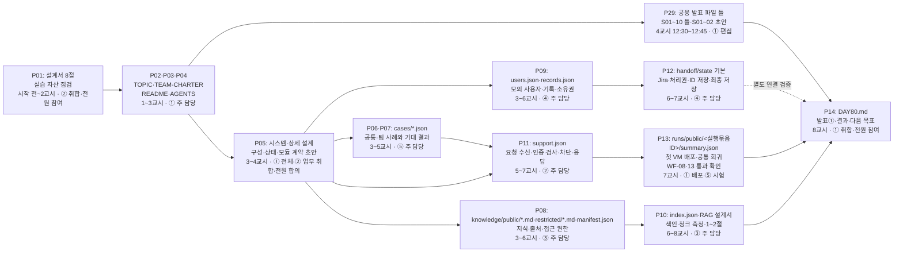
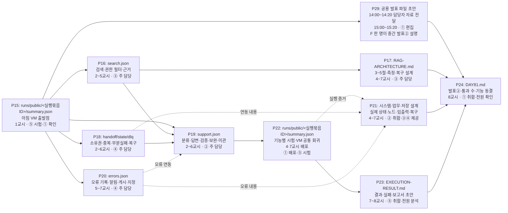
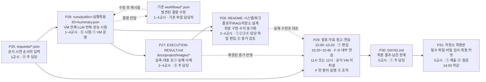
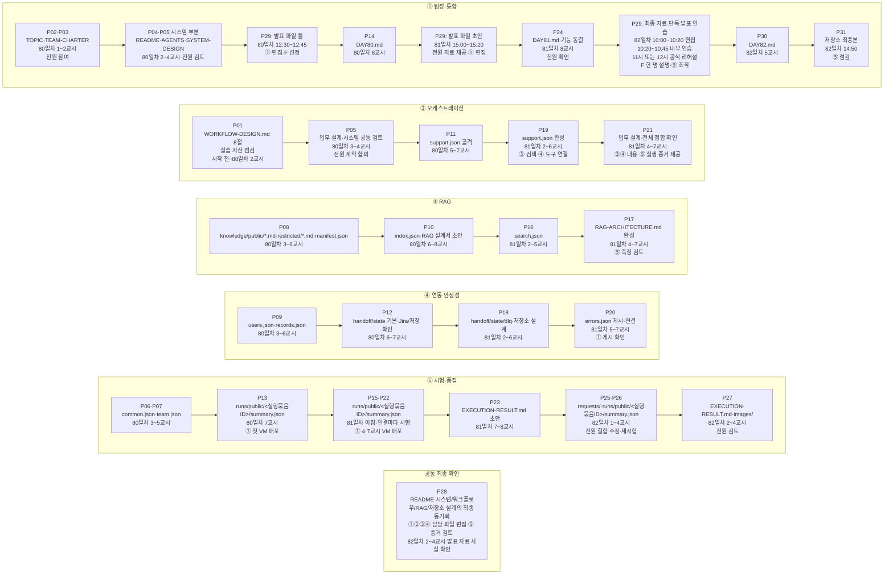

# 개발 순서와 역할별 진행 관리

작성·상태 확인: 2026-11-03. 대상: 따릉이 기술지원 프로젝트, 5명 팀, 80~82일차.

이 문서는 개발 순서·파일 소유자·선행 작업·완료 증거를 관리합니다. 실제 설계 내용은 설계서, 실행 결과와 수치는 `runs/`와 실행 결과서에 기록합니다. 공식 요구를 바꾸는 문서는 아닙니다.

전체 구성·상태·시나리오·기능 관계는 [최상위 시스템 설계서](project/SYSTEM-DESIGN.md)에서 확인합니다. SYSTEM-DESIGN.md는 R01이 취합하고 R02~R05가 담당 상세 설계와의 정합성을 공동 검토합니다.

## 1. 현재 출발점과 계획의 전제

- Python 개발은 3.12·uv 잠금·Ruff 린트/포맷을 사용합니다. [Python 기준](PYTHON-DEVELOPMENT.md)·[공개 정책](PUBLICATION.md)이 원본입니다. 로컬 원문은 보존하고 같은 폴더의 .gitignore·Git 후보로 공개 범위를 관리하며 ZIP은 선택 사항입니다. 실제 업로드는 별도 작업입니다.

- Docker Compose를 배포 방식으로 채택했습니다. 경로 용도는 [시스템 설계 9절](project/SYSTEM-DESIGN.md#9-프로젝트-경로와-배포-구조), 경로별 주 담당/검토자는 [헌장](project/TEAM-CHARTER.md), 작업 절차는 [AGENTS](../AGENTS.md), 환경/복구는 [infra 안내](../infra/README.md)가 원본입니다. 기존 VM n8n·이미지 태그·볼륨·네트워크는 2026-11-04 확인했습니다. 새 compose·DB 채택·data-api·Credential·업무 배포는 준비 전이며 [점검 안내](../infra/vm-preflight.md)를 따릅니다.

- 조사·문제 정의 v1.2·시나리오 후보 v0.2는 작성되어 있습니다. 조사 결과가 실제 직원 수요나 내부 권한을 증명하지는 않습니다.
- 서비스용 워크플로우는 P11 골격 `workflows/dubakwi-support.json`(B07~B32 mock, 로컬 n8n 호출만 확인)이 main에 병합됐다. `knowledge/` 지식 초안과 `cases/common.json`·`team.json`이 준비되었다. P13 사례 실행 도구는 가짜 Webhook 시험만 수행했으며 실제 서비스·VM 시험은 미실행이다. 교육용 색인·검색 워크플로우는 PR #10이 main에 병합됐으며 팀 VM 검증은 남고 승인된 지식은 아직 준비되지 않았다. 시스템·워크플로우·RAG·저장소 설계는 초안이다.
- 현재 개발 기준은 **Discord 이용자 입구 + 공통 시험용 팀 Webhook + n8n 본체·하위 기능 + Jira + 최소 처리 상태·실행 기록·DLQ**입니다. Jira는 채택했으며 실제 계정·필드·전환·물리 저장은 D01에서 확인합니다. A/B/C 조합 표기와 주제 적합성의 강사 확인은 남아 있지만 이미 정한 Jira 선택을 다시 미정으로 두지 않습니다.
- 범위는 시민 문의 6유형과 시스템 설계 S1~S8입니다. 직원은 Jira 티켓을 받는 담당자이며 별도 직원 업무·조직 협업 서비스는 개발하지 않습니다. 조사 후보 100개 전체 구현과 기관 내부 절차 확정은 전제하지 않습니다.
- 실제 기관 계정·거래 대신 모의 사용자·기록·가상 정책을 사용합니다. 실제 티켓 관리는 Jira 어댑터로 연결하고 과정 data-api는 공통 판정·고장 주입의 검증 경로로 구분합니다. 두 경로의 데이터·소유권·기대 결과를 명시하며 data-api 통과를 Jira 연동 완료로 대신하지 않습니다. 실제 환불·요금 변경·강제 반납·원격 잠금 해제는 범위 밖입니다.
- 제안서·헌장·설계·결과·데일리·발표 자료의 작성 원본은 [docs/project/](project/README.md)에 모읍니다. 공식 보존 가이드의 경로는 변경하지 않으며 제출 경로 대응은 해당 README와 P31에서 확인합니다.
- 팀 이름은 **두바퀴**, 기술 접두사는 **dubakwi**로 확정했습니다. 실행 파일은 support/index/search/handoff/state/dlq/errors의 7개 책임 경계로 관리합니다. state/dlq는 고정 명령을 처리하며 범용 실행기나 별도 상담 이력 테이블을 추가하지 않습니다. PostgreSQL 2테이블은 물리 저장 제안입니다. 제공 자료는 P01에서 기능·위치를 확인하고 필요할 때 채택·변경·검증합니다.

## 2. 상태를 갱신하는 방법

**상태의 원본은 5절 작업 원장 하나입니다.** 그래프에는 상태를 복사하지 않습니다. 그래프의 작업 번호로 원장의 상태·증거를 확인합니다.

| 상태 | 표시 기준 |
| --- | --- |
| 대기 | 아직 시작하지 않음. 선행 작업이나 자료를 기다리는 것도 포함 |
| 진행 | 담당자가 작업 중이며 현재 파일·실습 원본 위치를 증거 칸에 기록 |
| 검토 | 완료 기준을 충족했다고 판단하여 검토 요청. 파일·실행 증거 필수 |
| 완료 | 검토자가 완료 기준과 증거를 확인. 파일 존재만으로 완료하지 않음 |
| 막힘 | 구체적인 원인·해결 담당·다음 조치를 증거 칸에 기록 |
| 보류 | 선택하지 않은 추가 범위. 재개 조건 명시 |

1. 각 담당자는 매일 1교시와 작업 인계 때 원장의 상태·증거·갱신일을 수정합니다. 실명 대신 [팀 헌장](project/TEAM-CHARTER.md)의 R01~R05를 사용하며, 이 계획의 ①~⑤는 각각 해당 ID에 대응합니다.
2. 체크박스는 **완료일 때만** 체크합니다. 진행·검토·막힘 상태는 빈 체크박스를 유지하고 상태 칸으로 구분합니다.
3. 완료 증거는 파일 경로와 확인 내용을 적습니다. 구현은 실행 보고서·검토 기록, 배포는 배포한 버전과 VM 시험 보고서까지 연결합니다. 아직 없는 파일 경로는 코드로 쓰고, 생성 후 링크로 바꿉니다.
4. 기능 수정 시 관련 시험과 공통 회귀를 수행합니다. 완료한 항목의 기준이 깨지면 체크를 해제하고 상태를 되돌립니다. 이전 실패 보고서는 덮어쓰지 않습니다.
5. 데일리 기록에는 원장 작업 번호와 당일 측정값을 참조합니다. 현재 상태·시험 수치를 별도 표에 중복 관리하지 않습니다. 날짜별 데일리는 당시 기록으로 보존합니다.
6. 막히면 30분 안에 팀에 공유하고, 1시간이면 강사에게 문의합니다. 키·VM 주소·계정·실제 연락처는 증거 칸에 기록하지 않습니다.

## 3. 역할과 파일 소유권

| 역할 | 주 담당 파일 | 공동 작업 방식 |
| --- | --- | --- |
| ① 팀장·통합 | `docs/project/TOPIC.md`, `docs/project/TEAM-CHARTER.md`, `docs/project/SYSTEM-DESIGN.md` 취합, `README.md`, 루트 `AGENTS.md`, 이 관리 문서, `docs/project/daily/DAY*.md` | 전원 의견 취합·병합·기능 동결·기본 브랜치에서 VM 배포 |
| ② 오케스트레이션 | `workflows/dubakwi-support.json`, `docs/project/WORKFLOW-DESIGN.md` | ③ 검색·④ 도구를 합의한 입출력으로 연결. 설계서 편집 취합 |
| ③ RAG | `knowledge/public/*.md·restricted/*.md·manifest.json`, `workflows/dubakwi-index.json`, `workflows/dubakwi-search.json`, `docs/project/RAG-ARCHITECTURE.md` | ④ 권한 모델 확인, ⑤ 검색 평가. 메인 JSON은 ②에게 변경 요청 |
| ④ 연동·안정성 | `data/users.json`, `data/records.json`, `workflows/dubakwi-handoff.json`, `workflows/dubakwi-state.json`, `workflows/dubakwi-dlq.json`, `workflows/dubakwi-errors.json`, `docs/project/STORAGE-DESIGN.md` | Jira·조회·알림·상태·DLQ·권한·복구. R02와 업무 계약, R05와 실패 판정 확인 |
| ⑤ 시험·품질 | `cases/common.json`, `cases/team.json`, `requests/*.json`, `runs/*.json`, `docs/project/EXECUTION-RESULT.md`, `docs/project/images/*` | 기대 결과를 구현 전에 작성. 각 담당자에게 결함 전달·재시험 |

공통 계약은 전원이 합의하고 ①이 변경을 관리합니다. 워크플로우 JSON은 소유자만 편집하며 공동 구현은 담당자의 화면에서 함께 검토하는 방식으로 합니다. 같은 파일을 동시에 편집하지 않습니다. 발표 자료는 ①이 최종 편집하고 전원이 담당 내용을 제공합니다. 발표는 F 한 명이 전체를 설명합니다. F는 R01~R05 중 한 역할 ID로 선정하며 현재 미정입니다. 시연은 ⑤가 말없이 조작하되 F=⑤이면 조작 담당을 별도로 정합니다. [발표 준비 계획](PRESENTATION-PLAN.md) 7절의 편집·연습 예약 시간에는 같은 사람에게 구현 업무를 중복 배정하지 않습니다.

루트 `data/users.json`, `data/records.json`은 **모의 서비스 데이터**입니다. 기존 `data/research/`의 수집 원본·분석 결과와 구분하고 기존 데이터를 이동하거나 덮어쓰지 않습니다.

## 4. 시간 흐름과 통과 지점

| 기간 | 순서와 확인할 산출물 | 다음 단계 진입 기준 |
| --- | --- | --- |
| 시작 전~80일차 2교시 | P01 제공 자료 목록 확인과 P02 제안서·P03 헌장·P04 실행 안내 | 11/05 10:50까지 주제·구성 승인. 제공 기능·위치·누락 파악, 전체 실행·재사용 확정은 요구하지 않음 |
| 80일차 3~5교시 | P05 시스템·상세 설계 초안에서 범위·상태·권한·모듈 입출력 합의 → P06 공통 사례·P07 팀 사례. P08~P11 병렬 착수. P29 발표 틀은 4교시 12:30~12:45 작성 | 5교시 점검: 설계서 1~4절·공통 계약·변환한 공통 사례 |
| 80일차 6~8교시 | P08 지식 → P10 색인, P09 모의 데이터·Jira/저장 확인 → P12 연동·상태 기본. P11 골격과 모의 계약 연결 → P13 첫 VM 시험 → P14 데일리 | 7교시 첫 VM 배포에서 WF-08·13 통과. 8교시 발표① |
| 81일차 1~4교시 | P15 출발점 → P16 검색·P18 도구와 P19 메인 흐름 연결. P17 RAG 설계와 P21 설계서 갱신 | S1/WF-01 종단 연결(생성·종료·최종 저장) 후 WF-03 이관 확인. 4교시 VM 배포·중간점검: 입출력 표·RAG 3~5절·연동 표·WF-02/11/12 |
| 81일차 5~8교시 | P18~P20 보안·장애 처리 → P22 전체 회귀 → P23 결과서 초안 → P24 데일리·동결. P29 자료 인계는 14:00~14:20, ① 편집은 15:00~15:20 | WF-02b 포함 공통 14유형과 팀 사례의 통과/실패를 기록. 공식 설계서 2종과 시스템·저장소 보조 설계를 실행 내용에 맞춤. 8교시 발표② 후 기능 동결 |
| 82일차 1~4교시 | P25 시연 요청 → P26 최종 시험·결함 수정 반복 → P27 결과서 확정·P28 문서 동기화·P29 발표 자료 | ① 편집 10:00~10:20, F·⑤ 내부 연습 10:20~10:45, 공식 VM 리허설 3~4교시 배정 시간. LLM 3회 반복·성능·실패 근거 확보 |
| 82일차 5교시 | P30 데일리 → P31 제출본 검사 | 14:00~14:15 최종 확인, 14:30 내부 제출 목표·공식 마감 14:50. 이후 제출본 수정하지 않음 |

표의 시간은 공식 일정에 맞춘 목표입니다. 설계와 구현은 반복하며, 문서의 최종 완성을 후속 구현의 착수 조건으로 삼지 않습니다. 다만 모듈 간 입출력·권한·오류 계약은 연결 전에 합의해야 합니다. 주말 작업을 필수로 전제하지 않습니다.

### 4.1. 11월 5일: 설계·골격·첫 배포

왼쪽에서 오른쪽으로 진행하며, 갈라지는 경로는 병렬 작업입니다. 공동 문서는 하나로 합쳤습니다. 각 노드의 번호로 5절의 상태를 확인합니다.

주제·구성은 2교시 10:50까지 승인받습니다. 5교시에는 설계서 1~4절·공통 계약·변환한 공통 사례를 점검받습니다. 화살표는 합의한 초안 또는 동작 가능한 모듈의 인계를 포함하며, 모든 최종 문서의 완성을 기다린다는 뜻은 아닙니다.

### 4.2. 11월 6일: 연결·보안·장애 처리·기능 동결

P19와 P22는 기능 단위로 구현·시험을 반복합니다. 4교시에는 입출력 표·RAG 3~5절·연동 표를 점검받고, 7교시 배포 뒤 전체 회귀를 수행합니다. 8교시 발표② 이후에는 기능을 동결합니다.

### 4.3. 11월 9일: 재시험·문서 확정·리허설·제출

발표 파일은 80일차부터 만들고 81일차에 S01~08 초안과 S09~10 틀을 확보합니다. 82일차에는 완성한 문서를 기다리지 않고 초안으로 연습하며 최종 증거를 반영합니다. 10:20~10:45 내부 연습과 3~4교시 배정된 공식 VM 리허설은 별도입니다. F 한 명이 전체를 설명합니다. 시간별 담당자·중복 작업 조정은 [발표 준비 계획 7절](PRESENTATION-PLAN.md#7-자료-작성발표-준비의-시간-예약안)을 따릅니다. 82일차에는 새 기능을 추가하지 않습니다.

## 5. 작업 원장

초기 상태는 모두 대기였으며, 현재 P01·P02·P03·P04·P05·P10·P17은 자료 목록·설계 초안 작성으로 진행 상태입니다. P10/P17의 진행은 문서 작성에 한하며 지식·실행·측정 완료를 뜻하지 않습니다. 현재 조사 자료는 입력으로 활용하되, 아래 구현 산출물의 완료 증거로 대신하지 않습니다. 같은 파일의 초안·완성 단계는 별도 작업 번호로 관리합니다.

| 완료 | 번호 | 파일·문서 단위 작업 / 완료 기준 | 주 담당 / 검토 | 선행 | 상태 | 증거·막힌 원인·다음 조치 | 갱신일 |
| --- | --- | --- | --- | --- | --- | --- | --- |
| [ ] | P01 | `docs/project/WORKFLOW-DESIGN.md` 8절: 제공 자료의 기능·위치·확인 수준·접근 가능 여부 목록. 재사용 결정·변경점은 설계/구현 시 누적하며 전체 자료 실행을 선행 조건으로 두지 않음 | R02 / 전원 | 없음 | 진행 | [8.1절 후보 목록](project/WORKFLOW-DESIGN.md#81-p01-실습-자료-후보-목록)에 64~79일차 실습 15개 후보의 기능·위치·노드·확인 수준 기록. 파일 읽기 수준이며 실행 안 함. 팀 검토 전, `Last3Mon/80`·단위 프로젝트 판 flow.py 미확인 | 2026-11-04 |
| [ ] | P02 | `docs/project/TOPIC.md`: 시민 문의 6유형·대표 사례·Webhook/Jira 조합·제외 범위·승인 결과 | R01 / 전원·강사 | P01 자료 목록 초안(전체 실행 불필요) | 진행 | [v0.7 초안](project/TOPIC.md): 시민·전체 정상 신규 티켓·Jira·최소 저장 반영. 조합 표기·주제 적합성·팀/강사 확인 필요 | 2026-11-03 |
| [ ] | P03 | `docs/project/TEAM-CHARTER.md`: 역할 ID·7개 실행 파일과 문서 소유권·계약 변경·배포 규칙 | R01 / 전원 | P02 초안 | 진행 | [v0.13 초안](project/TEAM-CHARTER.md): PostgreSQL 준비본 책임·P11 임시 사례 경로·R01 hook 수정 인계 반영. 실제 팀 권한·발표 ID·팀 검토 남음 | 2026-11-05 |
| [ ] | P04 | README·AGENTS·Python/uv/Ruff/CI·공개 정책/도구·infra 안내·compose·.env.example: 경로/규칙·Docker 환경/실행/복구·비밀 제외. 실제 compose 검증·VM 재현까지 확인 | R01 / R04·R05·R02/R03 연결 | P02/P03 초안·D01/D03 실제 환경 확인(설정/배포 부분) | 진행 | [AGENTS](../AGENTS.md)·[infra 안내](../infra/README.md)·[.gitignore](../.gitignore) 작성. [구조/책임](project/SYSTEM-DESIGN.md) 명시. Python 설정/잠금·품질 CI·공개 도구 추가. [VM 점검](../infra/vm-preflight.md): 기존 n8n/볼륨/네트워크·healthz 확인, 운영 경로 준비·시험 .env.example 작성. 기존 설치 유지. 기준/변경 전 백업 검증·Header Auth 등록·P11 연결/게시·VM 입력 부분 시험10/10 완료. 79원본 data-api 기동·신규P11 22/22·로그18/18로B35실패 해소. 전체 복원·R05 공식 판정 미완료. [새 증거](../runs/public/20261105-114531-vm-course79-data-api/summary.json) | 2026-11-05 |
| [ ] | P05 | `SYSTEM-DESIGN.md`와 워크플로우·RAG·저장소 설계 초안: 구성·상태/전이·S1~S8·기능F01~F10·공개 계약·담당 경계 공동 검토 | R01 전체 취합·R02 업무 / R03·R04 상세·R05 판정 | P02·P03 초안 | 진행 | [시스템 v0.12](project/SYSTEM-DESIGN.md)·[워크플로우 v0.14](project/WORKFLOW-DESIGN.md)·[RAG v0.10](project/RAG-ARCHITECTURE.md)·[저장소 v0.4](project/STORAGE-DESIGN.md). 문서 보완 반영, 공동 검토·D01~D07 실제 확인은 미완료 | 2026-11-05 |
| [ ] | P06 | `cases/common.json`: WF-01~13과 WF-02b의 14유형을 따릉이로 변환. 조건·판정 유지, 5교시 점검 | ⑤ / ②③④·강사 | P05 초안 | 진행 | [PR #13](https://github.com/ik-e/dubakwi-ttareungi-support/pull/13) flow.py 형식 공통14유형(17건), P09 비노출 기대값 반영. R05 WF08/WF13 4건 부분 실행은 P13 증거 참조. 키트 판정 동등성·D02 codes 대조·전체 회귀 미완료. 과거 PR #7 초안/실패 기록 보존 | 2026-11-05 |
| [ ] | P07 | `cases/team.json`: 5개 이상, S1~S8·기능ID·상태/효과와 연결한 기대 결과. case_ref 왕복·저장/ID 바인딩 실패·효과 미확인·재처리·오탐 포함 | R05 / R02·R03·R04 | P05 초안 | 진행 | [PR #13](https://github.com/ik-e/dubakwi-ttareungi-support/pull/13): 단일 요청 team과 다단계 team-extended 분리, TC08 사본 모드/해시 지정. R02 회신 반영 기록 포함. 실제 Jira/state/DLQ·고장/복구·소유권 종단 및 전체 역할 판정은 미완료 | 2026-11-05 |
| [ ] | P08 | `knowledge/public/*.md·restricted/*.md·manifest.json`: 공개 안내6개+제한 모의 정책2개 제안, 각 문서 ##절3개 이상. 출처·확인일·적용 범위·권한·가상 정책 구분 | R03 / R04·R05 | P05 초안·D04 지식/권한 초안 | 진행 | [PR #4](https://github.com/ik-e/dubakwi-ttareungi-support/pull/4) 병합: 공개6개·제한 가상2개·manifest·평가 초안 반영. 승인 대기·색인 비활성 유지. 원문은 최신 추적 제외·로컬 보존. 실제 지식 승인·색인/권한 시험 미완료 | 2026-11-04 |
| [ ] | P09 | `data/users.json`·`data/records.json`: 모의 사용자 5명 이상·서로 다른 소유자의 기록 4건 이상, API 공급 방식·권한 확인 | ④ / ③⑤ | P05 초안 | 진행 | R01이79일차 원본 모의 직원6명의API공급·P11조회12회를 확인. R04 팀users/records 반영·권한/소유권 연결은 후속. [새증거](../runs/public/20261105-114531-vm-course79-data-api/summary.json) | 2026-11-05 |
| [ ] | P10 | `workflows/dubakwi-index.json`·`docs/project/RAG-ARCHITECTURE.md` 1~2절: 색인 실행·권한 메타데이터·청크 분포 측정 | ③ / ⑤ | P08 | 진행 | [PR #6](https://github.com/ik-e/dubakwi-ttareungi-support/pull/6) 병합: 청크 준비 도구·오프라인 시험 반영. PR #10에서 로컬 임시 Webhook 시험으로 임베딩·삽입·재시작 복구 확인. R01 VM 원본 수동 색인44청크·ready 확인. [VM 증거](../runs/public/20261105-111311-vm-rag-integration/summary.json). VM 재시작/동시성·지식 승인·역할 검토는 후속 | 2026-11-05 |
| [ ] | P11 | `workflows/dubakwi-support.json` 골격: Header Auth·입력 검사·주입 차단·공통 응답. WF-08의 LLM 호출 0·WF-13의 400 확인 | ② / ④⑤ | P04 환경/규칙 초안(최종 배포 완료 불필요)·P05·P06 초안 | 진행 | `r02/p11-support-skeleton` 브랜치에 [골격 JSON](../workflows/dubakwi-support.json) 작성(B01~B06·B33·B35·B36, B07~B32는 mock). [로컬 Code 시험 50/50](../runs/public/20261104-140902-local-p11-spacing-fix/summary.json) ([띄어쓰기 수정 전 49/50](../runs/public/20261104-140902-local-p11-before-spacing-fix/summary.json)), [이전 46/46](../runs/public/20261104-102342-local-p11-b02-fix/summary.json) ([B02 수정 전 38/46](../runs/public/20261104-102320-local-p11-before-b02-fix/summary.json), [B05 보완 후 36/36](../runs/public/20261104-090407-local-p11-skeleton/summary.json), [B05 보완 전 8/36](../runs/public/20261104-090315-local-p11-before-fix/summary.json)). [로컬 n8n Webhook 11/11](../runs/public/20261104-152533-local-n8n-p11-5113956/summary.json) ([첫 실행 5/11](../runs/public/20261104-103531-local-n8n-p11-before-url-fix/summary.json)). R01 VM 입력 부분 시험10/10·게시/실행 저장 확인. WF-08/13 공식 판정과 완성본 재시험은 미실행. 웹훅 경로는 `dubakwi-support` 유지. B05 권한 조합·user_lookup_error는 R04·R05 동의(2026-11-05, R02 취합). PR #11이 main에 병합됨(146a43d)([설계 4.5절](project/WORKFLOW-DESIGN.md#45-p11-골격-구현-상태)) | 2026-11-05 |
| [ ] | P12 | `workflows/dubakwi-handoff.json`·`dubakwi-state.json` 기본: Jira 조회/생성·종료·알림과 begin/prepare/bind/save/finish 고정 계약의 작은 연결 검증. 생성 ID 즉시 저장·최종 저장 확인 | R04 / R02·R05 | P09·P05 계약·D01/D03 해당 연결 확인 | 대기 | Jira/물리 저장 실제 지원 확인 전. R01 환경 준비·R05 계약/기대값 지원. DLQ 계약과 D07 Discord 앱/SDK·defer/사용자 매핑 준비도 병행 | 2026-11-03 |
| [ ] | P13 | `runs/public/<실행묶음ID>/summary.json`: R01 첫 VM 배포, R05 입력/차단 공통 회귀·WF-08/13 증거. 모의 기능과 실제 연결을 보고서에 구분 | R05·R01 / R02·R04 | P11·P06 해당 사례·P04 compose/VM 준비; P12 미완료도 입구 시험 가능 | 진행 | R01 기존 P11/79API 시험 증거 보존. R05 [143325 보고서](../runs/public/20261105-143325-vm-p13-official/report.md): WF08/WF13a/b/c 응답·로그 검사 성공, 자동 결과4건 auto_pass_unverified. 실행49~52 수동 경로 확인; D02 codes·키트 동등성·config 기록 미완료. 최초403 두 실행 보존. P11-01은 citizen-a 미공급으로 보류. 사용자 인계로 R01 hook 실패 후 전송 차단·회귀시험 보완. VM 데이터 적용은 사용자 지시로 이번 통합 범위에서 제외; P13 전체 완료 아님 | 2026-11-05 |
| [ ] | P14 | `docs/project/daily/DAY80.md`: 당일 작업 번호·통과 수·보고서·발표① 피드백·다음 목표 | ① / 전원 | P13/P10의 당일 진행·실패·미완료 증거(완료 대기 불필요) | 대기 | 당일 기록 예정 | 2026-11-02 |
| [ ] | P15 | `runs/public/<실행묶음ID>/summary.json`: VM의 아침 공통 시나리오 통과 수·실패 출발점 | ⑤ / ① | P13 | 대기 | 미실행 | 2026-11-02 |
| [ ] | P16 | `workflows/dubakwi-search.json`: 검색 전 권한 필터·점수·문서/절 근거 반환·검색 없음 처리 | ③ / ②⑤ | P10·P05 계약 | 진행 | [PR #6](https://github.com/ik-e/dubakwi-ttareungi-support/pull/6)의 글자 일치 모의 검색·fixture 권한 시험만 반영. PR #10에서 교육용 검색 JSON과 로컬 벡터 검색 평가를 추가했다. Q01~Q13 기대 문서·절 포함, WF03 empty, public 요청의 제한 문서/canary 0건은 로컬 기록이며 R01 VM 실제 HTTP7/7·HTTPS검색을 추가 확인. [VM 증거](../runs/public/20261105-111311-vm-rag-integration/summary.json). 서버 사용자 인가·공식 판정·복구/동시성은 미완료 | 2026-11-05 |
| [ ] | P17 | `docs/project/RAG-ARCHITECTURE.md` 완성: 3~5절·청킹/검색 비교·비용·복구·확장, 실측과 운영 설계 구분 | ③ / ⑤ | P16의 실행·측정 | 진행 | [RAG v0.10](project/RAG-ARCHITECTURE.md)·PR #19 템플릿/인계/대본과 기존 VM 수동44청크/검색부분증거를 동기화. 청킹/검색비교·실제비용·VM재시작/재색인·서버인가·공식판정은후속 | 2026-11-05 |
| [ ] | P18 | `workflows/dubakwi-handoff.json`·`dubakwi-state.json`·`dubakwi-dlq.json` 및 저장소 설계 갱신: 소유권·중복/동시성·조건부 갱신·case 연결·외부 효과/저장 실패·복구 캡슐·운영 재처리 | R04 / R02·R05 | P12 동작 가능한 부분·P06/P07 관련 기대값·D05의 시험/시간 계약 초안(전체 검증 완료 불필요) | 대기 | R01 배포/DB 환경 지원, R05 장애·동시·재시작·복구 시험 지원. Jira 성공 단계 반복 없이 복구 확인. D07 Discord 계약/전송·비공개 시험 연결은 core 우선 후 수행 | 2026-11-03 |
| [ ] | P19 | `workflows/dubakwi-support.json`: S1 분류→RAG→답변→검증→Jira 생성/종료→최종 저장→응답 연결 후 S2/S3→S4/S5→S6~S8 확장. 보완 한도·권한·긴급 우선 유지 | R02 / R03·R04·R05 | P11·P16/P12/P18의 필요한 계약·동작 부분 | 대기 | 모의 종단 연결 먼저 가능. 실제 S1 통과는 외부 종료·최종 저장 증거까지 필요. 이후 Discord 어댑터 연결, 3초 ACK를 최종 SLA로 오인하지 않음 | 2026-11-03 |
| [ ] | P20 | `workflows/dubakwi-errors.json`: 오류 기록·알림·게시·상위 지정, 업무상 실패 처리와 별도 확인 | ④ / ①⑤ | P12·P05 오류 계약 | 대기 | Error Workflow만으로 WF-04 충족 처리하지 않음 | 2026-11-02 |
| [ ] | P21 | 시스템·워크플로우·저장소 설계를 실제 구성/상태·노드/엣지·연결선 실행 예시·오류/복구에 맞게 갱신. RAG 내용은 P17 참조 | R01 시스템·R02 업무·R04 저장 / R03·R05 | P16·P18~P20의 누적 실행 내용 | 대기 | 문서 소유자가 편집. 공개 계약 변경은 소비 역할과 시험도 함께 갱신 | 2026-11-03 |
| [ ] | P22 | `runs/public/<실행묶음ID>/summary.json`: 4·7교시 VM 배포 후 공통 회귀·팀/장애 시험·고장 복원 기록 | ⑤·① / 각 구현자 | P15·P06·P07·연결된 기능 | 대기 | 기능별 즉시 시험, 최종판만 기다리지 않음 | 2026-11-02 |
| [ ] | P23 | `docs/project/EXECUTION-RESULT.md` 초안: 시나리오 결과·보고서 경로·실패와 재현 조건·잔여 위험 | ⑤ / 전원 | P22의 누적 보고서 | 대기 | 실패를 통과로 바꾸어 적지 않음 | 2026-11-02 |
| [ ] | P24 | `docs/project/daily/DAY81.md`: 발표②·공통/팀 통과 수·미해결 결함·기능 동결 기록 | ① / 전원 | P17·P21~P23의 당일 증거·공식 동결 시각(전체 통과 대기 불필요) | 대기 | 불통과 시 추가 기능 보류·필수 결함 우선 | 2026-11-02 |
| [ ] | P25 | `requests/*.json`: 정상→보완 질문→장애→이관·로그의 공식 시연 순서 7단계에 맞춘 입력, 모의 식별자만 사용 | ⑤ / ②③④ | P06/P07부터 초안, P19 동작 부분·P23 보고서로 보정 | 진행 | [시연 순서 초안](../requests/demo-sequence.json)과 요청4개 준비. 정상→보완→장애/복원→이관·로그 7단계, 모의 사용자·실행별 고유ID 사용. 실제 Discord/Jira 시연·고장 복원 리허설·공식 원본 순서 대조는 미실행. P19 동작·P23 증거로 보정 필요 | 2026-11-05 |
| [ ] | P26 | `runs/public/<실행묶음ID>/summary.json`: VM 전체 시험·LLM 사례 3회 반복·bench·수정 후 회귀, 근거 없는 답/권한 위반 확인 | ⑤ / 전원 | P24·P25 | 대기 | 결함은 기존 소유자가 수정. 실행·보고서는 미생성 | 2026-11-02 |
| [ ] | P27 | `docs/project/EXECUTION-RESULT.md`·`docs/project/images/*` 완성: 대표 로그 3건·실패 2건 이상·실측 수치·원본 체크리스트 15개 | ⑤ / 전원 | P26 | 대기 | 정상·예외·이관 증거, 문서·로그 개인정보 가림 | 2026-11-02 |
| [ ] | P28 | `README.md`·시스템/워크플로우/RAG/저장소 설계·개발 계획·헌장: 최종 구현·실측·재현 명령·시연·역할·링크 동기화 | R01·R02·R03·R04 담당 파일 / R05 증거 검토 | P26·P27 초안 | 대기 | 실제 구현 차이·미해결 한계 표시, 상태는 이 원장 하나로 관리 | 2026-11-03 |
| [ ] | P29 | 발표 자료·발표자 메모: F 한 명의 19분 설명/시연+여유 1분·질의 5분. 80일차 틀·81일차 초안·82일차 내부/공식 연습과 실측 반영 | ① 편집·F 발표 / 전원·⑤ 조작 | P02·P05부터 준비·P23으로 초안·P26~P28로 최종 확인. 초안으로 연습 착수 가능 | 대기 | [교시별 시간 예약안](PRESENTATION-PLAN.md#7-자료-작성발표-준비의-시간-예약안) 작성. [발표 계획](PRESENTATION-PLAN.md)을 시민/Jira·저장·Docker 기준으로 동기화. 실제 발표 파일·F 역할 ID·증거·연습은 미완료 | 2026-11-02 |
| [ ] | P30 | `docs/project/daily/DAY82.md`: 제출 전 결과·남은 한계·최종 시험 보고서 기록 | ① / 전원 | P26~P29 | 대기 | 5교시 제출 전 작성 | 2026-11-02 |
| [ ] | P31 | 제출 최종본: 필수 파일·기본 브랜치·tscan 비밀0건·데일리3장·재현·최종 커밋. 공식 제출 경로 대응과 보조 설계·링크/앵커 포함. GitHub 공개는 별도 허용 목록·비밀/원문 제외·공개본 재현 확인 | R01 / R05·전원 | P27~P30 | 대기 | 11/09 14:50 마감. [경로 대응표](project/README.md) 적용·검사. 실제 인증정보 제외 | 2026-11-03 |

## 6. 역할별 파이프라인

**각 역할은 위아래로 구분한 행이며, 각 행 안에서 왼쪽 → 오른쪽으로 시간이 흐릅니다.** 행 사이의 가로 위치는 정확한 교시를 뜻하지 않습니다. 날짜·교시는 노드와 4절에서 확인합니다.

5절의 작업 번호·상태를 그대로 사용합니다. 공동 파일은 편집 책임자의 행에 한 번만 표시하고 참여 역할을 함께 적었습니다. 공동 최종 확인 P28은 마지막 공통 행에 모았습니다. 역할 간 인계·의존 관계는 4절의 하루별 그래프와 5절 선행 칸에서 확인합니다. 역할 사이의 교차 화살표를 생략하여 각 행의 시간 순서가 유지되도록 구성했습니다.

P29는 같은 발표 파일의 틀·초안·최종 편집 및 연습 단계를 시간순으로 표시했습니다. F가 ①이 아니면 F의 연습 시간도 해당 역할의 기술 작업에서 비워 둡니다. 실제 시간 예약은 발표 준비 계획 7절을 따릅니다.

①의 VM 배포는 중복 노드를 만들지 않고 ⑤ 행의 P13·P22에 함께 표시했습니다. ①②③④는 82일차에 P26에서 발견한 결함을 각자 소유한 파일에서 수정하고, P28에 참여합니다. P05는 ①의 시스템 문서와 ②의 업무 문서로 나누어 표시한 공동 작업입니다.

각 행의 화살표는 주된 진행 순서입니다. 예를 들어 P20 오류 계약·초안은 P18 작업과 병렬로 준비할 수 있고, P21·P17 문서도 구현·측정과 함께 작성합니다. 정확한 착수 조건은 5절 선행 칸을 따릅니다.

## 7. 완료 기준과 범위 조정

- 기본 구현: 인증된 팀 Webhook, 분류·답변·검증 역할 3개 이상, 조회·접수·알림 도구 3개 이상, 근거 기반 답변·보완 질문·담당자 이관·권한 제한·차단을 연결합니다.
- 필수 검증: 공통 14유형과 팀 사례 5개 이상을 유지합니다. WF-02b의 보완 한도, WF-03의 빈 근거와 티켓 이관, WF-04의 HTTP 200·티켓 없음·사유·DLQ 1건·알림 1건, WF-12의 긴급 이관·알림·초동 조치 근거·본인 건 상태를 빠뜨리지 않습니다. 세부 판정은 공식 가이드를 따릅니다.
- 위 조건을 확인한 시험 보고서 없이 해당 구현 작업을 완료 처리하지 않습니다. 결과서에는 실패와 반복 흔들림도 기록합니다.
- 근거 안내 완료·접수 완료·실제 작업 완료·실제 문제 해결을 구분합니다. 외부 처리 미확인이나 접수 실패를 성공이라고 답하지 않습니다.
- 현재 Jira 어댑터는 필수 작업입니다. 추가 채널·직원 화면은 범위 밖입니다. 구성 표기 확인이나 시연 대체 경로를 변경할 때 R01이 담당·기대 결과·선행 조건을 갱신하고, 공통 계약·회귀와 실제 Jira 연결 증거를 구분합니다.
- 일정이 밀리면 추가 채널·화면·문의 유형 수를 줄이고 필수 검증을 우선합니다. 81일차 8교시 기능 동결 이후에는 결함 수정·시험·문서·발표 준비만 합니다.

## 8. 근거와 연결 문서

| 기준 | 문서 |
| --- | --- |
| 경로·책임·작업·배포 원본 | [시스템 경로](project/SYSTEM-DESIGN.md#9-프로젝트-경로와-배포-구조)·[헌장](project/TEAM-CHARTER.md)·[AGENTS](../AGENTS.md)·[infra 안내](../infra/README.md) |
| 현재 시스템·상세 설계 | [시스템](project/SYSTEM-DESIGN.md) → [워크플로우](project/WORKFLOW-DESIGN.md)·[RAG](project/RAG-ARCHITECTURE.md)·[저장소](project/STORAGE-DESIGN.md), [헌장](project/TEAM-CHARTER.md) |
| 교시별 일정·팀 역할·동결 | [시간표 — 공개본 제외 자료](../docs/PUBLIC-SOURCES.md), [일정·팀·역할 — 공개본 제외 자료](../docs/PUBLIC-SOURCES.md) |
| 공통 계약·역할·모듈 | [참조 아키텍처 — 공개본 제외 자료](../docs/PUBLIC-SOURCES.md) |
| 모의 데이터·14유형·팀 사례 | [범위·공통 데이터·시나리오 — 공개본 제외 자료](../docs/PUBLIC-SOURCES.md), [주제 가이드 — 공개본 제외 자료](../docs/PUBLIC-SOURCES.md) |
| 반복·장애 시험·측정 | [시험 가이드 — 공개본 제외 자료](../docs/PUBLIC-SOURCES.md) |
| 파일 구조·제출·시연 | [제출 가이드 — 공개본 제외 자료](../docs/PUBLIC-SOURCES.md) |
| 작성할 문서 구조 | [팀 헌장 — 공개본 제외 자료](../docs/PUBLIC-SOURCES.md), [제안서 — 공개본 제외 자료](../docs/PUBLIC-SOURCES.md), [워크플로우 설계서 — 공개본 제외 자료](../docs/PUBLIC-SOURCES.md), [RAG 설계서 — 공개본 제외 자료](../docs/PUBLIC-SOURCES.md), [실행 결과서 — 공개본 제외 자료](../docs/PUBLIC-SOURCES.md), [데일리 — 공개본 제외 자료](../docs/PUBLIC-SOURCES.md) |
| 발표 내용·슬라이드 구성·참조·증거 | [발표 준비 계획](PRESENTATION-PLAN.md) |
| 현재 문제·후보·근거 | [문제 정의 — 공개본 제외 자료](../docs/PUBLIC-SOURCES.md), [상황 후보 — 공개본 제외 자료](../docs/PUBLIC-SOURCES.md), [조사 대문 — 공개본 제외 자료](../docs/PUBLIC-SOURCES.md), [데이터 대문 — 공개본 제외 자료](../docs/PUBLIC-SOURCES.md) |

## 9. 변경 기록

| 날짜 | 내용 |
| --- | --- |
| 2026-11-04 | P01: 64~79일차 실습 자료 후보 15개를 워크플로우 설계 8.1절에 기록. 파일 읽기 수준이며 실행·채택 확정 아님 |
| 2026-11-05 | P11 제안서 8개 항목에 R04·R05 모두 동의(R02 취합). 사용자 조회 API 주소·VM 배포 방식과 공식 판정은 미확정·미실행 |
| 2026-11-04 | R05 TC11b 대응: B02가 글자 사이를 띄운 한국어 주입을 차단. 로컬 Code 시험만 수행 |
| 2026-11-04 | P11 로컬 n8n 시험: B04·B35 주소를 `data-api:8800`으로 수정하고 Webhook 11/11 확인. `citizen-a`는 과정 data-api에 없어 R04 P09 필요. VM·공식 판정 미실행 |
| 2026-11-04 | R05 요청 반영: 반납 필수 항목에 자전거번호 추가, WF-13 `codes`에 `invalid_input` 포함, 주입 탐지 오탐 경계 수정. 로컬 Code 시험만 수행, n8n·VM·공식 판정 미실행 |
| 2026-11-04 | R01 협의로 웹훅 경로 `dubakwi-support` 유지. `team2-support` 고정 요구는 확인되지 않아 경로 결정 필요 표시 정리 |
| 2026-11-04 | P11 보완: B05 사용자 응답 구조·ID·권한 조합 검증과 user_lookup_error 제안(R04·R05 검토 대기), mock 문구 수정, 최신 main 병합, 워크플로우 v0.14 참조 동기화, 로컬 Code 시험 증거 추가. n8n·VM·WF-08/13 공식 시험 미실행 |
| 2026-11-03 | 사용자 결정으로 팀 이름 두바퀴 확정. dubakwi 파일/웹훅/색인 접두사와 현재 문서 버전·착수 안내 동기화. 실제 역할/환경·원격은 미확정 |
| 2026-11-03 | 팀 공유 전 점검: 첫 실행/PR·가린 runs/public/데일리/발표 메모 공유, 보완 횟수/재전송 계약, D05/데일리의 부분 인계·버전 참조 보완. 도구 검사와 서비스 실행 구분 |
| 2026-11-03 | Discord 이용자 채널·Gateway 봇 기본안·R04 구현/R01 배포/R02 계약/R05 시험과 D07 추가. 본체7개 흐름·Webhook 공통 시험 유지, 실연결 미구현 |
| 2026-11-03 | 같은 폴더 .gitignore 공개·로컬 자료 보존·출처 안내·Git 후보/무시 파일 강제 추적 검사 도입. 로컬 Git만 초기화, stage/commit/remote 미실행 |
| 2026-11-03 | Python3.12·uv.lock·Ruff·CI 및 공개 허용 목록/검토본 생성 도구를 P04에 반영. 현재 Git 공개 범위와 과제 제출본/로컬 원문 보존 구분 |
| 2026-11-03 | 발표 계획을 현행 MVP/시나리오·Jira/저장·Docker·실측/시연 경로로 동기화. 실행 결과 경로를 runs 묶음 구조에 맞추고 일회성 문서 작업18개 보관·정식 검사 도구 추가 |
| 2026-11-03 | Docker Compose 채택·경로/파일 책임·AGENTS·infra 안내 작성.P04 진행 반영, 11절에 우선순위/의존성·변경 동기화 원본 연결 추가. 실제 배포·시험 미완료 |
| 2026-11-03 | 시스템 v0.2 기준으로 시민/Jira 범위·7개 파일 소유권·상태/DLQ 작업·S1 우선 순서·원장/4개 도표·보조 문서 제출을 동기화. 작업ID와 실제 완료 상태 유지 |
| 2026-11-03 | 검증 F01~F07 문서 보완: 보완 참조 왕복·pending/버전 계약·명시 저장 게이트·실패 상태 기록·DLQ 복구 캡슐·업무 우선순위·RAG 내부 정합성을 동기화. 실제 연동/실행은 미완료 |
| 2026-11-03 | STORAGE-DESIGN v0.1 신설: 최소 상태·DLQ 필드/전이·처리권·재처리·실행 기록/보존·복구 상세를 워크플로우에서 분리. PostgreSQL 2테이블 제안과 미확인 경계 명시 |
| 2026-11-03 | 사용자 최소 저장 범위 채택: Jira가 문맥·티켓 원본,추가 관리는 최소 처리 상태·n8n 실행 기록·DLQ. PostgreSQL 3테이블 제안 제외,물리 저장·실연동은 미완료 |
| 2026-11-03 | 사용자 Jira 채택 결정 반영. PostgreSQL은 서비스 DB 제안으로 분리,티켓 상태 원본은 Jira·시민 소유권/문맥/요청 원본은 서비스 DB로 구분. 실제 연결·DB 채택 미완료 |
| 2026-11-03 | 워크플로우 v0.6/RAG v0.2: 공통 입출력·상태 의미·검증 통과·티켓 완료·오류 대응과 역할별 결정 경계 구체화. 담당 내부 구현·실측은 미완료 |
| 2026-11-03 | 워크플로우 v0.5는 RAG 공개 계약·호출·업무 분기에 집중. 검색/색인 내부 21노드·23엣지와 상세를 RAG v0.1 공식 5절로 이관, 실제 측정 미완료 |
| 2026-11-03 | 설계 v0.4를 가이드 기본 7단계로 재구성. 일반 티켓 최초 생성을 답변 검증 뒤로 이동, 정상 분기·보조 상세·오류 확장 분리. 실제 실행 전 |
| 2026-11-03 | 설계 v0.3을 정상 S1~S5 우선·7절 오류 확장으로 재구성. 역할별 인계 ID와 단계별 구현 순서 동기화, 실제 실행 미완료 |
| 2026-11-03 | 설계 v0.2를 노드·엣지·AI 연결·스키마 ID로 재구성. 설계의 작업 착수·인계·결정 담당/시점은 이 문서 10절로 분리 |
| 2026-11-02 | n8n 중심 워크플로우 설계 v0.1 작성·P05 진행 반영. P01은 자료 파악으로 좁히고 재사용 선택·실행 검증과 구분 |
| 2026-11-02 | 개발 산출물 원본을 docs/project로 분리. TOPIC 초안 이동·P02 진행 반영·P31 제출 경로 대응 추가. 공식 가이드·조사 이력 보존 |
| 2026-11-02 | 사용자 결정인 발표자 1명을 반영하고 P29의 자료 작성·연습 예약을 하루별/역할별 그래프에 동기화. 내부 제출 목표 14:30·공식 마감 14:50 구분 |
| 2026-11-02 | 발표 준비 계획을 연결하고 P29에 초기 구성·실행 증거·리허설의 구분을 반영. 실제 발표 자료 작업은 대기 유지 |
| 2026-11-02 | 하루별 가로 진행 그래프 3개 추가. 역할별 파이프라인을 위아래 역할 행·왼쪽에서 오른쪽 시간 순서로 재구성. 작업 번호·상태는 유지 |
| 2026-11-02 | 공식 일정·템플릿을 기준으로 31개 작업과 5개 역할 파이프라인 작성. 서비스 구현·실습 재사용 실행이 미확인인 초기 상태 기록 |

## 10. 공통 설계 결정과 역할별 구현 인계

전체 기준은 [SYSTEM-DESIGN v0.12](project/SYSTEM-DESIGN.md)의 구성·상태·시나리오·기능 관계이며, 실행 상세 기준은 [WORKFLOW-DESIGN v0.14](project/WORKFLOW-DESIGN.md)의 해당 노드·엣지·스키마 ID다. 아래는 작업 배정·확인 시점이며 설계 계약의 사본이 아니다. D 항목의 확인 결과는 워크플로우 설계 5.3절과 RAG·저장소 설계의 영향받는 명세를 함께 갱신하고 실제 작업의 상태·완료 증거는 P01~P31 원장에서 관리한다. 공통 논리 계약은 워크플로우6.4~6.5/7.4와 저장소6.1의 단일 원본을 작업 기준으로 삼는다. case_ref·저장 명령/봉투·버전 의미·복구 캡슐은 이번 보완에서 구체화했다. D01~D07의 실제 API·환경·측정·공동 확인은 미완료다.

| 결정 ID | 확인·결정할 작업 | 담당 / 검토 | 확인 시점·연결 작업 |
| --- | --- | --- | --- |
| D01 | Jira 연결 종류·프로젝트·필드·조회/생성/담당/상태 전환·권한 확인,data-api 공통 검증 경로와 어댑터 분리. Jira에 문맥/횟수/소유권을 매핑하고 최소 처리 상태·n8n 기록·DLQ의 물리 저장·중복방지·복구·version 확인 방식 결정. 별도 상담/연동 이력 테이블 제외 | R04·R01 / R02·R05 | 해당 연동 구현 전. P09·P12·P18에 반영 |
| D02 | 확정 초안의 case_ref 왕복·pending/conflict·새 참조 오류와 공통 시험 도구의 실제 호환 검토 | R02·R05 / R01 | P06·P07 명세와 보완 연결 구현 전 |
| D03 | Docker Compose 채택에 따른 VM OS/자원·이미지 버전/포트/볼륨·n8n typeVersion·LLM/Vector 원시 출력·AI 연결·실행 설정 확인. Basic LLM Chain으로 역할을 분리하는 안의 과정 기준 적합성 검토 | R02·R03·R04 / R01·R05 | P10·P11·P12 연결 전, VM에서 재확인 |
| D04 | 지식·가상 보안 정책·권한 partition·검색/청킹 비교·버전별 색인 검증과 Q02의 수동 활성 설정·배포/복구 절차 확정 | R03 / R04·R05 | P08·P10·P16·P17. 점수는 실측 후 확정 |
| D05 | deadline·재시도·동시 중복방지·알림/DLQ/종료·저장 부분실패와 수동 재처리의 실제 동작 시험 | R04·R05 / R02 | P18·P22·P26. 계획값을 실측처럼 쓰지 않음 |
| D06 | 담당 역할 매핑·종료 후 재문의·서비스 흐름·구성의 공동 검토·승인 | R01·전원 | P02·P03·P05 검토 때, 변경 시 관련 시험 갱신 |
| D07 | Discord Gateway 봇·SDK uv 잠금·허용 서버/계정 매핑·최소 권한·3초 비공개 defer·본체 인증·전송/토큰 만료·봇 재시작 확인. 실제 Discord ID/토큰 커밋 금지 | R04·R01 / R02·R05 | P12/P18에서 봇 준비, 실제 연결은 P19/P22 해당 공통 흐름 통과 후. P25 시연·P26 회귀에 반영 |

| 역할 | 착수 입력 | 먼저 작성·구현할 작업 | 인계물·완료 증거 |
| --- | --- | --- | --- |
| R01 | TOPIC·헌장·설계 경계·D01~D07 | 시스템 설계 취합·환경·접두사·저장소·배포 안내·계약 검토·R04 환경 지원 | 비밀 없는 실행 안내·결정/검토 기록 |
| R02 | B/L 노드·E번호 엣지·Request/Ctx/Response 및 하위 호출 계약 | support 골격·분기·권한·가림, mock search/handoff 연결 | JSON·정적 검사·계약 검토, 연결 후 runs |
| R03 | RAG 설계 4절 Q/I 노드·E번호 내부 엣지·청킹/색인 설정, 워크플로우 6절 공개 SearchRequest/Result | knowledge·index/search·RAG 설계·평가 세트 | 공개/제한 검색·empty/error·색인복구·비교 증거 |
| R04 | H/X/E 노드·저장 게이트·CaseFacts·저장소6.1 공통 봉투·RecoveryCapsule | 사용자/기록·Jira 확인·Discord Gateway 어댑터·handoff/state/dlq·저장 게이트·오류 흐름 | 실제 API 매핑·멱등/버전·오류·종료/알림별 증거 |
| R05 | TOPIC·공통 판정·노드/엣지 계약 | cases/requests·모의 통합·장애/동시/재시작·누락 경로 시험 | 구현 전 기대 결과, 실행 후 runs·결함·재시험 |

구현 순서는 ① 공통 입구·인증/권한·응답 계약과 S1의 분류→RAG→답변→검증→티켓 생성/종료→최종 저장→응답 종단 연결 → ② S2 보완 연결·S3 맥락 전달/담당 이관 → ③ S4 본인 조회·S5 긴급 복합 문의 → ④ 설계 7절의 실패·재시도·부분실패·복구 확장과 공통 14유형/팀 5개 이상 회귀 시험이다. R03/R04는 이 순서에 필요한 하위 모듈을 병렬 준비하고 R05는 구현 전에 각 정상 시나리오의 기대 결과를 작성한다. 보안 검사는 첫 단계부터 적용하며 정상 흐름만 통과한 상태를 최종 완료로 표시하지 않는다.

공통 계약을 검토한 뒤 역할별 내부 구현은 소유자가 결정한다. 모델·청킹·프롬프트·저장 기술의 내부 변경으로 공개 계약이 유지되면 전원 사전 결정을 기다리지 않는다. 공개 필드·성공 의미·권한·분기·시간 계약 변경은 생산·소비 역할/R05 영향 검토 후 R01이 취합한다.

하위 모듈이 아직 없으면 합의한 봉투의 mock으로 본체를 개발한다. mock 통과는 실제 연동 완료가 아니다. 관련 계약을 검토하기 전에 각 역할이 임의로 필드·route·오류 의미를 바꾸지 않는다. 미확인 항목 때문에 전체 설계를 멈추거나 자료 목록만으로 재사용을 확정하지 않는다.

### 10.1 시스템 기능과 작업의 대응

기능 ID는 SYSTEM-DESIGN 6절의 추적용 ID다. 과거 검증 보고서의 지적 번호와 구분하며 실제 상태는 5절 원장에만 기록한다.

| 시스템 기능 | 구현·문서 작업 | 기대값·실행 확인 |
| --- | --- | --- |
| F01 입력·권한 | P09·P11·P18/P19 | P06/P07 → P13·P22·P26 |
| F02 처리권·재전송 | P12 기본·P18 완성·P19 연결 | 같은 요청/다른 입력/동시 case·재시작 시험 |
| F03 분류·분기 | P19·P21 | S1~S6, 보완 한도·긴급 우선 |
| F04 지식·색인·검색 | P08·P10·P16·P17 | 공개/제한·empty/error·비교·복구 측정 |
| F05 답변·검증 | P19·P21 | 근거·인용·가림·검증 실패, LLM 반복 |
| F06 본인 조회 | P09·P12/P18·P19 | 이번 문의와 대상 건 구분, 타인 비노출 |
| F07 티켓 생애주기 | P12/P18·P19·P21 | 안내 종료·보완 대기·담당 연결의 실제 효과 |
| F08 최종 저장·응답 | P12/P18·P19·P21 | prepare/bind/finish 확인·최신 참조·저장 실패 |
| F09 오류·복구 | P18·P20·P21 | P22/P26에서 미확인 효과 확인·조건부 재처리 |
| F10 기록·증거 | P13·P15·P22~P28 | 가린 실행·측정·대표 로그·실패/재시험 |

### 10.2 연결 순서와 통과 조건

| 단계 | 역할별 병행 준비 | 다음 단계에 사용할 증거 |
| --- | --- | --- |
| 공통 입구 | R01 환경, R02 입력/응답, R03 지식, R04 Jira·저장 지원 확인, R05 기대값 | WF-08/13·공개 봉투 모의 연결. 실제 연동 완료와 구분 |
| S1 종단 | R03 허용 검색, R04 생성/종료·상태 저장, R02 분류/답변/검증 연결 | 한 문의의 Jira ID·종료 확인·completed 최종 응답·sources를 같은 식별자로 추적 |
| S2/S3 | 보완 case_ref·횟수·재사용, 사람 판단 맥락·배정/알림 | 보완 응답은 요청 completed/티켓 waiting_info, 이관은 completed/handed_off 구분 |
| S4/S5 | 본인 조회·타인 거절, 긴급 선이관 후 검색/조회 | 대상 티켓 변경0·긴급 재생성/재알림0·권한 판정 |
| S6~S8·회귀 | empty/검증 실패·중복·장애·응답 유실·저장 실패·복구 | failed/unknown·known ID·DLQ·재처리 결과, 공통14/팀5 이상 및 반복/성능 보고 |

표는 기능을 연결하는 순서다. 오류·보안 계약과 시험 입력은 처음부터 준비하며 실제 외부 변경에는 저장 게이트를 처음부터 적용한다. D01의 Jira/저장 확인은 P09부터 병행하고 P12에서 작은 검증을 먼저 수행한다. R04가 실제 지원 불가를 확인하면 R01/R02/R05와 범위·일정·시험 영향을 조정하고 성공처럼 표시하지 않는다.

## 11 우선순위와 의존성

우선순위는 개발 순서를 뜻하며 사고 긴급도와 다르다. P04의 환경/규칙 초안 → P11 → P04의 실제 compose 준비 → P13 VM 시험 → P04 재현 증거 확인의 부분 인계로 진행한다. P11이 P04 전체 완료를 기다리거나 P04가 검증 완료를 선행 조건으로 삼는 순환 의존성을 만들지 않는다. 상위 단계의 모든 작업 완료를 기다리기보다 아래 필수 인계물을 충족하면 해당 기능을 연결한다. 공식 일정·동결·제출 시각은 4절을 유지한다. 작업 상태와 완료 증거는 5절만 갱신한다.

| 순위 | 작업과 연결 목표 | 먼저 필요한 인계물 | 병행 가능·완료 판단 |
| --- | --- | --- | --- |
| 우선1 공통 기준·환경 | P02/P03/P05 범위·책임·계약, P04 uv/Ruff/CI·공개·Docker/작업 안내, P06/P07 기대값, P09 실제 연결 준비 | P01 제공 자료 목록 초안. 전체 자료 실행은 불필요 | 문서 초안·모의 계약·환경 확인 병행. D01/D03 실제 정보는 compose/Jira/DB 연결 전 확보 |
| 우선2 입구·S1 종단 | P11 입구, P08/P10/P16 지식/검색, P12 Jira·상태, P19 S1, P13 첫 입구 배포 | 검토된 공개 계약·권한, 시험 입력. 실연동은 실제 이미지·Credential·Jira/저장 준비 | WF-08/13은 P12 전체 완료 없이 가능. S1 실제 통과는 검색/검증·생성/종료·최종 저장 확인 필요. 원시 결과는 비공개 runs, 인계는 runs/public 요약 |
| 우선3 정상 시나리오 확장 | P18/P19의 S2/S3→S4/S5, P20 오류 워크플로우 | case_ref/소유권/횟수, 담당/알림·조회·초동 근거. 연결 시 D02/D04 해당 조건 확인 | R03/R04 하위 기능 병행 준비. P22는 연결된 기능마다 반복 시험 |
| 우선4 실패·복구·측정 | P18/P20 안정화, P17 RAG 비교/복구, P21 설계 갱신, P22/P26 회귀 | 단계별 timeout/재시도·효과 판정·복구 자료·고장 주입/해제 방법 | 오류 계약·저장 게이트는 우선1/2부터 적용. 이 단계는 실제 실패/미확인·동시/재시작·복구 검증 |
| 우선5 제출·운영 인계 | P23~P31 결과·데일리·시연·문서·발표·최종 패키지 | 누적 실행 증거·실측·미해결 한계·버전/재현 정보 | P29 발표 초안은 우선1부터 병행. 결과와 제출 확정은 검증 증거 이후 |

### 11.1 필수 선행 관계

| 대상 | 반드시 먼저 확인 | 의존성을 두지 않는 부분 |
| --- | --- | --- |
| 디렉터리·파일 추가 | 시스템 경로 용도·헌장 소유자·관련 P 작업·AGENTS 규칙 | 모든 예정 폴더의 일괄 생성 |
| compose 작성/배포 | R01 VM/접두사/접근 확인, D03 이미지/실행 환경. DB 포함 시 D01 물리 저장 채택·R04 검토 | DB 채택 전 DB 서비스를 확정하거나 설치 |
| 모의 본체 연결 | P05 공개 계약·P06/P07 관련 기대값 | 실제 Jira·모델·DB 연결 전체 완료 |
| 실제 저장/Jira 변경 | D01 필드/상태/소유권·저장 원자성, P12 prepare/bind/finish, 환경 Credential·처리권 확인 | 문서/모의 통과를 실제 외부 성공으로 간주 |
| 보완/긴급/조회 | S1 공통 연결 기반, D02 case_ref, 서버 소유권/횟수, 긴급 담당/알림·공개 초동 근거 | 긴급 이관 전 필수 정보 보완·검색 완료 대기 |
| 장애/재처리 | 원 실행/외부 효과 확인·복구 캡슐·조건부 처리권·시험 고장 해제 | 단순 전체 n8n 재실행·실행 기록만으로 입력 복원 |
| 최종 제출 | 필수 판정·재시험·실측·모든 참조 문서 포함·비밀/링크 검사 | 결과서 수치와 다른 발표 수치 별도 관리 |

### 11.2 문서 변경의 연결

Python 환경/품질 원본은 PYTHON-DEVELOPMENT·pyproject/uv.lock, 공개 정책은 PUBLICATION·.gitignore이며 ZIP 허용 목록은 선택 도구용이다. P04에서 환경과 공개본을 준비하고 P31에서 제출본과 공개본을 별도로 확인한다. 코드 품질 CI는 서비스 시험 완료 증거가 아니다.

내용 우선관계는 요구(가이드) → 범위(TOPIC) → 전체 관계(SYSTEM-DESIGN) → 소유하는 상세 계약 → 구현/시험이며, 각 문서는 자기 정보의 원본이다. 상위 개요가 상세 계약 필드를 임의로 덮어쓰지 않는다. 상세 구현에서 범위/정책 문제가 발견되면 영향 역할과 상위 문서도 함께 검토한다.

경로/기능/상태 변경은 시스템 설계와 소유 상세 문서, 담당 변경은 헌장, 작업 상태·의존성 변경은 이 문서, 작업 절차 변경은 AGENTS, 배포 절차 변경은 infra 안내를 먼저 갱신한다. [AGENTS의 동기화 표](../AGENTS.md#6-문서-동기화와-검증)에 따라 소비 문서·cases·실행 파일·README/목록의 링크를 같은 검토에서 확인한다. 원본을 복제하여 독립 수정하지 않는다.

[문서 대문](README.md) · [프로젝트 대문](../README.md)

### P08 PR #2 통합 검토 기록 (2026-11-03 KST)

사용자의 PR 처리 지시에 따라 R01이 이번 PR의 RAG 설계 경로 설명을 대리 편집한다. R03의 지식 본문·공개 검색 계약·노드/상태 전이는 변경하지 않는다. 영향 경로는 RAG 설계·시스템 기준 버전·문서 목록·이 원장이며 선행 조건은 P05/D04 초안이다. 이 인계는 초안 경로 동기화에 한정하고 이후 지식 편집 책임은 R03이 유지한다.

이번 병합 대상은 검토 전 초안과 공개 공유 경로다. R04의 권한/가상 정책 검토, R05의 기대 문서·절 검토, 문서별 출처/적용 조건 승인과 실제 색인·검색 시험은 미완료이며 후속 P08/D04/P10/P16에서 수행한다. 자동 검사 통과는 해당 역할의 승인 또는 서비스 검증을 대신하지 않는다.

### P06/P07/P13 PR #7 통합 검토 기록 (2026-11-04 KST)

사용자의 PR 처리 지시에 따라 R01이 개발 원장과 R05 도구 안내를 대리 편집한다. R05의 시험 사례 기대값과 실행 로직은 변경하지 않는다. 영향 경로는 이 원장·scripts/test/README.md·검증 요약이다. P06/P07은 P05 초안을 기준으로 한 검토 전 명세, P13은 P11/P04 환경을 기다리는 시험 준비이며 실제 VM 완료를 뜻하지 않는다. 이후 사례·도구 편집 책임은 R05가 유지한다.

- 공통14유형과 팀10사례는 모두 not_run을 유지한다. R02/R03/R04 검토 결과를 기존 R05 요청에 따라 취합한다. 도구의 auto_pass_unverified는 서비스 완전 통과로 세지 않는다.
- 가이드 설명 원문은 WF07에 가림·masked>=1, WF13에 HTTP400·codes를 요구한다. WF07의 자동 답변 route는 팀 본인 조회 설계의 추가 기대값이다. 설명 원문은 WF13 세부 codes를 고정하지 않는다. 사례의 invalid_input/unknown_user 기대는 R02 tk의 4b3d3b7 구현과 정적으로 대응함을 확인했으나 해당 브랜치는 main 미병합이며 실제 공통 fixture·n8n 시험은 미확인이다.
- WF09 응답 비교, WF11 한도, 필수 정보·권한·미확인 효과/복구 판정은 합의/실행 전이다. 자체 JSON과 과정 flow.py의 호환을 주장하지 않는다. 지식·모의 데이터·고장 주입 준비 후 사례별로 실행한다.
- Webhook 공통 기준은 기존 dubakwi-support 경로와 가이드 X-Team-Key다. 실제 VM URL·Credential 연결은 미완료이며 키는 비공개로 주입한다. R01 최종 후보 비밀 검사와 도구 시험은 서비스 시험을 대신하지 않는다.

### R03 PR 스택 충돌 정리 (2026-11-04 KST)

사용자의 R03 작업 기반 정리 지시에 따라 R01이 PR #4에 최신 main을 병합하고 공통 원장을 취합한다. 지식 본문·manifest·승인 대기·접근권한·검색 계약은 R03 작업본을 유지한다. 원장은 main의 P06/P07/P13 상태·과거 검증 기록과 R03의 P08 진행 내용을 함께 보존한다. 새 지식 승인이나 서비스 통과를 뜻하지 않는다.

PR #4→#6→#10 순서의 누적 브랜치는 부모의 정리 커밋을 자식에 순차 병합하며 강제 push·과거 증거 해시 변경은 하지 않는다. PR #4의 챗봇 원문 HTML/사진 공개 예외는 작성자가 제안한 기존 변경 그대로이며, 이 충돌 정리로 해당 공개 범위나 재배포 조건의 검토가 완료됐다고 간주하지 않는다. 실제 n8n 구현·Credential·VM 실행은 미완료다.

PR #6은 정리된 #4 부모 커밋을 반영했다. P10/P16 상태·RAG 준비/모의 검색 코드·지식 및 해시는 R03 작업본을 유지하고 공통 원장의 main 기록을 보존한다. 실제 n8n/임베딩 검색 통과는 주장하지 않는다.

### P08 초안 병합 준비 (2026-11-04 KST)

사용자 지시에 따라 #4→#6을 준비/모의 구현으로 병합하고 #10을 최신 main 기준으로 맞춘다. 원문 HTML·사진은 최신 Git 추적에서 제외하고 로컬 보존한다. 지식 요약·서비스 후보8개와 manifest 해시는 유지한다. 원문용 공개 예외·용량 검사 완화는 채택하지 않는다. 지식 승인·색인·실제 권한/벡터/재시작 시험은 미완료이므로 P08/P10/P16 전체 완료를 체크하지 않는다.

### P10/P16 준비 도구 통합 (2026-11-04 KST)

사용자 지시로 PR #4 병합 main을 #6에 반영하고 base를 main으로 맞춘다. 청크 준비·오프라인 글자 일치 모의 검색·가짜 역할 fixture 시험만 반영한다. 실제 n8n 워크플로우·임베딩·서버 권한 강제·재시작 시험은 #10에서 계속하며 P08/P10/P16 전체 완료를 표시하지 않는다. PR #4 최종 범위에 따라 원문 HTML/사진 최신 추적 제외와 기존 공개 정책을 유지한다.

### R03 병합 결과 원장 반영 (2026-11-04 KST)

PR #4와 #6을 순서대로 main에 병합했다. P08/P10/P16은 초안·준비/모의 구현까지 진행으로 기록하며 전체 완료를 표시하지 않는다. 실제 n8n 구현·Credential·벡터/인가·재시작 시험은 열린 초안 PR #10에서 계속한다. 최신 main의 원문 HTML 추적 제외와 기존 공개 정책을 유지하며 과거 원격 커밋은 재작성하지 않는다.

### P04 VM 준비 기록 (2026-11-04 KST)

R01이 기존 VM을 읽기 점검하고 Git 밖 deploy/backups/evidence 경로를 권한700으로 만들었다. infra/vm-preflight.md와 .env.example·운영/시스템/책임 문서를 동기화한다. 사용자 지시 범위에서 R01 담당 경로만 편집하며 R02/R04 배포본과 실제 연결 인계를 기다린다. P04는 진행을 유지하고 P13 실제 시험·서비스 DB·백업/복원 완료를 주장하지 않는다. 가린 요약은 runs/public의 새 local-vm-preparation 실행묶음에, 원시 서버 식별자·화면은 Git 제외 경로에 보존한다.

### P04/P13 R05 검토 반영 (2026-11-04 KST)

사용자가 전달한 R05 검토를 반영해 PR #12의 vm-preflight v0.2에 운영 Webhook 활성화(게시)·실행 기록 화면/API 접근을 첫 시험 인계 조건으로 추가했다. 관측/미실행 구분에는 수정 의견이 없었다. R04 저장/복구 검토는 별도 미완료다. 검토된 골격과 인증·실행 기록 접근이 준비되면 WF08·WF13 빈 질문/501자는 사용자 조회 인계 전 부분 시험 가능하며, 미등록 사용자는 정상 data-api가 필요하다. B35 로그 저장 실패는 입력 응답과 분리하며 실행 노드 목록을 골격 증거로 사용하고 최종 기능 연결 후 호출0을 재시험한다. 실제 VM 시험은 아직 미실행이다.

R05 병합 후보는 r05/p06-flow-cases로 변경됐고 r05/p06-flow-format은 사용 종료다. 새 형식 전환과 team-extended.json 책임/참조·현재 flow.py 호환 한계 문구 갱신은 해당 변경 검토 단위에서 처리한다. 과거 PR #7 당시 자체 형식·검증 결과와 기존 실행 증거는 보존한다.

R05 신규 후보의 가짜 Webhook/도구 시험34개·Ruff·문서/공개 검사는 통과했다. 파일 수준 before /tickets-reset 실패(가짜503) 후에도 Webhook 전송이 계속되고 auto_pass_unverified가 나오는 것을 모의 재현했다. --no-hooks로 선택 입력 시험에서는 reset을 피할 수 있으나 전체 시험의 사전 초기화 실패 중단과 고장 해제 실패 후 다음 사례 오염 방지는 R05 보완이 필요하다. 실제 VM에서 reset·hook·사례 전송은 하지 않았다.

R05 형식 전환 후보는 [PR #13](https://github.com/ik-e/dubakwi-ttareungi-support/pull/13)으로 정리했다. 사전 hook 실패 처리 보완·R02/R04 계약 검토 전 초안이며 PR #12와 공통 문서 편집을 분리한다.

### P04 충돌 정리·이슈 범위 정돈 (2026-11-04 KST)

R01이 PR #12에 최신 main을 반영했다. main의 지식/준비 도구·P08/P10/P16 진행 및 기존 증거와 #12의 VM 관측·운영 경로·R05 검토·확장 사례 책임을 함께 보존한다. 현재 참조는 시스템 v0.9·워크플로우 v0.13·RAG v0.8·저장소 v0.4·헌장 v0.11이다. R04 계획 공유는 실제 저장/복구 검토 완료와 구분하며 #12는 초안을 유지한다. VM 구성·Credential·활성화·업무 실행을 새로 변경하지 않았다.

이슈 #1은 P08 지식 승인·남은 근거 검토, #5는 RAG 전체 계약/팀 환경 통합, #9는 로컬 구현·시험 인계로 구분하고 서로 연결한다. 담당은 R03이며 완료를 대신 선언하거나 이슈를 닫지 않는다. #4/#6 병합은 초안/준비 도구 반영이며 #10의 실제 구현을 완료로 처리하지 않는다.

### P04/P11 R01 배포 전 검토 (2026-11-04 KST)

사용자의 3가지 점검 지시에 따라 R01이 P11 코드·계약, 공식 과정 도구, 기존 VM을 읽기 점검했다. P11 e48a66f의 Code 시험50건·Python34건·Ruff·문서/공개 검사를 확인했으며 관련 역할 검토와 VM 공식 판정은 남아 있다. 공식 main eb6937f에는80일차 도구가 없고78/79 check는 팀 Header Auth를 거절했다. 기존 push는 게시/재시작을 포함하므로 실행하지 않았다. VM 이미지 ID·SQLite WAL·운영 경로와 빈 워크플로우/Credential/실행 목록, 로그인 후 실행 목록 접근을 확인했다. data-api 연결·팀 Credential·배포 전 백업/복구와 가져오기 방법은 미완료다. 직접 업무/지식 계약과 실행 JSON은 수정하지 않았다. 공개 절차는 [VM 점검 v0.3](../infra/vm-preflight.md), 새 증거는 [20261104-165003-local-p11-vm-preflight](../runs/public/20261104-165003-local-p11-vm-preflight/summary.json)다. 기존 P04 진행을 유지하며 P11/P13 완료·배포·서비스 통과를 선언하지 않는다.

### P04 VM 기준 백업·키 후보 준비 (2026-11-05 KST)

사용자 지시로 R01이 기존 VM의 운영/비밀 경로를 권한700으로 준비하고 SQLite online backup·설정/구성 사본의 기준 백업을 생성했다. 무결성 ok와 체크섬을 확인했으나 전체 복원을 시험하지 않았다. 서로 다른 입구/내부 키 후보와 등록 준비 파일은 VM 권한600 파일에만 저장했다. n8n Credential 실제 등록·JSON 가져오기/게시·DB/data-api 기동·네트워크/포트 변경·서비스 재시작·외부 API 호출은 하지 않았다. healthz200을 재확인했다. P04는 진행 유지이며 P11/P13 서비스 완료를 뜻하지 않는다. 소유 경로는 infra 안내·점검/이 원장·문서 목록·새 가린 증거이며 R04 저장 스키마/실행 JSON은 편집하지 않았다. [새 증거](../runs/public/20261105-101747-vm-baseline-preparation/summary.json)와 [VM 점검 v0.4](../infra/vm-preflight.md)를 참조한다.

### P10/P16 PR #10 최종 통합 검토 (2026-11-05 KST)

사용자의 PR 처리 지시에 따라 R01이 공통 개발 원장·시스템 기준 참조·산출물 목록·발표 기준을 취합한다. 영향 경로는 해당 R01 담당 문서이며 R03의 워크플로우·지식·시험 로직은 수정하지 않는다. 선행은 R03의 main 반영 커밋 8888f70, R04/R05 공유 의견 및 새 로컬 검색 평가 증거다. P10/P16은 진행을 유지한다.

R04의 의견은 P09 모의 권한값 일치 확인이며 서버 조회→B05→RAG 인가 승인이 아니다. R05는 교육용 로컬 범위 병합에 반대하지 않으며 증거 보완을 요청했다. R03의 보완 결과를 R05가 재확인했거나 공식 판정했다는 뜻으로 확대하지 않는다. 새 증거는 [093642 검색 평가](../runs/public/20261105-093642-local-rag-r05-review/summary.json)이며 Q01~Q13 기대 문서·절 포함, Q04/Q05/Q12/WF12 기대 절 2위, WF03 empty, 제한 문서별 public 요청의 restricted/canary 각각 0건을 기록한다. 기존 실패·재시험·과거 검토 기록과 해시는 보존한다.

교육용 로컬 구현으로 병합 준비 중이다. 저장소 수동 색인 JSON과 서버 검색 메모리 공유, 실제 서버 인가·R02 전체 흐름의 최종 버전 통합, R05 공식 판정, 팀 n8n 2.x/VM 검증은 후속이다. 검색 기준 0.30은 임시값이며 동시 색인 잠금·다중 프로세스 공유도 미검증이다. 지식 승인과 이슈 #1·#5·#9 완료는 선언하지 않는다.

R01 로컬 재검증: unittest 45건 중 38건 통과·실제 HTTP 7건 생략(골격 Code 50사례 포함), Ruff check/format·문서 링크·공개 후보·diff 검사 통과. [새 통합 검토 증거](../runs/public/20261105-100349-local-pr10-integration-review/summary.json)에 실제 검사 결과와 한계를 기록한다. tscan/Gitleaks는 이번 환경에 없어 공개 후보 검사를 대체 수행했으며 전문 비밀/개인정보 검사 보장은 아니다. 새 n8n·임베딩·VM 실호출은 하지 않았다.

R03 검색 증거의 ac037b2b 해시는 현재 Git LF 원본(cb56db18)을 CRLF로 변환한 바이트의 해시와 일치함을 확인했다. 줄바꿈 차이를 새 증거에 기록하고 기존 실행 요약의 해시는 수정하지 않는다.

### P04/P13 첫 VM 배포 준비 진행 (2026-11-05 KST)

사용자의 가능한 배포 준비 진행 지시에 따라 R01이 최신 main의 P11·RAG 병합본을 작업 브랜치에 통합한다. 영향 경로는 infra 배포 안내·공통 원장·문서 목록·신규 검증 증거다. 기존 VM 백업과 키 후보를 보존하고 검토된 main P11 JSON의 버전·해시·Credential 연결 조건과 VM 가져오기 명령을 확인한다. R02/R03 업무 JSON은 수정하지 않는다. 실제 Credential 등록·게시·VM 사례 통과는 실행 증거가 생긴 뒤 별도로 기록한다.

R01 실행 결과: main P11 원본 해시·기준 백업 체크섬을 확인하고 서버 CLI로 비활성 초안1건을 반입했다. 원본 ID 부재로 첫 반입 실패 후 환경 id/versionId만 추가해 성공했으며 노드·연결·설정 일치를 검증했다. Credential0·실행0·미게시·healthz200이다. 브라우저 도구의 신규 지속 인증 접근 실행 시점 확인 전이므로 Credential 등록·게시·WF08/WF13 서비스 시험은 미실행이다. [신규 증거](../runs/public/20261105-103334-vm-p11-staging/summary.json)·[VM 점검 v0.5](../infra/vm-preflight.md)를 따른다.

### P04/P13 팀 인증 연결·P11 게시 진행 (2026-11-05 KST)

사용자가 팀/내부 인증 등록과 P11 연결·게시·첫 VM 입력 시험 진행을 지시했다. R01 담당으로 기존 VM 키/백업·main P11 원본을 유지하고, 현재 OpenAI Credential을 보존한 변경 전 백업 → 환경별 Header Auth 등록 → P11 인증 연결/게시 → 입력 차단·오류 응답·실행 기록을 확인한다. 영향 경로는 infra 안내·원장·새 runs/public 증거다. R02 업무 로직·R04 저장소/사용자 공급은 변경하지 않으며 data-api 없는 부분 시험과 공통 공식 판정을 구분한다.

R01 실행 결과: OpenAI를 보존한 새 변경 전 백업 검증 후 기존 팀/내부 키를 n8n Header Auth로 등록·P11에 연결/게시했다. 내부 HTTP와 기존 HTTPS에서 인증 없음/틀린 키·빈 질문/501자·주입의5건씩10건 모두 통과했다. 저장 실행6건·개별 UI 접근·B04/M01 호출0을 확인했다. B35 메타 기록6건은 ECONNABORTED로 별도 실패이며 data-api 준비 후 재시험한다. 서비스 재시작은 없었다. [신규 요약](../runs/public/20261105-110022-vm-p11-publish/summary.json)·[보고서](../runs/public/20261105-110022-vm-p11-publish/report.md)·[VM 점검 v0.6](../infra/vm-preflight.md). P04/P11/P13은 후속 역할 검토·공식 판정/전체 완료 전까지 진행을 유지한다.

### P04/P13 PR #12 인계 기록 최종 정리 (2026-11-05 KST)

사용자의 PR #12 우선 처리 지시에 따라 R01 담당 infra/vm-preflight와 원장의 현행/과거 관측 구분을 정리한다. 현재 게시·인증·VM 부분 입력 시험과 과거 준비 전 관측을 분리하며 R02/R03 업무 JSON·VM 설정은 이번 검토에서 변경하지 않는다. 별도 작업 중인 로컬 원장의 미커밋 후속 진행 기록은 이 검토 커밋에 포함하지 않는다.

기존 110022 요약의 10건 결과/통과 수·저장 실행6건·별도 B35 실패6건과 기록된 main의 워크플로우/시험 도구 SHA-256 일치를 로컬에서 재확인했다. 이는 증거 정합성 검사이며 새로운 VM 재실행이나 R05 공식 판정이 아니다. VM 점검 v0.7은 과거 증거를 보존하고 현재 인계를 설명한다. P04/P11/P13 진행 상태를 유지한다. R04 저장/복구·data-api 조건과 R05 재현/판정 검토를 취합하기 전 초안을 유지하며, 해당 의견은 PR 작성자인 R01이 요청·취합한다.

### P04/P13 PR #12 R05 검토 취합 (2026-11-05 KST)

사용자가 전달한 R05 답변에서 준비·관측 기록 범위 병합에 이견 없음을 확인했다. [검토 취합](../infra/pr12-r05-review.md)에 확인 범위와 LN06 명칭/시간 해석 보완을 기록하고 VM 점검 v0.8에 연결한다. 기존 증거·해시는 유지한다. R05 공식 판정·새 VM 재실행은 아니며 R04 저장/복구·data-api 검토 취합 전 초안을 유지한다.

### P04/P10/P13/P16 data-api 진단·RAG VM 연결 진행 (2026-11-05 KST)

사용자가 가능한 후속 작업 진행을 지시했다. R01은 기존 P11과 인증을 보존하고 data-api 컨테이너/네트워크/공식 제공 원본 유무를 읽기 진단한다. main 0e44fdb의 R03 색인·검색 원본을 환경 ID/Credential만 연결해 VM 반입하고, 동일 서버 프로세스의 수동 색인·검색을 실제 시험한다. 영향 경로는 infra 안내·원장·새 실행 증거이며 R03 지식/검색 업무 로직과 R04 서비스/저장소 계약은 임의 수정하지 않는다. 과정 main eb6937f의80일차 원본 미제공과 R04 사용자 fixture의 API 공급 부재는 실행 확인과 구분해 기록한다.

R01 실제 결과: data-api 컨테이너/네트워크 별칭·확인 경로 실행 원본이 없고2500ms 타임아웃을 확인했다. 강사님/R04의 실행 원본 인계가 필요하다. main RAG 원본을 환경 메타데이터만 연결해 VM 반입했다. 검색 원본의 webhookId 부재에 따른404를 배포 사본의 환경 ID 보완으로 해소했다. UI 원본 Manual 색인ID9로44청크 삽입/ready 성공, 실제 RAG HTTP7/7·HTTPS검색1건·P11부분회귀5/5를 확인했다. 원본 업무 로직·지식/승인은 변경하지 않았다. [신규 요약](../runs/public/20261105-111311-vm-rag-integration/summary.json)·[보고서](../runs/public/20261105-111311-vm-rag-integration/report.md). R03 상세 반영/권한 연결 검토와 R05 공식 판정·VM 복구/동시성 시험은 후속이며 P10/P16은 진행을 유지한다.

### P04/P09/P13 79일차 원본 도구 재사용 진행 (2026-11-05 KST)

사용자가 설계에 포함된 GitLab 도구 재사용을 지시했다. R01은 고정 커밋 eb6937f의 Last3Mon/79/data-api·tools/flow.py를 원본 그대로 확보·검토하고 기존 P11의 employees/logs 계약과 호환을 확인한다. VM 배포용 Compose만 이미지 다이제스트·기존 네트워크·loopback8800 연결로 파생한다. R04 모의 사용자/업무 저장·원본 Python은 수정하지 않으며 실제 로그/사용자 조회 재시험과 과정 도구의 현재 지원/미지원 명령을 구분한다. 이전 80경로 미제공을 전체 data-api 원본 부재로 확대했던 해석은 이번79원본 확인으로 정정한다.

R01 실제 결과: GitLab79 원본25파일과흐름도구를확보·해시검증후data-api를기존망에기동했다. 이미지다이제스트고정·loopback8800·읽기전용마운트이며n8n재시작은없다. P11전체입력11유형×2경로22/22·로그18/18·B04조회12회와B35오류0을확인했다. flow ops exit0,doctor/정적check는수업Credential ID제한으로각exit1을유지했다. 원본도구·인증을바꾸지않고한계를기록했다. [실행요약](../runs/public/20261105-114531-vm-course79-data-api/summary.json)·[보고서](../runs/public/20261105-114531-vm-course79-data-api/report.md). 이전80경로미제공을전체원본부재로확대했던판단을정정하며R04팀fixture/권한·실제Jira/저장연결과R05공식시험은후속이다.

### P04/P19 VM 미실행 연결 시험 진행 (2026-11-05 KST)

사용자가 P11 기존 시험을 반복하지 않고 P19 미실행 연결 검증을 지시했다. R01은 PR #16의 고정 원본을 확인하고 기존 P11 게시본·Credential·RAG 메모리를 보존한다. 영향 경로는 infra 배포 기록·개발 원장·신규 실행 증거다. P19 전체 사본은 환경 ID/Credential을 명시해 비활성으로 반입하고, 운영 경로와 분리한 부분 시험 사본에서 원본 B14와 L01~L03의 실제 호출을 확인한다. 부분 시험 문맥은 fixture이며 R04 state·DLQ·Jira를 우회한 전체 서비스 통과로 기록하지 않는다. R02 소유 JSON은 편집하지 않는다.

R01 실제 결과: PR #16 329778c 원본54노드 비활성 사본의 Credential7노드 연결을 확인했다. 별도14노드 부분 시험에서 인증없음403·팀키200, B14 내부주소 검색200/ok·공개근거5개, L01~L03 실제 모델과 작성/검증JSON·grounded/policy_ok=true·issues0을 확인했다. 실행45 success에 모델3개·B14 실행이 기록됐다. 종료 후 시험 사본을 비활성화해404를 확인했고 P11/index/search·기존Credential전체행은 전후 동일하다. 기존P11시험·n8n재시작은없다. 이번10.228초는WF-11 6초통과가아니며시간예산검증은후속이다. B15/B27 실제handoff·R04 state/DLQ/사용자/Jira와P19전체/R05공식판정은남았다. [연결시험요약](../runs/public/20261105-121200-vm-p19-connection/summary.json)·[보고서](../runs/public/20261105-121200-vm-p19-connection/report.md), VM점검v0.11을따르며P19진행을유지한다.

### P04/P17 팀장 요청 PR 정리·RAG 문서 동기화 (2026-11-05 KST)

사용자가 팀장 역할을 명시하고 처리 가능한 PR 마무리를 지시했다. R01은 기존 영향 역할 검토 미취합과 실제 기능 승인·VM 완료를 구분하면서 준비 자료/관측 기록을 통합 검토한다. PR #12/#20/#21/#22의 VM 기록과 #15 자료 목록·#17 fixture·#18 미적용 마이그레이션은 main에 병합했다. 병합은 팀 사용자 API 공급·PostgreSQL 채택/기동·Jira 연결·복원·공식 시험 완료를 뜻하지 않는다. R02의 #17 소비 검토와 #18 후속 매핑 질문은 보존하며 R03/R04/R05의 미취합 검토를 완료로 쓰지 않는다.

PR #19에서는 R01이 기존 VM 증거와의 상태 정합성에 한해 R03 문서를 대리 동기화한다. 영향 경로는 RAG 상세/인계/템플릿/발표 대본과 공통 참조다. 수동44청크·실제HTTP7메서드와 후속B14 연결을 반영하고, 재시작/재색인·서버 인가·공식 판정은 미완료로 유지한다. R03 지식·검색 JSON·모델·권한 계약·과거 증거는 수정하지 않는다. 후속 기능 편집 소유권은 헌장대로 유지한다.

[PR 통합 검토 증거](../runs/public/20261105-125100-local-pr-integration-review/report.md)에 후보별 범위·검사와 보류 사유를 기록했다. PR #13의 파일 before503 뒤요청2건/pass2건, 사례after503 뒤후속요청진행을 가짜 transport로 재현했다. R05 hook 중단 보완 전 병합하지 않는다. PR #16도 실제R04연결/전체VM/시간기준 미완료로 초안을 유지한다. 새 VM시험·DB적용·P19전체게시를 이번 PR정리에 포함하지 않았다.

### P04/P18 PostgreSQL 배포 준비본·R04 검토 인계 진행 (2026-11-05 KST)

사용자가 R01 배포 준비본 작성과 R04 검토 항목 전달을 지시했다. R01은 기존 n8n Compose·운영 P11·Credential을 유지한 독립 PostgreSQL Compose·비밀 없는 설정 예시·적용/백업/복원/Credential 연결 안내를 준비한다. 영향 경로는 infra·설정 예시·시스템 경로/헌장·원장·새 검증 증거다. PR #23은a2d8fca수정요청상태이며 SQL/워크플로우는 임의 변경하거나 VM에 배포하지 않는다. 이미지 다이제스트와 Compose 문법/필수값 차단을 확인하고 R04의 저장/권한/복원 검토 요청을 구체화한다. DB 채택·실제 VM 자원/아키텍처·비밀 주입·실행은 검토 후 적용 조건으로 남긴다.

R01 준비 결과: [PostgreSQL 전용 Compose](../infra/postgres-compose.yaml)·[배포/검토 안내v0.1](../infra/postgres-deployment.md)·비밀없는설정이름을작성했다. 공식16.15-bookworm index digest조회/고정, 로컬Compose5.6.1문법·서비스1개·무공개포트·external볼륨/기존망·파일비밀3개·필수값누락5건차단을확인했다. [준비검증](../runs/public/20261105-141233-local-postgres-deploy-prep/report.md)을따른다. R04에게호환/권한/마이그레이션/복원/Credential6개항목검토를요청하며회신전승인으로쓰지않는다. VM/자원생성/DB기동/비밀생성/Credential등록/SQL·워크플로우변경은0이며실제서비스완료는아니다.

### P18 PR #23 재시험·병합과 PR #25 후속 정리 (2026-11-05 KST)

사용자의 두 PR 완료 요청에 따라 R01이 PR #23 수정본365c419를 실제 격리 PostgreSQL16.15에서 재시험했다. 원본001~004·제약/함수(owner/runtime)·runtime권한거절과 기존세실패경계가통과했고원본n8n Code/IF전달·정규화도대조했다. [재시험증거](../runs/public/20261105-143415-local-pr23-storage-retest/report.md)에첫harness정상거절문구오분류와수정후통과를보존했다. SQL/JSON은수정하지않고저장/안전실패범위로승인해PR #23을main95479d5에병합했다. 실제Jira save는미준비실패를유지하며S1통과가아니다.

PR #25에최신main과재시험증거·현재적용조건을반영했다. Compose필수값5개차단·문서20개/링크438개/앵커50개·공개후보146개/링크514개·JSON/diff를확인했다. R01준비는완료했지만R04준비본검토요청은회신전이다. 기존VM/P11/Credential은유지했고DB기동·비밀등록·실제n8n/Postgres연결·백업/복원은하지않았다. 역할검토를받은것으로만들지않으며R04검토·D01/실제환경조건확인후적용한다.

### P04/P18 R04 배포 검토 취합 (2026-11-05 KST)

사용자가 전달한 R04의 PR25 여섯 항목 조건부 동의·준비본 병합 이견 없음을 취합했다. PostgreSQL16.15/fresh001~004/계정분리/복원후권한재적용을 적용 기준으로 하며 실제망/TLS/권한/복원·Jira정보는 미확인으로 남긴다. 사용자 적용 지시에 따라 준비본 병합 후 환경 실측을 진행한다. D01 전체 완료·GitHub 정식리뷰·VM 적용 완료로 표시하지 않는다. 원본SQL·워크플로우는 수정하지 않았다. 웹SSH와 sudo Docker 읽기 권한은 사용자 인증 후 확인했으며 기존 서비스는 보존한다.

### P13/P25 R05 통합·시민 데이터 공급 진행 (2026-11-05 KST)

사용자가 R05 요청 처리와 VM 시민 데이터 적용을 지시했다. R01은 main과 PR #13 `9a7ede1`을 분리 작업본에서 통합 검토하고, 헌장 사례 경로·P13 부분 시험 증거·P25 시연 초안을 취합한다. 영향 경로는 R01 공통 문서·infra·새 가린 증거이며 R05 시험 로직/과거 실행 요약은 수정하지 않는다. 선행은 PR #17의 STORAGE-DESIGN 2.1 시민 호환 계약과 기존 data-api/운영 P11이다. VM에서는 게시 버전과 사용자 공급을 재확인한 뒤 기존 employees를 저장소 밖에 백업하고 기존 직원 보존·시민3명 병합·읽기 전용 공급·등록200/미등록404를 검증한다. 진행 중이며 실제 결과와 검사는 후속 기록한다.

사용자가 hook 실패 처리 두 경로와 관련 회귀시험의 R01 대리 수정을 명시적으로 승인했다. 인계 범위는 `scripts/test/run_cases.py`의 파일/사례 준비 실패 후 전송 중단·고장 해제 실패 후 다음 사례 차단, 관련 `test_run_cases.py`와 사용 안내에 한정한다. R05가 이후 소유권을 유지하며 업무 기대값·과거 결과·워크플로우는 변경하지 않는다. 모의 재현 증거는 [새 통합 검토](../runs/public/20261105-154737-local-r05-integration-review/summary.json)에 보존한다. VM 작업은 사용자 지시로 이번 범위에서 제외한다.

R01 수정 후 검증: 공통 unittest67건 중60통과·실제HTTP7생략(실행도구35건 포함),Ruff check/format·문서20개/링크448개/앵커50개 통과. 파일초기화503은현재/다음파일Webhook0,사례준비503은cleanup시도후다음사례차단,cleanup503은H01실패+다음파일차단을가짜서버로확인했다. [재시험 증거](../runs/public/20261105-154737-local-r05-integration-review/hook-fix-retest.json). R05 기존VM4건은auto_pass_unverified를보존하며P11-01·codes공식대조·전체회귀는남는다. VM시민데이터·게시상태는이번작업에서변경하지않았다. tscan/Gitleaks미제공으로현재Git후보검사를대체수행하며전문비밀검사한계는유지한다.

### P08 PR #30 공개 범위 정리 (2026-11-05 KST)

사용자의 원문 내부 보관·출처/자체 요약 공개 지시로 R01이 이번 공개 범위와 공통 정책을 취합한다. R03의 출처·미확인 시점·시점 차이 설명을 보존하고 원문 Markdown·사진10장은 Git 제외 내부 자료로 바이트 검증해 보관했다. 원문 재배포 허용·기관 지식/색인 승인은 주장하지 않는다. #30을 최신 main 기준 출처/요약 변경으로 분리하며 #24의 설계·시험 준비·발표 PDF와 검사 예외는 이 PR에 섞지 않는다. #24는 별도 검토로 남긴다. 과거 원격 커밋을 재작성하지 않으므로 최신 트리에서 제외한 것이 이력 삭제를 뜻하지 않는다. 이후 지식 본문·워크플로우 편집 책임은 R03에 유지한다. 공개 원본은 [정책](PUBLICATION.md)·rag-knowledge .gitignore이며 [조사 요약](rag-knowledge/chatbot_documents/README.md)과 출처 목록을 연결한다. 이번 문서/추적 범위 변경으로 서비스 성공·VM 시험을 기록하지 않는다.
