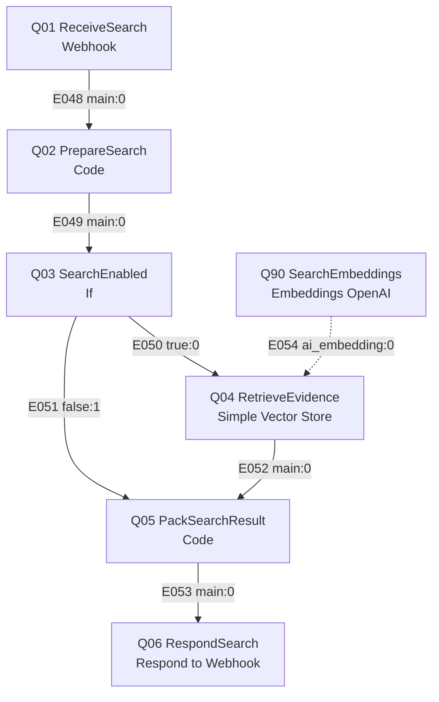
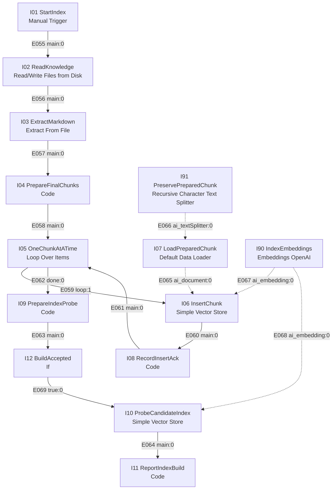

# RAG 아키텍처 설계서 · 두바퀴

전체 구성·상태·시나리오에서 RAG의 위치는 [최상위 시스템 설계서](SYSTEM-DESIGN.md)를 참조한다. 검색·색인 내부 상세의 원본은 이 문서다.

**2026-11-05 템플릿 작성본:** [두바퀴 RAG 아키텍처 설계서](../rag-knowledge/rag-architecture-template.md)에 현재 로컬 실측과 구현·미구현을 정리했다. 아래 과거 기록의 미측정 표와 달라지는 값은 최신 작성본을 확인한다.

**사용자 결정:** 향후 팀 VM의 Docker 기반 PostgreSQL에 RAG 데이터를 저장한다. pgvector 검색과 3,072차원 인덱스 호환성, 권한·백업·R04 상태 저장과의 경계는 [템플릿 작성본](../rag-knowledge/rag-architecture-template.md#postgresql-전환-시-확인할-설계)에 정리했으며 실제 배포·연동은 아직 미완료다.

- 작성: 2026-11-03 KST / 버전·상태: **v0.9 교육용 로컬 n8n 색인·검색 구현 및 제한적 시험** / 책임: R03, 검토: R02·R04·R05.
- v0.9 변경: 로컬 n8n 색인·검색과 실제 임베딩 시험을 기록한다. 팀 사용자 인가·VM 통합은 미검증이며 원격 실행 자료의 사용 승인을 의미하지 않는다.
- v0.8 변경: R03 청크 준비·오프라인 모의 검색·기대 근거 대응을 통합한다. 도구 시험과 실제 벡터/권한/서비스 시험을 구분하고 승인 대기 상태를 유지한다.
- v0.7 변경: 시민용6개·제한 가상정책2개·manifest·평가 초안을 반영한다. 조사 원문 HTML/사진은 Git 제외 로컬 보존, 승인 대기와 색인 비활성을 유지한다.
- v0.6 변경: PR #2의 문서6개를 검토용 초안으로 연결한다. 승인 서비스 지식·manifest와 구분하며 공개 계약·노드/엣지는 유지한다. R01의 이번 대리 편집은 개발 계획 P08 통합 검토 기록에 남긴다.
- v0.5 변경: 팀 이름 두바퀴·색인/검색 접두사 dubakwi 반영. 검색 설정·버전/권한 실측은 미완료.
- v0.4 변경: I02는 시스템 설계의 knowledge/public·restricted와 manifest를 따르며, 승인된 문서만 읽고 manifest를 본문으로 색인하지 않는다. 공개 SearchRequest/SearchResult 계약은 유지한다.
- [공식 템플릿 — 공개본 제외 자료](../../docs/PUBLIC-SOURCES.md)의 5개 절과 [RAG 가이드 — 공개본 제외 자료](../../docs/PUBLIC-SOURCES.md)를 따른다. 기존 워크플로우 설계의 검색·색인 상세를 이 문서로 이관했다. 기술 후보를 확정값 또는 실측으로 표현하지 않는다.
- 문서 경계: [워크플로우 설계서](WORKFLOW-DESIGN.md)는 RAG 호출 시점·공개 SearchRequest/SearchResult/Evidence 계약·업무 분기를 소유한다. 이 문서는 지식·청킹·임베딩·검색/색인 내부 노드·내부 엣지·운영·품질 측정을 소유한다. 둘을 합쳐 n8n 노드·엣지 수준 설계를 확인한다. 작업 배정·기한은 [개발 계획](../DEVELOPMENT-PLAN.md).

## 1. 원본 문서

| 항목 | 값 |
| --- | --- |
| 대상 문서 | 따릉이 시민 안내 6개: 대여·반납·고장/사고·요금/환불·계정/보안·후속 문의. 두바퀴 교육용 담당자 정책 2개: 이관·티켓 수명주기. 팀 knowledge 문서 총 8개. 과정 data-api `/docs` 문서 8+1개는 이 색인에 포함하지 않음 |
| 원자료 | 사용자가 수집한 따릉이 앱 챗봇의 FAQ·화면, 따릉이/서울시·서울시설공단 공개 안내. 내부 처리 절차는 실제 기관 정책이 아닌 팀 가상 설정 |
| 문서 형식 | UTF-8 Markdown, `#` 문서 제목·`##` 주제 절·문단·목록. 정리된 `knowledge/`가 색인 후보이며 원문 HTML/사진은 직접 색인하지 않음 |
| 문서 길이 | 8개 Markdown 파일 텍스트 기준 최소 **405자**, 중앙값 **1,049자**, 최대 **2,385자**. Python `read_text(encoding="utf-8")` 및 `len()` 실측, 줄바꿈 포함, 2026-11-05. 토큰 수 아님 |
| 언어 | 한국어 중심, QR·앱 등 일부 영문 용어. 비율은 미측정 |
| 갱신 주기 | 정기 주기 미확정. 출처나 정책 변경을 확인하면 원문을 검토하고 manifest 해시·버전을 갱신한 뒤 색인을 재생성하는 안 |
| 접근 권한 | `public` 시민용 6개, `restricted` 담당자용 가상 정책 2개. 시민은 public, 서버에서 허용된 담당자는 public+restricted. 사용자 조회→B05→RAG 전체 인가는 미검증 |
| 승인 | `knowledge/manifest.json` 기준 8개 모두 승인 대기·색인 비활성. 명시적인 demo 준비로만 로컬 시연에 사용하며 서비스 지식 승인을 의미하지 않음 |

문서 목록·원본 해시·출처·승인 상태·접근권한은 manifest로 관리する。調査原文はサービス知識として自動承認しない。

### 1.1 검토 전 초안과 서비스 지식의 관계

[PR #2](https://github.com/ik-e/dubakwi-ttareungi-support/pull/2)의 `docs/rag-knowledge/`는 공유·검토용 초안이며 I02의 색인 입력에 추가하지 않는다. 초안 병합은 사실 정확성·현행성·서비스 사용 승인이 아니다.

| 초안 | 내용 |
| --- | --- |
| [대여](../rag-knowledge/rental-guide.md) | 대여 준비·오류 안내 |
| [반납](../rag-knowledge/return-guide.md) | 반납·완료 확인 |
| [고장 신고](../rag-knowledge/breakdown-report.md) | 고장·신고 경로 |
| [요금·환불](../rag-knowledge/fees-refund-guide.md) | 이용권·요금·환불 |
| [계정·보안](../rag-knowledge/privacy-security-guide.md) | 계정·개인정보 |
| [후속 문의](../rag-knowledge/support-followup.md) | 상담·모의 조회/이관 |

R03이 문서/절별 출처·확인일·적용 범위·가상 정책 여부를 정리하고, R04가 권한/가상 정책을, R05가 근거와 기대 문서·절을 검토한다. 검토된 내용만 `knowledge/public/` 또는 `knowledge/restricted/`로 이관하고 `knowledge/manifest.json`에 원본 경로·해시·출처·승인 상태·권한·버전을 등록한다. I02는 기존 계약대로 승인 manifest의 서비스 문서만 읽는다. 이관 이후 내용 수정은 서비스 지식 원본에서 관리하며 초안을 별도 현행 원본으로 병행 관리하지 않는다.

미확인·상충하는 금액/기간·앱 조건은 확인 또는 제외한 뒤 승인한다. 공개 안내와 가상 정책의 구분·출처·적용 조건은 절/최종 청크에서도 보존하고 내부 정책은 공개 청크에 섞지 않는다. 실제 manifest 형식과 권한 값은 D04에서 정한다. 지식 승인·manifest 등록·색인/권한/검색 검증은 후속 작업이며 이번 PR에서는 완료로 처리하지 않는다.

### 1.2 P08 지식 및 평가 초안 (2026-11-04)

R03이 `knowledge/public/` 시민용 6개, `knowledge/restricted/` 교육용 가상 정책 2개와 `knowledge/manifest.json` 초안을 작성했다. 문서별 SHA-256, 출처, 권한, 가상 구분, 승인 대기 및 색인 비활성 상태를 기록한다. manifest 스키마와 access_level은 제안이며 D04 확정 전이다. 충돌 판단과 20개 기대 질문은 [자료 검토·평가 초안](../rag-knowledge/day1-review-and-evaluation.md)에 있다.

사용자 요청에 따라 상충·미확인 항목에는 교육용 가상 설정을 명시한다. 이는 공식 따릉이 정책 확인이나 실제 서비스 승인에 해당하지 않는다. R04 권한·R05 근거 검토와 실제 색인·검색·권한 시험은 미완료다. 조사 원문 HTML·사진은 로컬에 보존하고 현재 Git 추적/색인 입력에서 제외한다. 원격 과거 이력은 재작성하지 않는다. 공개 계약과 노드/엣지는 변경하지 않았다.

### 1.3 사용자 결정: 검색 권한과 근거 표기

2026-11-04 사용자 결정: 시민은 공개 지식 6개, 담당자는 공개 6개와 제한 2개를 검색할 수 있다. 담당자의 실제 서비스 역할은 서버가 등록한 `support` 또는 `security` 등으로 확인하며 개발 역할 ID R01~R05와 구분한다. 검색 전 허용 partition을 선택하며 입력 텍스트나 클라이언트가 지정한 권한을 신뢰하지 않는다. 실제 인가·적용 시험은 아직 미구현이다.

실제 공개 자료나 사용자가 제공한 실제 챗봇 안내는 출처·확인일·적용 한계를 함께 **[실제 안내]**로, 두바퀴의 임의 규칙·미확인 사항에 대한 시연 가정은 **[가상 설정]**으로 구분한다. 혼합 문서는 문서 수준 `source_type=mixed`만으로 각 절을 판단할 수 없으므로 최종 청크마다 유형·근거를 보존하고 혼합 청크는 분리한다. 유형을 결정할 수 없으면 실제 안내로 표시하거나 추측하지 않는다. 과거 자료의 현재 적용 여부를 표시 유형만으로 보증하지 않는다.

사용자의 표기 방식 결정은 실제 자료의 최신성 확인이나 실행·권한 시험 완료를 뜻하지 않는다. SearchResult Evidence에는 현재 전용 유형 필드가 없으므로 구현 시 내부 메타데이터 및 유형을 보존한 근거 텍스트로 전달하는 방안을 우선 검토한다. 계약에 필드를 추가할 필요가 있으면 R02의 워크플로우 계약과 소비·시험을 함께 갱신한다. 시험 기대 결과는 [검색·답변 시험 기대 결과](../rag-knowledge/search-expected-results.md)를 따른다.

### 1.4 색인 준비 도구 개발 (P10/P16 진행 중)

`scripts/dev/prepare_rag_chunks.py`는 manifest 경로·SHA-256·공개/제한 분류 및 승인 상태를 검사하고 제목·절·출처·유형이 포함된 JSON 청크를 준비하는 로컬 도구다. 기본 실행은 승인되지 않은 문서를 거절하며 `--demo`는 승인 대기 문서를 **로컬 교육용 검토에만** 허용한다. 출력은 벡터 색인·서비스 권한 확인이 아니다. 문단 기준 실제/가상 분리 규칙은 초안이며 모든 문서와 예외를 확인하기 전 최종 색인에 사용하지 않는다.

2026-11-04 로컬 n8n 1.120.4, OpenAI `text-embedding-3-large`, Simple Vector Store에서 승인 전 교육용 문서를 실제 색인하고 내부 인증 HTTP 검색을 시험했다. 공개·제한 분리, 근거·실제/가상 표시 및 재시작/실패 후 재색인을 제한된 로컬 사례에서 확인했다. 저장소 `workflows/dubakwi-index.json`의 수동 트리거는 시험본의 임시 인증 Webhook과 다르며 수동 실행본과 서버 검색 간 공유는 미확인이다. 팀 VM, R02 전체 흐름·R04 서버 인가·R05 공식 판정, 동시 색인 잠금과 다중 프로세스 공유는 미검증이다. [로컬 실행·시험 및 한계](../rag-knowledge/local-n8n-runbook.md)를 참조한다.

### 1.5 R05 사례 검토 대응 초안

공개 보안 초동 안내와 QR 오류 절, 가상 환불 이관 절을 보완하고 제한 가상 문서 2개에 개별 노출 검사용 표식을 넣었다. [R05 검토 메모 대응](../rag-knowledge/r05-review-response.md)에 실제 문서·절 매핑과 WF03의 검색 0건/답변 근거 부족 구분을 기록했다. manifest 해시는 갱신했으나 승인·실제 색인·검색·권한 시험은 미완료다.

### 1.6 로컬 청크 준비 측정 (2026-11-04)

현재 manifest를 승인 대기 상태로 유지한 채 로컬 `prepare(..., allow_demo=True)`를 실행했다. 문단 단위 후보 44개(공개 36·제한 8), 유형 기준 실제 안내 24·가상 설정 20, 텍스트 길이 최소 61·중앙 124.5·최대 251자, 중복 chunk_id 0개다. 이 값은 라벨 접두사를 포함한 단순 문자 수이며 벡터 청크 품질·검색 성공률·토큰 수를 뜻하지 않는다. 해당 도구는 실제 권한 처리나 색인을 수행하지 않는다.

현재 청크 준비 도구는 출처 URL을 추출하고 제한 문서의 혼합 문단을 항상 가상으로 표시한다. 사용자 제공 실제 안내와 프로젝트 가상의 경계에 대한 정규식 판정은 모든 표현을 자동으로 보장하지 않으며 색인 전 추가 검토가 필요하다. 팀 인계 문구 초안은 [파트별 전달 문서](../rag-knowledge/team-handoff.md)에 있다.

### 1.7 최신 사례 반영과 R03 구현 기본안

2026-11-04 `main`의 P13 공통14·팀10 사례 및 도구 초안을 병합했다. 사례는 실제 서비스 실행 전이다. R03의 독립 구현 기본안은 [역할별 인계 문서](../rag-knowledge/team-handoff.md)의 2026-11-04 항목을 따른다. 이는 당시 기본안의 이력이다. 이후 로컬 시연·재시작 시험을 수행했으며 팀 VM·서버 인가·비용은 미검증이다. 팀원이 동의하거나 구현했다고 기록하지 않는다.

### 1.8 로컬 검색 평가와 역할 전달 기본안

`scripts/dev/rag_local_evaluation.py`는 준비된 청크를 2글자 중복도로 찾는 오프라인 비교 도구다. `--role`은 시험용 가상 값이며 실제 인증·서버 권한·벡터 검색을 제공하지 않는다. 시민 fixture는 public만, 담당자 fixture는 두 범위를 사용하도록 필터를 시험한다. 의미 검색 품질이나 n8n 서비스 성능 근거로 사용하지 않는다.

R03 기본안은 Discord가 검증한 ID → 인증된 어댑터 → 메인 B05의 서버 사용자 조회 → 서버가 결정한 access_levels → 인증된 내부 검색 호출 → 검색 전 권한 partition 선택이다. 실제 구현·서버 신뢰 경계는 미검증이며 [역할별 인계](../rag-knowledge/team-handoff.md)를 참조한다. R05의 새 flow.py 형식 브랜치는 별도로 확인했으며 해당 사례 변경은 아직 기본 브랜치에 병합되지 않았다.

### 1.9 로컬 개발 시작 기준

2026-11-04 사용자 결정: 로컬 n8n에서 `text-embedding-3-large`와 Simple Vector Store를 시작 구성으로 사용한다. 사용자 소유 OpenAI API 키는 사용자가 로컬 n8n Credential에 직접 등록하며 실제 키·환경 비밀은 저장소에 넣지 않는다. 이는 당시 결정 이력이다. 이후 로컬 모델 접근·n8n 실행은 확인했으며 실제 과금액과 팀 VM 동일 구성은 미확인이다.

Simple Vector Store는 재시작 시 데이터가 사라질 수 있고 인스턴스의 다른 사용자도 키로 접근할 수 있으므로 교육용 모의 정책만 취급한다. public/restricted 키 분리는 실제 인가를 대체하지 않는다. 승인 대기 문서는 명시된 로컬 교육용 시연에만 사용하며 서비스 승인과 구분한다. 상세 절차는 [로컬 개발 계획](../rag-knowledge/RAG-개발계획.md)을 따른다.

## 2. 전처리 및 청킹

| 항목 | 우리 선택 | 비교한 다른 선택 | 근거 (숫자) |
| --- | --- | --- | --- |
| 전처리 | 사용자가 수집한 안내를 주제별 Markdown으로 정리하고 실제 안내·가상 설정 및 출처를 구분. 파일 경로·권한·승인 상태·정규화한 줄바꿈 기준 SHA-256 검증 | 자동 HTML 본문 추출은 별도 구현하지 않음 | manifest 8개; 전체 품질·최신성 승인은 대기 |
| 청킹 단위 | Markdown `##` 절 아래 빈 줄로 구분한 문단. 실제 안내와 가상 설정이 한 문단에 섞인 특정 표현은 분리 | 절 전체·300자 고정 길이는 비교 후보 | 전처리 결과 44개; 절 전체 구조 41개와 길이만 비교; 같은 질문의 대안 hit@k 비교 미실행 |
| 오버랩 | **전처리 청크 기준** 인접 문단 복제 없음, **0자** | 길이 기반 분할의 50자 또는 토큰 오버랩 후보 | 주제·문단 경계를 우선 보존하는 초기 선택. 검색 품질에 따른 최적화·비교 미측정 |
| 청크 앞에 붙이는 것 | `[실제 안내]` 또는 `[가상 설정]`을 본문에 붙임. `title`, `section`은 메타데이터이며 임베딩 본문 앞에 별도 추가하지 않음 | 제목·절을 본문에 접두하는 방식 | 대안 성능 비교 미실행 |
| 표·목록 처리 | Markdown 문단을 보존. 문단 단위 이외 표 머리글 반복·절차 보호를 위한 별도 로직 없음 | 긴 표의 헤더 반복과 단계별 분할은 후속 설계 | 현재 문서 내 실제 활용 여부·분할 품질 별도 평가 필요 |

청크 길이 분포 (2026-11-05 `prepare(ROOT, MANIFEST, allow_demo=True)` 결과, [구조 비교 기록](../../runs/public/20261105-110255-local-rag-chunk-structure/summary.json)):

| 방식 | 청크 수 | 길이 최소 | 중앙 | 최대 | hit@3 |
| --- | ---: | ---: | ---: | ---: | --- |
| 현재 절·문단 단위 | 44: public 36, restricted 8 | 61자 | 124.5자 | 251자 | 교육용 공개 Q01~Q13에서 기대 문서 포함 13/13, 기대 절 정확 일치 13/13. [실행 기록](../../runs/public/20261105-093642-local-rag-r05-review/summary.json); R05 공식 판정 아님 |
| 절 전체 구조 비교(동일 절의 준비 청크를 결합) | 41 | 61자 | 123자 | 364자 | 미측정. 3개 절에서 실제·가상 청크가 섞여 그대로 운영에 사용하지 않음 |
| 고정 길이 후보 | 미측정 | 미측정 | 미측정 | 미측정 | 동일 질문 비교 미실행 |

길이는 `[실제 안내]`·`[가상 설정]` 표시를 포함한 Python 문자 수이며 토큰이 아니다. Q13은 대안으로 제시된 절 중 하나를 비교했다. 문서/절 hit@3은 정답 품질이나 다국어 모델 비교를 뜻하지 않는다. n8n 데이터 로더의 `textSplittingMode=simple`은 별도로 존재하므로 최종 저장 청크 수·재분할 여부는 저장본에서 재확인한다.

측정 계획: 동일 원본·권한·질문10개 이상으로 청킹2방식 이상을 비교한다. 질문별 기대 doc/section을 구현 전에 정하고 정상 안내·정보 없음·긴급 초동·제한 문서·도메인 용어를 포함한다. 청크 분포와 hit@k,공통 WF01/03/05/12 및 팀 사례 답변 품질을 함께 기록한다. 가이드의 chunk_stats.py 제공 여부·입출력은 P01에서 확인하고 실제 명령·설정·보고서 경로를 실행 후 기재한다.

## 3. 임베딩

| 항목 | 값 | 근거 |
| --- | --- | --- |
| 모델 | OpenAI `text-embedding-3-large` | 과정 기본 구성이고 로컬 Credential과 n8n 노드에서 실제 호출 성공. OpenAI는 영어와 비영어 작업용 모델로 안내한다. 한국어 따릉이 표현 비교 우위는 별도 미측정. [OpenAI 모델 문서](https://developers.openai.com/api/docs/models/text-embedding-3-large) |
| 벡터 차원 | **3,072차원** | 2026-11-04 로컬 임시 실행 `dubakwi-44-final-result.txt`의 Embeddings 출력 벡터 1개의 길이를 `len()`으로 확인. [가린 확인 기록](../../runs/public/20261105-110303-local-rag-embedding-audit/summary.json). 전체 벡터 원문은 공유하지 않음. 모델의 차원 축소 설정은 적용하지 않음 |
| 거리 방식 | **Cosine similarity**, 값이 클수록 유사 | 로컬 n8n 1.120.4에 설치된 LangChain `dist/vectorstores/memory.cjs`에서 기본 `similarity ?? cosine`과 내림차순 정렬 확인. 다른 VM/버전은 재확인. 단위 벡터라면 cosine과 유클리드 거리의 순위는 동일하나 실제 벡터 정규화는 이 시험에서 별도 검증하지 않음 |
| top_k | 각 공개·제한 저장소 검색 5건, 합쳐 점수순 상위 5건 반환 | 현재 워크플로우 설정. 3 대 5의 품질 비교는 미실행 |
| 최소 점수 | **0.30**, 로컬 시연 임시값 | Q01~Q13·WF03을 사용한 제한적 평가; 정상과 무관 질문의 충분한 점수 분포·임계값 비교는 미실행 |
| 단가와 비용 | 2026-11-05 확인 기준 입력 100만 토큰당 **$0.13**. 실제 색인 토큰·청구 금액 미측정 | [OpenAI 모델 가격](https://developers.openai.com/api/docs/models/text-embedding-3-large). large는 small $0.02보다 비싸며 실제 팀 데이터의 모델별 성능·비용 비교는 미실행. 금액=입력 토큰/1,000,000×단가 |

색인 I90과 검색 Q90은 동일 모델·차원·전처리 버전을 사용해야 한다. 모델/차원/청킹 변경은 새 인덱스로 재생성한다. writer/verifier LLM의 역할·업무 검증은 워크플로우 설계서에 두며 이 절의 임베딩 선택과 혼동하지 않는다.

## 4. 인덱스 및 메타데이터

| 항목 | 값 |
| --- | --- |
| 저장소 | 현재 로컬: n8n Simple Vector Store의 프로세스 메모리. 이후 팀 VM: Docker 기반 PostgreSQL에 RAG 데이터 영속 저장 계획, 벡터 검색은 pgvector 확장 및 n8n PGVector 노드 검토. 아직 구현·배포 전. 실제 로컬 시험 키: `dubakwi-demo-public`, `dubakwi-demo-restricted`, `dubakwi-demo-readiness` |
| 명명·전환 | 현 demo 키에는 버전이 없고 각 권한별로 기존 내용을 재생성한다. 운영 제안 `dubakwi_kb_v<version>_<access>`; 새 버전 완전 검증 뒤 검색 설정을 전환하는 방식은 미구현 |
| 메타데이터 | 저장 로더 설정: `doc`, `title`, `section`, `chunk_id`, `access_level`, `type`, `version`, `source_url`, `source_checked_at`. 일부 출처 URL은 없을 수 있음. `updated_at`·제품군 필터는 현재 구현하지 않음 |
| 검색 전 필터 | 인증된 내부 호출자의 `access_levels`를 검사하고 허용된 public/restricted 메모리 키만 검색. 서버 사용자 인증과 role→권한 전달은 R02/R04 통합 시험 전 |
| 검색 후 처리 | 접근수준·필수 필드 검사, 0.30 미만 제외, 점수순 상위 5건. 일반 중복 청크 제거는 현재 별도 구현 확인되지 않음 |
| 파티션·샤딩 | public/restricted 메모리 키 분리는 소규모 논리 분리. 분산 샤딩·제품군/조직 단위 파티셔닝은 미구현이며 지속형 저장소 도입 시 데이터량·권한 기준으로 검토 |

### 4.1. 외부 호출 계약과 업무 책임

공개 계약과 역할 간 판정 기준의 원본은 [워크플로우 설계서 6절](WORKFLOW-DESIGN.md#6-노드-간-페이로드-연결선마다)의 SearchRequest/SearchResult/Evidence다. 이 문서에 복제 편집하지 않는다. 특히6.4의 ok/empty/skipped/error 조건·chunk_id 인용·단일 봉투 반환을 지킨다. 내부 모델/청킹/top_k/최소 점수는 R03이 비교·선정하고 승인 설정/버전을 R02/R05에 인계한다. 미선정 수치를 임의 기본값으로 숨겨 반환하지 않는다.

- B14가 내부 인증으로 dubakwi-search를 호출한다. request_id·enabled·query·서버 access_levels·deadline_at을 전달하고 결과 봉투1개를 받는다.
- status=ok는 유효 Evidence,empty는 검색 성공/근거 없음,skipped는 검색 불필요,error는 설정/권한/서비스 실패다. 내부키·Credential은 결과에 노출하지 않는다.
- 공개 Evidence의 doc/section/chunk_id/text/score/access_level/version 및 선택 source_url은 Q05가 내부 document+metadata에서 매핑한다.
- 답변 생성·검증·이관은 본체 B17~B28의 책임이다. RAG가 티켓을 생성하거나 업무 route를 결정하지 않는다.

### 4.2. 검색 노드·연결

| 노드 ID·이름 | n8n 종류 | 입력 | 출력 | 설정·처리 계약 |
| --- | --- | --- | --- | --- |
| Q01 ReceiveSearch | Webhook | SearchRequest | WebhookBody | 내부 Header Auth, responseNode |
| Q02 PrepareSearch | Code | WebhookBody.body | SearchCtx | 서버 KB설정·공개키·권한·enabled 검사. 설정키는 시민 입력에서 선택하지 않음 |
| Q03 SearchEnabled | If | SearchCtx.enabled | SearchCtx | true=enabled이며 설정·권한 검사 통과, false=skip 또는 설정/권한 오류를 Q05에서 구분 |
| Q04 RetrieveEvidence | Simple Vector Store | query,공개 memory_key | VectorRaw | Get Many, top_k=승인값, Always Output Data |
| Q05 PackSearchResult | Code | VectorRaw 또는 skip SearchCtx | SearchResult | ok/empty/skipped/error 구분, metadata→Evidence 매핑·점수·중복 처리 |
| Q06 RespondSearch | Respond to Webhook | SearchResult | SearchResult | request_id와 단일 결과 봉투 반환 |
| Q90 SearchEmbeddings | Embeddings OpenAI | 임베딩 설정 | EmbeddingModel | text-embedding-3-large, 실제 차원 확인 |

### 4.3. 색인 노드·연결

| 노드 ID·이름 | n8n 종류 | 입력 | 출력 | 설정·처리 계약 |
| --- | --- | --- | --- | --- |
| I01 StartIndex | Manual Trigger | 관리자 실행 | object | 색인은 요청 처리와 분리, 새 version·청킹설정·문서목록 승인 후 실행 |
| I02 ReadKnowledge | Read/Write Files from Disk | knowledge/manifest.json이 지정한 public/·restricted/ 문서 | Binary | 승인 경로만 읽기; 예상 파일목록·권한 대조, manifest 자체를 본문 청크로 색인하지 않음 |
| I03 ExtractMarkdown | Extract From File | Binary | TextItem[] | 텍스트·파일명 보존 |
| I04 PrepareFinalChunks | Code | TextItem[]+서버 BUILD_CONFIG | ChunkJob[] | 문서/절 구분·최종 chunk 분할·가림·권한·출처·chunk_id 생성. 최종 본문은 job.text |
| I05 OneChunkAtATime | Loop Over Items | ChunkJob[] | ChunkJob/InsertAck[] | batchSize=1; output1 loop, output0 done |
| I06 InsertChunk | Simple Vector Store | ChunkJob | VectorRaw | Insert Documents, 새 version 권한별 memory_key, Always Output Data |
| I07 LoadPreparedChunk | Default Data Loader | 현재 ChunkJob | Document[] | JSON 특정 필드 text=$json.text; metadata=$json.metadata; 한 item |
| I08 RecordInsertAck | Code | VectorRaw+현재 ChunkJob | InsertAck | job별 성공/실패·chunk_id 기록, 다음 batch로 복귀 |
| I09 PrepareIndexProbe | Code | InsertAck[] | IndexBuild | 전수 ACK·파일/절/청크 검증, 실패0일 때 새 공개키 probe query 준비; 빈 문서/청크·실패 ACK·예상목록 불일치면 valid=false |
| I10 ProbeCandidateIndex | Simple Vector Store | IndexBuild | VectorRaw | 새 키 Get Many, 기대 doc/section/chunk 비교용 |
| I11 ReportIndexBuild | Code | VectorRaw+IndexBuild | IndexBuild | 프로브·ACK·실측 결과 보고. 새 버전 활성화는 검토 후 Q02 설정 변경·배포, 자동 alias API 추가 안 함 |
| I90 IndexEmbeddings | Embeddings OpenAI | 임베딩설정 | EmbeddingModel | 검색과 동일 모델/차원 |
| I91 PreservePreparedChunk | Recursive Character Text Splitter | 현재 ChunkJob | TextSplitter | chunkSize > job.text.length, overlap=0: I04가 정한 chunk를 다시 나누지 않음 |
| I12 BuildAccepted | If | IndexBuild.valid | IndexBuild | true=전수 ACK 검증 성공 후 probe; false=실패 보고, 새 버전 활성화 금지 |

### 4.4. RAG 내부 스키마

| 스키마 | 필수 필드·자료형 | 추가 규칙 |
| --- | --- | --- |
| VectorRaw | 검색 원시 결과는 Document와 유한 score를 포함하는 항목들,삽입 원시 결과는 공급자의 성공/실패/오류 응답 | 최소 의미를 정의한 내부 타입. 정확한 배열 경로·document 키·ACK 필드는 D03 확인 후 Q05/I08 매퍼에서 고정. 빈 결과·오류·미확인을 구분 |
| SearchCtx | request:SearchRequest,enabled:boolean,valid:boolean,memory_key:string／null,error_code:string／null | 서버 설정·권한 검사에서 생성. valid=false는 skipped가 아닌 error |
| TextItem[]/Binary | TextItem={filename:string,text:string}; Binary=n8n binary item | 파일명과 본문을 I04까지 보존, 실제 binary 필드명 D03 |
| InsertAck | chunk_id:string,status:confirmed/failed/unknown,error_code:string／null | HTTP 성공만으로 실제 삽입·검증 완료를 추정하지 않음 |
| IndexBuild | version:string,memory_key:string,expected_chunks:int,acks:InsertAck[],valid:boolean,probe_query:string,probe_ok:boolean／null | valid는 전수 ACK·문서/절 검증. I11의 ready는 valid && probe_ok=true일 때만 |
| object/Document[]/TextSplitter/EmbeddingModel/LanguageModel | object=Manual Trigger 입력; Document={pageContent:string,metadata:ChunkJob.metadata} | 나머지 Model/Splitter는 JSON 업무 데이터가 아닌 n8n AI 자원 연결 |
| ChunkJob | doc,section,text:string,memory_key,version,metadata:{doc,title,section,chunk_id,access_level,type,version,source_url?,updated_at?,applies_to?:string[],source_checked_at?:string} | I04에서 최종 chunk_id=doc+section+순번+본문해시 생성. I07은 job.text, splitter는 재분할 금지 |

metadata.title은 필수이며 I04가 manifest/Markdown 제목에서 만들고 I07은 그대로 보존한다. updated_at/source_url은 확인 가능한 원본에서 채우고 모르면 선택값을 생략한다. chunk_id는 내부 최종 청크 ID이며 가이드의 chunk 필드와 대응한다. 제공 노드가 다른 필드명을 쓰면 매퍼를 구현하고 Evidence.chunk_id로 정규화한다. 실제 title/필수 metadata를 I04/I07→Q05까지 보존하는지 검사한다.

### 4.5. RAG 내부 엣지 전체

정상·오류 연결과 AI 자원 연결을 함께 기재한다. If false가 별도 오류 확장인 I12→I11도 이 표가 원본이다. main:0→inputN은 n8n 수신 포트 지정이다.

| 엣지 ID·연결선 | 포트 | 필수 필드 | 선택 필드 | 변환·검증 | 구분 |
| --- | --- | --- | --- | --- | --- |
| E048 Q01 → Q02 | main:0 | WebhookBody (내부4.4/공개계약) | WebhookBody 선택 | 동일 업무 컨텍스트 유지 | normal |
| E049 Q02 → Q03 | main:0 | SearchCtx (내부4.4/공개계약) | SearchCtx 선택 | 동일 업무 컨텍스트 유지 | normal |
| E050 Q03 → Q04 | true:0 | SearchCtx (내부4.4/공개계약) | SearchCtx 선택 | 동일 업무 컨텍스트 유지 | normal |
| E051 Q03 → Q05 | false:1 | SearchCtx (내부4.4/공개계약) | SearchCtx 선택 | valid=false→error;valid=true && enabled=false→skipped | normal |
| E052 Q04 → Q05 | main:0 | VectorRaw (내부4.4/공개계약) | VectorRaw 선택 | 동일 업무 컨텍스트 유지 | normal |
| E053 Q05 → Q06 | main:0 | SearchResult (내부4.4/공개계약) | SearchResult 선택 | 동일 업무 컨텍스트 유지 | normal |
| E054 Q90 → Q04 | ai_embedding:0 | EmbeddingModel (내부4.4/공개계약) | EmbeddingModel 선택 | 동일 업무 컨텍스트 유지 | normal |
| E055 I01 → I02 | main:0 | object (내부4.4/공개계약) | object 선택 | 동일 업무 컨텍스트 유지 | normal |
| E056 I02 → I03 | main:0 | Binary (내부4.4/공개계약) | Binary 선택 | 동일 업무 컨텍스트 유지 | normal |
| E057 I03 → I04 | main:0 | TextItem[] (내부4.4/공개계약) | TextItem[] 선택 | 동일 업무 컨텍스트 유지 | normal |
| E058 I04 → I05 | main:0 | ChunkJob[] (내부4.4/공개계약) | ChunkJob[] 선택 | 동일 업무 컨텍스트 유지 | normal |
| E059 I05 → I06 | loop:1 | ChunkJob (내부4.4/공개계약) | ChunkJob 선택 | 동일 업무 컨텍스트 유지 | normal |
| E060 I06 → I08 | main:0 | VectorRaw (내부4.4/공개계약) | VectorRaw 선택 | 동일 업무 컨텍스트 유지 | normal |
| E061 I08 → I05 | main:0 | InsertAck (내부4.4/공개계약) | InsertAck 선택 | 다음 batch | normal |
| E062 I05 → I09 | done:0 | InsertAck[] (내부4.4/공개계약) | InsertAck[] 선택 | 동일 업무 컨텍스트 유지 | normal |
| E063 I09 → I12 | main:0 | IndexBuild (내부4.4/공개계약) | IndexBuild 선택 | 전수 ACK 검증 결과를 명시적 조건으로 전달 | normal |
| E064 I10 → I11 | main:0 | VectorRaw (내부4.4/공개계약) | VectorRaw 선택 | 동일 업무 컨텍스트 유지 | normal |
| E065 I07 → I06 | ai_document:0 | Document[] (내부4.4/공개계약) | Document[] 선택 | 동일 업무 컨텍스트 유지 | normal |
| E066 I91 → I07 | ai_textSplitter:0 | TextSplitter (내부4.4/공개계약) | TextSplitter 선택 | 동일 업무 컨텍스트 유지 | normal |
| E067 I90 → I06 | ai_embedding:0 | EmbeddingModel (내부4.4/공개계약) | EmbeddingModel 선택 | 동일 업무 컨텍스트 유지 | normal |
| E068 I90 → I10 | ai_embedding:0 | EmbeddingModel (내부4.4/공개계약) | EmbeddingModel 선택 | 동일 업무 컨텍스트 유지 | normal |
| E069 I12 → I10 | true:0 | IndexBuild (내부4.4/공개계약) | IndexBuild 선택 | 동일 업무 컨텍스트 유지 | normal |
| E070 I12 → I11 | false:1 | IndexBuild (내부4.4/공개계약) | IndexBuild 선택 | 실패 보고만, provider 검색·활성화 없음 | extension |

I04는 최종 청크를 만든 뒤 I05가 batch1 처리한다. I07 본문은 $json.text,metadata는 $json.metadata,I91 chunkSize는 준비된 본문 길이보다 커서 재분할하지 않는다. 이 sub-node 표현식·실제 chunk 수는 과정 n8n 버전에서 검증한다. I08은 삽입 원시 응답과 현재 job을 합쳐 ACK를 만들고 I09/I12가 전수 성공·기대목록을 확인한다. 실패는 I11 보고,성공만 I10 probe 후 I11 준비 상태를 판정한다. Q05는 valid=false를 error로 먼저 판정하고,검사를 통과한 enabled=false만 skipped로 판정한다. 정상 준비 후 무관련 결과만 empty다. skip/error/empty도 항상 봉투1개를 반환한다.

앱/채널·적용 조건·출처 확인일은 서비스 문서에 표시한다. applies_to/source_checked_at을 확인할 수 있으면 metadata→공개 Evidence의 같은 선택 필드로 전달한다. 질문의 앱과 다른 안내를 적용하거나 인덱스 version을 앱 version으로 해석하지 않는다. 적용 범위를 확인하지 못하면 추가 정보 요청/이관의 근거로 사용하고 기관 SOP를 창작하지 않는다.

## 5. 백업 · 복구 및 확장

| 항목 | 오늘 구현 · 잰 것 | 운영 설계 |
| --- | --- | --- |
| 원본 백업 | 지식 Markdown·manifest·워크플로우를 Git에서 버전 관리. 정기 오프사이트 백업·복원 시험은 미실행 | 승인된 원본·설정·manifest의 주기적 백업과 복원권한·보존 주기 결정 |
| 색인 재생성 | 44 청크 로컬 임시 Webhook 색인, 완료 후 검색 확인. 로컬 실행 기록 ID 140은 성공까지 약 9.38초(시각 차이)였으나 이 실행의 청크별 완료 수·토큰 수는 별도 확인하지 못했다. 재시작 후 준비 안 됨 및 재색인 복구 시험; 저장소 수동 트리거 원본과 검색 메모리 공유 미검증. 토큰·비용 및 청크별 성공 건수는 미측정 | 재시작 시 원본/버전을 확인해 전량 재색인 후 공개·제한 검색 probe를 통과시킨다. 담당자는 팀 VM에서 실행·복구 절차 확인 |
| 롤백 | 새 후보 키/이전 버전 alias 전환 미구현. building/ready와 세대 검사로 진행·실패 중 검색 차단 | 새 버전 키를 따로 생성·검증 후 검색 설정 전환, 실패 시 이전 키 유지·복귀. 구현·동시성 확인 필요 |
| 부분 재처리 | 문서별 재시도·중복 제거 미구현; 실패 후 전체 재색인 | 실패 문서 추적 및 배치 재처리, 중복 쓰기 보장 검증 후 도입 |
| 확장 ×10/×100 | 같은 청크 분포가 유지된다는 가정의 단순 규모: **약 440/4,400청크**. 토큰·비용과 해당 실행의 청크별 성공 확인이 없어 시간·비용 추정 보류 | 기준 44개에 T초·X토큰·C달러가 측정되면 10배·100배를 초기 추정하고 실제 재측정. Docker 기반 PostgreSQL+pgvector를 우선 설계하고 배치 임베딩·권한 필터·필요 시 파티션/샤딩 검토 |

색인/검색 실패는 자체 결과·운영 기록에 남기고 본체에는 공개 error 계약만 반환한다. 오류 원문·전체 문서·Credential을 외부 응답이나 감사 로그에 복사하지 않는다. 재시작·후보 버전 실패·롤백·제한 검색·청크 일부 실패를 시험한다. 문서·검색 결과·시간·비용·비교 보고서가 생기면 미측정 표를 증거로 교체한다. 초안 작성은 구현·측정 완료가 아니다.

## VM 수동 색인·검색 검증 (2026-11-05, R01 PR #20)

R01이 n8n 2.42.6 팀 VM에서 main `0e44fdb` 원본 Manual Trigger 색인을 UI로 실행해 준비 청크 44개와 Insert 44회, Mark ready 성공을 기록했다. 같은 VM의 검색 워크플로우에서 실제 HTTP 시험 7개 모두 통과했으며, HTTPS QR 검색은 200/ok와 `rental-guide` 포함, public만 반환 및 제한 canary 비노출을 확인했다. 따라서 해당 VM의 이번 실행에서는 수동 색인과 검색 사이의 메모리 공유가 관측됐다. [R01의 PR #20 및 가린 증거](https://github.com/ik-e/dubakwi-ttareungi-support/pull/20) ([실행 요약](https://github.com/ik-e/dubakwi-ttareungi-support/blob/r01/p16-vm-rag-integration/runs/public/20261105-111311-vm-rag-integration/summary.json)).

최초 검색은 404였고, 저장소 검색 JSON에 `webhookId`가 없어 VM 배포 사본에 환경별 ID를 추가해 재게시 후 해결했다. 저장소 업무 JSON·검색 로직은 변경되지 않았다. VM에 가져올 때 경로와 ID, 내부 인증 Credential의 실제 연결을 확인하며 환경 ID나 비밀값은 공개하지 않는다. 이 시험은 재시작, 동시 색인, 다중 프로세스, 실제 사용자 조회→B05→RAG 인가, R05 공식 판정이나 전체 서비스 시험을 증명하지 않는다. 메모리는 휘발성이며 재색인·복구는 VM에서 별도 검증이 필요하다. 위 기존의 미검증 문구는 이 기록 이전 로컬 상태를 설명한다.
