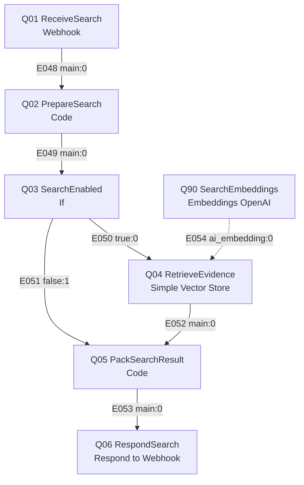
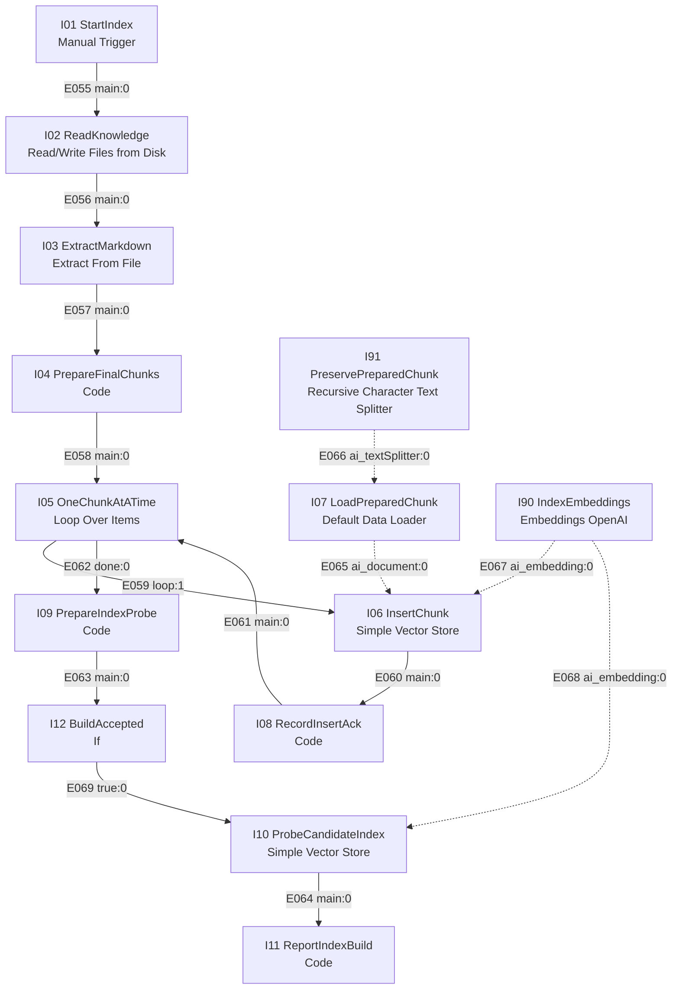

# RAG 아키텍처 설계서 · 두바퀴

전체 구성·상태·시나리오에서 RAG의 위치는 [최상위 시스템 설계서](SYSTEM-DESIGN.md)를 참조한다. 검색·색인 내부 상세의 원본은 이 문서다.

- 작성: 2026-11-03 KST / 버전·상태: **v0.6 P08 지식 초안 경로 동기화·색인/검색 미구현·미측정** / 책임: R03, 검토: R02·R04·R05.
- v0.6 변경: PR #2의 문서6개를 검토용 초안으로 연결한다. 승인 서비스 지식·manifest와 구분하며 공개 계약·노드/엣지는 유지한다. R01의 이번 대리 편집은 개발 계획 P08 통합 검토 기록에 남긴다.
- v0.5 변경: 팀 이름 두바퀴·색인/검색 접두사 dubakwi 반영. 검색 설정·버전/권한 실측은 미완료.
- v0.4 변경: I02는 시스템 설계의 knowledge/public·restricted와 manifest를 따르며, 승인된 문서만 읽고 manifest를 본문으로 색인하지 않는다. 공개 SearchRequest/SearchResult 계약은 유지한다.
- [공식 템플릿 — 공개본 제외 자료](../../docs/PUBLIC-SOURCES.md)의 5개 절과 [RAG 가이드 — 공개본 제외 자료](../../docs/PUBLIC-SOURCES.md)를 따른다. 기존 워크플로우 설계의 검색·색인 상세를 이 문서로 이관했다. 기술 후보를 확정값 또는 실측으로 표현하지 않는다.
- 문서 경계: [워크플로우 설계서](WORKFLOW-DESIGN.md)는 RAG 호출 시점·공개 SearchRequest/SearchResult/Evidence 계약·업무 분기를 소유한다. 이 문서는 지식·청킹·임베딩·검색/색인 내부 노드·내부 엣지·운영·품질 측정을 소유한다. 둘을 합쳐 n8n 노드·엣지 수준 설계를 확인한다. 작업 배정·기한은 [개발 계획](../DEVELOPMENT-PLAN.md).

## 1. 원본 문서

| 항목 | 값 |
| --- | --- |
| 대상 문서 | 팀 knowledge/에 시민 문의용 문서6개 이상, 각 ##절3개 이상 준비 예정. 제공 /docs 8개+관리자 문서1개는 가이드상 자료이며 실제 제공·채택 미확인. 그대로 전부 색인하지 않음 |
| 후보 내용 | rental-guide.md,return-guide.md,breakdown-report.md,fees-refund-guide.md,support-followup.md,privacy-security-guide.md. 공개6종에 더해 과제용 이관 정책·티켓 처리 정책의 제한 문서2종은 TOPIC의 추가 후보이며 기관 SOP로 쓰지 않음. 검토 전 초안6개 작성, 서비스 지식 이관·제한 문서2종 미작성 |
| 근거 | TOPIC의 조사·시나리오와 출처 원장을 바탕으로 작성. 실제 SOP·기관 내부 규정으로 간주하지 않음 |
| 문서 형식 | Markdown의 # 제목·##절·목록·표. 파일별 doc ID·출처·권한·갱신시각 명세 필요 |
| 문서 길이 | 최소/중앙/최대·절 수·글자/토큰 수 모두 미측정. 지식 문서 작성 뒤 측정 |
| 언어 | 한국어 중심, 앱·QR·영문 오류 용어 포함 예정. 실제 비율 미측정 |
| 갱신 주기 | 출처·운영 정책 변경 시 검토 후 버전 재색인 초안. 실제 주기·검토 담당 D04 |
| 접근 권한 | 시민은 공개 6개, 담당자는 공개 6개와 제한 2개. 서버가 권한을 확인해 검색 전 partition 선택. 실제 매핑·집행 시험은 미완료 |
| 색인 제외 | 실명·연락처·개별 거래/티켓 원문·미검증 내부 정책. 본인 상태는 업무 API 조회로 처리 |

문서 목록·원본 해시·출처·승인 상태·접근권한을 manifest로 관리하는 안이다. 조사 원문 전체를 서비스 지식으로 취급하지 않는다. 실제 지식 목록·통계·측정 명령/보고서는 생성 후 이 절에 연결한다.

### 1.1 검토 전 초안과 서비스 지식의 관계

[PR #2](https://github.com/ik-e/dubakwi-ttareungi-support/pull/2)의 `docs/rag-knowledge/`는 공유·검토용 초안이며 I02의 색인 입력에 추가하지 않는다. 초안 병합은 사실 정확성·현행성·서비스 사용 승인이 아니다.

| 초안 | 내용 |
| --- | --- |
| [대여](../rag-knowledge/rental-guide.md) | 대여 준비·오류 안내 |
| [반납](../rag-knowledge/return-guide.md) | 반납·완료 확인 |
| [고장 신고](../rag-knowledge/breakdown-report.md) | 고장·신고 경로 |
| [요금·환불](../rag-knowledge/fees-refund-guide.md) | 이용권·요금·환불 |
| [계정·보안](../rag-knowledge/privacy-security-guide.md) | 계정·개인정보 |
| [후속 문의](../rag-knowledge/support-followup.md) | 상담·모의 조회/이관 |

R03이 문서/절별 출처·확인일·적용 범위·가상 정책 여부를 정리하고, R04가 권한/가상 정책을, R05가 근거와 기대 문서·절을 검토한다. 검토된 내용만 `knowledge/public/` 또는 `knowledge/restricted/`로 이관하고 `knowledge/manifest.json`에 원본 경로·해시·출처·승인 상태·권한·버전을 등록한다. I02는 기존 계약대로 승인 manifest의 서비스 문서만 읽는다. 이관 이후 내용 수정은 서비스 지식 원본에서 관리하며 초안을 별도 현행 원본으로 병행 관리하지 않는다.

미확인·상충하는 금액/기간·앱 조건은 확인 또는 제외한 뒤 승인한다. 공개 안내와 가상 정책의 구분·출처·적용 조건은 절/최종 청크에서도 보존하고 내부 정책은 공개 청크에 섞지 않는다. 실제 manifest 형식과 권한 값은 D04에서 정한다. 지식 승인·manifest 등록·색인/권한/검색 검증은 후속 작업이며 이번 PR에서는 완료로 처리하지 않는다.

### 1.2 P08 지식 및 평가 초안 (2026-11-04)

R03이 `knowledge/public/` 시민용 6개, `knowledge/restricted/` 교육용 가상 정책 2개와 `knowledge/manifest.json` 초안을 작성했다. 문서별 SHA-256, 출처, 권한, 가상 구분, 승인 대기 및 색인 비활성 상태를 기록한다. manifest 스키마와 access_level은 제안이며 D04 확정 전이다. 충돌 판단과 20개 기대 질문은 [자료 검토·평가 초안](../rag-knowledge/day1-review-and-evaluation.md)에 있다.

사용자 요청에 따라 상충·미확인 항목에는 교육용 가상 설정을 명시한다. 이는 공식 따릉이 정책 확인이나 실제 서비스 승인에 해당하지 않는다. R04 권한·R05 근거 검토와 실제 색인·검색·권한 시험은 미완료다. 조사 원문 HTML은 Git에 공유하되 색인 입력에 포함하지 않는다. 공개 계약과 노드/엣지는 변경하지 않았다.

### 1.3 사용자 결정: 검색 권한과 근거 표기

2026-11-04 사용자 결정: 시민은 공개 지식 6개, 담당자는 공개 6개와 제한 2개를 검색할 수 있다. 담당자의 실제 서비스 역할은 서버가 등록한 `support` 또는 `security` 등으로 확인하며 개발 역할 ID R01~R05와 구분한다. 검색 전 허용 partition을 선택하며 입력 텍스트나 클라이언트가 지정한 권한을 신뢰하지 않는다. 실제 인가·적용 시험은 아직 미구현이다.

실제 공개 자료나 사용자가 제공한 실제 챗봇 안내는 출처·확인일·적용 한계를 함께 **[실제 안내]**로, 두바퀴의 임의 규칙·미확인 사항에 대한 시연 가정은 **[가상 설정]**으로 구분한다. 혼합 문서는 문서 수준 `source_type=mixed`만으로 각 절을 판단할 수 없으므로 최종 청크마다 유형·근거를 보존하고 혼합 청크는 분리한다. 유형을 결정할 수 없으면 실제 안내로 표시하거나 추측하지 않는다. 과거 자료의 현재 적용 여부를 표시 유형만으로 보증하지 않는다.

사용자의 표기 방식 결정은 실제 자료의 최신성 확인이나 실행·권한 시험 완료를 뜻하지 않는다. SearchResult Evidence에는 현재 전용 유형 필드가 없으므로 구현 시 내부 메타데이터 및 유형을 보존한 근거 텍스트로 전달하는 방안을 우선 검토한다. 계약에 필드를 추가할 필요가 있으면 R02의 워크플로우 계약과 소비·시험을 함께 갱신한다. 시험 기대 결과는 [검색·답변 시험 기대 결과](../rag-knowledge/search-expected-results.md)를 따른다.

### 1.4 색인 준비 도구 개발 (P10/P16 진행 중)

`scripts/dev/prepare_rag_chunks.py`는 manifest 경로·SHA-256·공개/제한 분류 및 승인 상태를 검사하고 제목·절·출처·유형이 포함된 JSON 청크를 준비하는 로컬 도구다. 기본 실행은 승인되지 않은 문서를 거절하며 `--demo`는 승인 대기 문서를 **로컬 교육용 검토에만** 허용한다. 출력은 벡터 색인·서비스 권한 확인이 아니다. 문단 기준 실제/가상 분리 규칙은 초안이며 모든 문서와 예외를 확인하기 전 최종 색인에 사용하지 않는다.

2026-11-04 현재 Docker 엔진 연결 실패, n8n 인스턴스·임베딩 Credential 및 벡터 저장소 접근은 확인되지 않았다. n8n 색인·검색 JSON, 서버 인증/검색 전 partition 강제, 검색·출처 전달·권한 누출 시험과 임베딩 비용/검색 성능은 미구현·미실행이다. Docker 설치 자체가 엔진 실행이나 팀 VM 사용 가능을 뜻하지 않는다. 준비 도구의 로컬 성공은 실제 RAG 검색 성공을 뜻하지 않는다.

### 1.5 R05 사례 검토 대응 초안

공개 보안 초동 안내와 QR 오류 절, 가상 환불 이관 절을 보완하고 제한 가상 문서 2개에 개별 노출 검사용 표식을 넣었다. [R05 검토 메모 대응](../rag-knowledge/r05-review-response.md)에 실제 문서·절 매핑과 WF03의 검색 0건/답변 근거 부족 구분을 기록했다. manifest 해시는 갱신했으나 승인·실제 색인·검색·권한 시험은 미완료다.

## 2. 전처리 및 청킹

| 항목 | 우리 선택 | 비교한 다른 선택 | 근거 (숫자) |
| --- | --- | --- | --- |
| 청킹 단위 | 초기 후보: ##절 + 긴 절만 재분할 | 절 단위 / 고정300자 / 하이브리드 비교 예정 | 미측정·미확정 |
| 오버랩 | 절 단위0 후보,길이 분할은0/50자 비교 후보 | 실제 절 길이로 비교값 조정 | 미측정 |
| 청크 앞에 붙이는 것 | 문서 제목·절 제목,출처는 metadata | 본문만과 동일 질문으로 비교 | 미측정 |
| 표·목록 처리 | 절차 순서·표 머리글을 보존,너무 긴 표는 문맥을 함께 분할하는 초안 | 단순 글자 분할과 비교 | 원본 내용 확인 전 |
| 전처리 | 공백 정규화·민감정보 제거·문서/절 ID 부여. 정책 조건·부정어·숫자 임의 삭제 금지 | 원문 대조·가림 검사 | 미실행 |
| chunk_id | 최종 분할 뒤 doc+section+순번+본문해시 생성. I07/I91에서 추가 분할하지 않음 | 검색·인용 추적의 안정성 확인 | 미실행 |

청크 길이 분포:

| 방식 | 청크 수 | 길이 최소 | 중앙 | 최대 | hit@3 (질문 N개) |
| --- | --- | --- | --- | --- | --- |
| 절 단위 | 미측정 | 미측정 | 미측정 | 미측정 | 미측정 |
| 고정300자/하이브리드 후보 | 미측정 | 미측정 | 미측정 | 미측정 | 미측정 |

측정 계획: 동일 원본·권한·질문10개 이상으로 청킹2방식 이상을 비교한다. 질문별 기대 doc/section을 구현 전에 정하고 정상 안내·정보 없음·긴급 초동·제한 문서·도메인 용어를 포함한다. 청크 분포와 hit@k,공통 WF01/03/05/12 및 팀 사례 답변 품질을 함께 기록한다. 가이드의 chunk_stats.py 제공 여부·입출력은 P01에서 확인하고 실제 명령·설정·보고서 경로를 실행 후 기재한다.

## 3. 임베딩

| 항목 | 값 | 근거 |
| --- | --- | --- |
| 모델 | 가이드 기본 text-embedding-3-large 후보,실제 노드·Credential 확인 전 | 한국어·QR/오류용어 검색·비용을 동일 질문으로 비교 후 확정 |
| 비교 후보 | 사용 가능하면 text-embedding-3-small 비교 | 사용 가능 여부·성능·비용 모두 미측정 |
| 벡터 차원 | 실제 출력 차원 미확인 | 선택 모델/설정에서 측정,가이드 숫자를 실측으로 복사하지 않음 |
| 거리 방식 | 과정 In-Memory의 유사도 점수 기준 확인 예정 | 실제 노드 구현·점수 방향 확인 전 |
| top_k | 3/5 비교 후보,선택 미확정 | 동일 질문 hit@k·답변 통과율·지연 비교 |
| 점수 기준 | 미확정 | 정상/무관/권한 제한 질문의 점수분포로 승인값 설정. 미승인 설정은 검색 error,지식 없음 empty와 구분 |
| 색인 비용 | 토큰 수·금액 미측정 | 실제 사용 토큰×측정일 확인한 단가,단가 출처·통화·재색인 비용 기록 |

색인 I90과 검색 Q90은 동일 모델·차원·전처리 버전을 사용해야 한다. 모델/차원/청킹 변경은 새 인덱스로 재생성한다. writer/verifier LLM의 역할·업무 검증은 워크플로우 설계서에 두며 이 절의 임베딩 선택과 혼동하지 않는다.

## 4. 인덱스 및 메타데이터

| 항목 | 값 |
| --- | --- |
| 저장소 | 과정 Simple Vector Store/In-Memory 초기 후보. 실제 노드·영속성·재시작 동작 D03 확인 |
| 컬렉션·키 | dubakwi_ttareungi_kb_v<version>_<access> 명명 기준. 팀 접두사 dubakwi 확정, 실제 version/access는 D04 확정 |
| 버전·전환 | 승인 원본→새 키 전수 색인→ACK/문서/절/청크/공개·제한 검색 probe→검토→Q02 한 곳 설정 변경·배포. 자동 alias API는 추가하지 않음 |
| 메타데이터 | doc,title,section,chunk_id,access_level,type,updated_at,source_url,version,선택 applies_to/source_checked_at. 실제 출처·작성/갱신일 구분,누락 필수값은 활성 차단 |
| 검색 전 필터 | 내부 서비스 인증·서버 actor 권한으로 허용 partition 결정. 시민이 보낸 key·자기소개로 권한 부여 금지 |
| 검색 후 처리 | 승인 top_k/점수·중복·출처·version 검증 후 Evidence. 제한 문서를 검색 후 지우는 방식으로 권한 통제를 대체하지 않음 |
| 파티션 | 공개/제한 키 분리 초안. 시민은 공개만,제한 계정 시험 별도 |
| 준비 상태 | 빈/실패/미준비 인덱스는 error,정상 준비 후 무관련 검색은 empty,enabled=false는 skipped. enabled=false도 인증·권한 입력 검사는 유지 |

### 4.1. 외부 호출 계약과 업무 책임

공개 계약과 역할 간 판정 기준의 원본은 [워크플로우 설계서 6절](WORKFLOW-DESIGN.md#6-노드-간-페이로드-연결선마다)의 SearchRequest/SearchResult/Evidence다. 이 문서에 복제 편집하지 않는다. 특히6.4의 ok/empty/skipped/error 조건·chunk_id 인용·단일 봉투 반환을 지킨다. 내부 모델/청킹/top_k/최소 점수는 R03이 비교·선정하고 승인 설정/버전을 R02/R05에 인계한다. 미선정 수치를 임의 기본값으로 숨겨 반환하지 않는다.

- B14가 내부 인증으로 dubakwi-search를 호출한다. request_id·enabled·query·서버 access_levels·deadline_at을 전달하고 결과 봉투1개를 받는다.
- status=ok는 유효 Evidence,empty는 검색 성공/근거 없음,skipped는 검색 불필요,error는 설정/권한/서비스 실패다. 내부키·Credential은 결과에 노출하지 않는다.
- 공개 Evidence의 doc/section/chunk_id/text/score/access_level/version 및 선택 source_url은 Q05가 내부 document+metadata에서 매핑한다.
- 답변 생성·검증·이관은 본체 B17~B28의 책임이다. RAG가 티켓을 생성하거나 업무 route를 결정하지 않는다.

### 4.2. 검색 노드·연결

| 노드 ID·이름 | n8n 종류 | 입력 | 출력 | 설정·처리 계약 |
| --- | --- | --- | --- | --- |
| Q01 ReceiveSearch | Webhook | SearchRequest | WebhookBody | 내부 Header Auth, responseNode |
| Q02 PrepareSearch | Code | WebhookBody.body | SearchCtx | 서버 KB설정·공개키·권한·enabled 검사. 설정키는 시민 입력에서 선택하지 않음 |
| Q03 SearchEnabled | If | SearchCtx.enabled | SearchCtx | true=enabled이며 설정·권한 검사 통과, false=skip 또는 설정/권한 오류를 Q05에서 구분 |
| Q04 RetrieveEvidence | Simple Vector Store | query,공개 memory_key | VectorRaw | Get Many, top_k=승인값, Always Output Data |
| Q05 PackSearchResult | Code | VectorRaw 또는 skip SearchCtx | SearchResult | ok/empty/skipped/error 구분, metadata→Evidence 매핑·점수·중복 처리 |
| Q06 RespondSearch | Respond to Webhook | SearchResult | SearchResult | request_id와 단일 결과 봉투 반환 |
| Q90 SearchEmbeddings | Embeddings OpenAI | 임베딩 설정 | EmbeddingModel | text-embedding-3-large, 실제 차원 확인 |

### 4.3. 색인 노드·연결

| 노드 ID·이름 | n8n 종류 | 입력 | 출력 | 설정·처리 계약 |
| --- | --- | --- | --- | --- |
| I01 StartIndex | Manual Trigger | 관리자 실행 | object | 색인은 요청 처리와 분리, 새 version·청킹설정·문서목록 승인 후 실행 |
| I02 ReadKnowledge | Read/Write Files from Disk | knowledge/manifest.json이 지정한 public/·restricted/ 문서 | Binary | 승인 경로만 읽기; 예상 파일목록·권한 대조, manifest 자체를 본문 청크로 색인하지 않음 |
| I03 ExtractMarkdown | Extract From File | Binary | TextItem[] | 텍스트·파일명 보존 |
| I04 PrepareFinalChunks | Code | TextItem[]+서버 BUILD_CONFIG | ChunkJob[] | 문서/절 구분·최종 chunk 분할·가림·권한·출처·chunk_id 생성. 최종 본문은 job.text |
| I05 OneChunkAtATime | Loop Over Items | ChunkJob[] | ChunkJob/InsertAck[] | batchSize=1; output1 loop, output0 done |
| I06 InsertChunk | Simple Vector Store | ChunkJob | VectorRaw | Insert Documents, 새 version 권한별 memory_key, Always Output Data |
| I07 LoadPreparedChunk | Default Data Loader | 현재 ChunkJob | Document[] | JSON 특정 필드 text=$json.text; metadata=$json.metadata; 한 item |
| I08 RecordInsertAck | Code | VectorRaw+현재 ChunkJob | InsertAck | job별 성공/실패·chunk_id 기록, 다음 batch로 복귀 |
| I09 PrepareIndexProbe | Code | InsertAck[] | IndexBuild | 전수 ACK·파일/절/청크 검증, 실패0일 때 새 공개키 probe query 준비; 빈 문서/청크·실패 ACK·예상목록 불일치면 valid=false |
| I10 ProbeCandidateIndex | Simple Vector Store | IndexBuild | VectorRaw | 새 키 Get Many, 기대 doc/section/chunk 비교용 |
| I11 ReportIndexBuild | Code | VectorRaw+IndexBuild | IndexBuild | 프로브·ACK·실측 결과 보고. 새 버전 활성화는 검토 후 Q02 설정 변경·배포, 자동 alias API 추가 안 함 |
| I90 IndexEmbeddings | Embeddings OpenAI | 임베딩설정 | EmbeddingModel | 검색과 동일 모델/차원 |
| I91 PreservePreparedChunk | Recursive Character Text Splitter | 현재 ChunkJob | TextSplitter | chunkSize > job.text.length, overlap=0: I04가 정한 chunk를 다시 나누지 않음 |
| I12 BuildAccepted | If | IndexBuild.valid | IndexBuild | true=전수 ACK 검증 성공 후 probe; false=실패 보고, 새 버전 활성화 금지 |

### 4.4. RAG 내부 스키마

| 스키마 | 필수 필드·자료형 | 추가 규칙 |
| --- | --- | --- |
| VectorRaw | 검색 원시 결과는 Document와 유한 score를 포함하는 항목들,삽입 원시 결과는 공급자의 성공/실패/오류 응답 | 최소 의미를 정의한 내부 타입. 정확한 배열 경로·document 키·ACK 필드는 D03 확인 후 Q05/I08 매퍼에서 고정. 빈 결과·오류·미확인을 구분 |
| SearchCtx | request:SearchRequest,enabled:boolean,valid:boolean,memory_key:string／null,error_code:string／null | 서버 설정·권한 검사에서 생성. valid=false는 skipped가 아닌 error |
| TextItem[]/Binary | TextItem={filename:string,text:string}; Binary=n8n binary item | 파일명과 본문을 I04까지 보존, 실제 binary 필드명 D03 |
| InsertAck | chunk_id:string,status:confirmed/failed/unknown,error_code:string／null | HTTP 성공만으로 실제 삽입·검증 완료를 추정하지 않음 |
| IndexBuild | version:string,memory_key:string,expected_chunks:int,acks:InsertAck[],valid:boolean,probe_query:string,probe_ok:boolean／null | valid는 전수 ACK·문서/절 검증. I11의 ready는 valid && probe_ok=true일 때만 |
| object/Document[]/TextSplitter/EmbeddingModel/LanguageModel | object=Manual Trigger 입력; Document={pageContent:string,metadata:ChunkJob.metadata} | 나머지 Model/Splitter는 JSON 업무 데이터가 아닌 n8n AI 자원 연결 |
| ChunkJob | doc,section,text:string,memory_key,version,metadata:{doc,title,section,chunk_id,access_level,type,version,source_url?,updated_at?,applies_to?:string[],source_checked_at?:string} | I04에서 최종 chunk_id=doc+section+순번+본문해시 생성. I07은 job.text, splitter는 재분할 금지 |

metadata.title은 필수이며 I04가 manifest/Markdown 제목에서 만들고 I07은 그대로 보존한다. updated_at/source_url은 확인 가능한 원본에서 채우고 모르면 선택값을 생략한다. chunk_id는 내부 최종 청크 ID이며 가이드의 chunk 필드와 대응한다. 제공 노드가 다른 필드명을 쓰면 매퍼를 구현하고 Evidence.chunk_id로 정규화한다. 실제 title/필수 metadata를 I04/I07→Q05까지 보존하는지 검사한다.

### 4.5. RAG 내부 엣지 전체

정상·오류 연결과 AI 자원 연결을 함께 기재한다. If false가 별도 오류 확장인 I12→I11도 이 표가 원본이다. main:0→inputN은 n8n 수신 포트 지정이다.

| 엣지 ID·연결선 | 포트 | 필수 필드 | 선택 필드 | 변환·검증 | 구분 |
| --- | --- | --- | --- | --- | --- |
| E048 Q01 → Q02 | main:0 | WebhookBody (내부4.4/공개계약) | WebhookBody 선택 | 동일 업무 컨텍스트 유지 | normal |
| E049 Q02 → Q03 | main:0 | SearchCtx (내부4.4/공개계약) | SearchCtx 선택 | 동일 업무 컨텍스트 유지 | normal |
| E050 Q03 → Q04 | true:0 | SearchCtx (내부4.4/공개계약) | SearchCtx 선택 | 동일 업무 컨텍스트 유지 | normal |
| E051 Q03 → Q05 | false:1 | SearchCtx (내부4.4/공개계약) | SearchCtx 선택 | valid=false→error;valid=true && enabled=false→skipped | normal |
| E052 Q04 → Q05 | main:0 | VectorRaw (내부4.4/공개계약) | VectorRaw 선택 | 동일 업무 컨텍스트 유지 | normal |
| E053 Q05 → Q06 | main:0 | SearchResult (내부4.4/공개계약) | SearchResult 선택 | 동일 업무 컨텍스트 유지 | normal |
| E054 Q90 → Q04 | ai_embedding:0 | EmbeddingModel (내부4.4/공개계약) | EmbeddingModel 선택 | 동일 업무 컨텍스트 유지 | normal |
| E055 I01 → I02 | main:0 | object (내부4.4/공개계약) | object 선택 | 동일 업무 컨텍스트 유지 | normal |
| E056 I02 → I03 | main:0 | Binary (내부4.4/공개계약) | Binary 선택 | 동일 업무 컨텍스트 유지 | normal |
| E057 I03 → I04 | main:0 | TextItem[] (내부4.4/공개계약) | TextItem[] 선택 | 동일 업무 컨텍스트 유지 | normal |
| E058 I04 → I05 | main:0 | ChunkJob[] (내부4.4/공개계약) | ChunkJob[] 선택 | 동일 업무 컨텍스트 유지 | normal |
| E059 I05 → I06 | loop:1 | ChunkJob (내부4.4/공개계약) | ChunkJob 선택 | 동일 업무 컨텍스트 유지 | normal |
| E060 I06 → I08 | main:0 | VectorRaw (내부4.4/공개계약) | VectorRaw 선택 | 동일 업무 컨텍스트 유지 | normal |
| E061 I08 → I05 | main:0 | InsertAck (내부4.4/공개계약) | InsertAck 선택 | 다음 batch | normal |
| E062 I05 → I09 | done:0 | InsertAck[] (내부4.4/공개계약) | InsertAck[] 선택 | 동일 업무 컨텍스트 유지 | normal |
| E063 I09 → I12 | main:0 | IndexBuild (내부4.4/공개계약) | IndexBuild 선택 | 전수 ACK 검증 결과를 명시적 조건으로 전달 | normal |
| E064 I10 → I11 | main:0 | VectorRaw (내부4.4/공개계약) | VectorRaw 선택 | 동일 업무 컨텍스트 유지 | normal |
| E065 I07 → I06 | ai_document:0 | Document[] (내부4.4/공개계약) | Document[] 선택 | 동일 업무 컨텍스트 유지 | normal |
| E066 I91 → I07 | ai_textSplitter:0 | TextSplitter (내부4.4/공개계약) | TextSplitter 선택 | 동일 업무 컨텍스트 유지 | normal |
| E067 I90 → I06 | ai_embedding:0 | EmbeddingModel (내부4.4/공개계약) | EmbeddingModel 선택 | 동일 업무 컨텍스트 유지 | normal |
| E068 I90 → I10 | ai_embedding:0 | EmbeddingModel (내부4.4/공개계약) | EmbeddingModel 선택 | 동일 업무 컨텍스트 유지 | normal |
| E069 I12 → I10 | true:0 | IndexBuild (내부4.4/공개계약) | IndexBuild 선택 | 동일 업무 컨텍스트 유지 | normal |
| E070 I12 → I11 | false:1 | IndexBuild (내부4.4/공개계약) | IndexBuild 선택 | 실패 보고만, provider 검색·활성화 없음 | extension |

I04는 최종 청크를 만든 뒤 I05가 batch1 처리한다. I07 본문은 $json.text,metadata는 $json.metadata,I91 chunkSize는 준비된 본문 길이보다 커서 재분할하지 않는다. 이 sub-node 표현식·실제 chunk 수는 과정 n8n 버전에서 검증한다. I08은 삽입 원시 응답과 현재 job을 합쳐 ACK를 만들고 I09/I12가 전수 성공·기대목록을 확인한다. 실패는 I11 보고,성공만 I10 probe 후 I11 준비 상태를 판정한다. Q05는 valid=false를 error로 먼저 판정하고,검사를 통과한 enabled=false만 skipped로 판정한다. 정상 준비 후 무관련 결과만 empty다. skip/error/empty도 항상 봉투1개를 반환한다.

앱/채널·적용 조건·출처 확인일은 서비스 문서에 표시한다. applies_to/source_checked_at을 확인할 수 있으면 metadata→공개 Evidence의 같은 선택 필드로 전달한다. 질문의 앱과 다른 안내를 적용하거나 인덱스 version을 앱 version으로 해석하지 않는다. 적용 범위를 확인하지 못하면 추가 정보 요청/이관의 근거로 사용하고 기관 SOP를 창작하지 않는다.

## 5. 백업 · 복구 및 확장

| 항목 | 오늘 구현 · 잰 것 | 운영 설계 |
| --- | --- | --- |
| 원본 백업 | 아직 지식 파일·백업 미구현. 승인 문서·manifest·설정·워크플로우를 저장소에서 버전 관리할 계획 | 원본 저장소 백업 주기·복구권한·보존 정책 수립 |
| 색인 재생성 | index 전수 재생성·소요시간/청크/비용 미측정 | 메모리 소실 시 원본·승인 설정으로 재색인,probe 후 재개. 지속형 후보는 별도 비교 |
| 롤백 | 새 키 probe 실패 시 활성화 금지,이전 키 유지. 수동 Q02 설정 복귀·배포 계획,미실행 | 지속형 저장소의 버전/alias 및 원본 버전 복구 |
| 부분 재처리 | I08의 실패 문서/청크 보고 기반 재처리 계획. 실제 중복삽입/덮어쓰기 기능 미확인 | 중복 쓰기 보장 전 기존 키 재삽입 금지,새 후보 키 전수 재생성이 기본 안전안. API가 보장할 때 선택 재처리 |
| 확장 문서×10/×100 | 기준 청크/시간/토큰/비용 미측정으로 수치 추정 보류 | 측정 N청크/T초/X토큰/C비용 기준 선형 초기 추정+실제 병목 재측정,배치·지속형·파티션 검토 |

색인/검색 실패는 자체 결과·운영 기록에 남기고 본체에는 공개 error 계약만 반환한다. 오류 원문·전체 문서·Credential을 외부 응답이나 감사 로그에 복사하지 않는다. 재시작·후보 버전 실패·롤백·제한 검색·청크 일부 실패를 시험한다. 문서·검색 결과·시간·비용·비교 보고서가 생기면 미측정 표를 증거로 교체한다. 초안 작성은 구현·측정 완료가 아니다.
