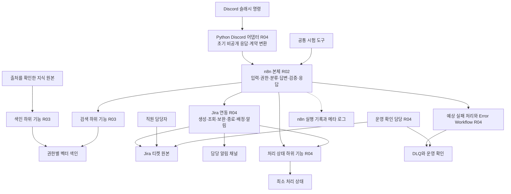
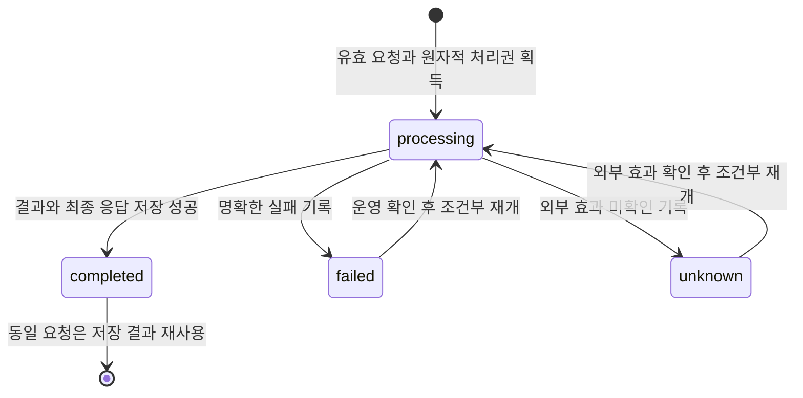
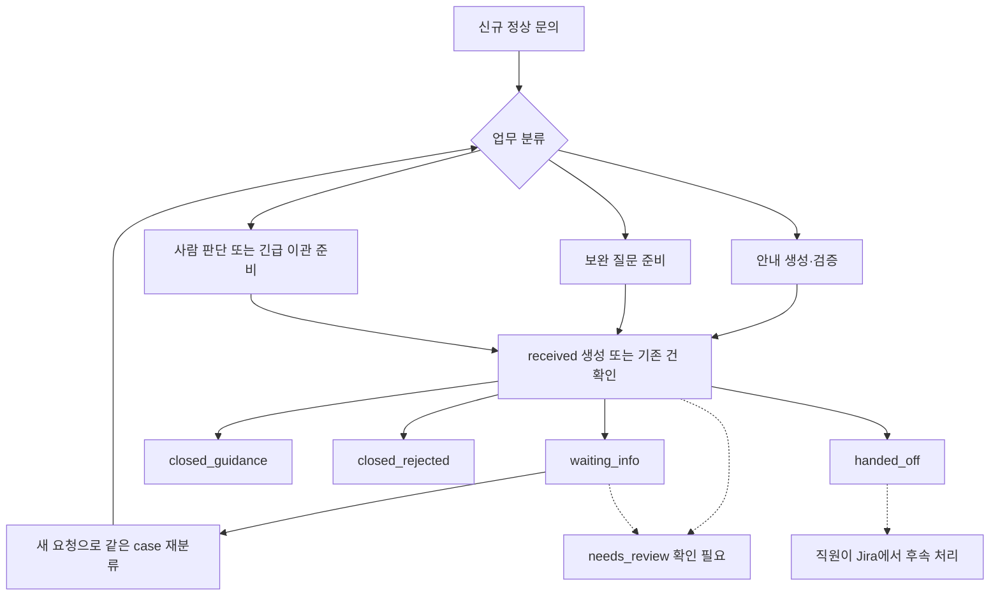

# 두바퀴 따릉이 시민 문의 지원 시스템 설계서

- 작성일: 2026-11-03 KST
- 버전·상태: v0.13 / PostgreSQL 준비·R05 시험·통합 인계 동기화 초안
- 책임: R01 통합, R02 흐름, R03 RAG, R04 연동·저장, R05 검증 공동 검토
- 상세 기준: 워크플로우 v0.14, RAG v0.10, 저장소 v0.4. RAG 교육용 원본의 VM 수동 색인·검색 부분 시험은 [최신 실행 증거](../../runs/public/20261105-111311-vm-rag-integration/report.md)를 따른다. 실제 서버 사용자 인가·공식 판정·전체 종단 연결은 미확인이다.

시민 문의를 접수하고 근거로 안내하거나 담당자에게 연결한다. 모든 정상 신규 문의는 Jira 티켓으로 관리하며, 안내 완료·보완 대기·담당자 이관을 구분한다. 팀 이름은 두바퀴, 기술 접두사는 dubakwi다. 이 문서에서 시스템 전체 구성과 기능·상태·시나리오의 관계를 파악한 뒤 담당 상세 설계로 이동한다.

현재 후보별 구현/검토·VM 적용 경계는 [팀 통합 인계](../../infra/team-integration.md)를 따른다. 사용자 API 후보는 별도 내부 공급이며 기존 과정 API는 보존한다. R04의 Jira/bind와 실제 저장 완료 경로·서버 인가·공식 시험은 미완료다.

## 1 목적과 설계 범위

대상은 대여·반납·고장·요금/환불·후속 조회·개인정보/보안의 시민 문의다. 직원은 이관된 티켓을 처리하는 담당자다. 실제 환불·요금 변경·강제 반납·원격 잠금 해제·출동 승인과 직원용 별도 업무 화면은 구현 범위에서 제외한다. 자동 종료는 안내 제공 완료를 의미하며 실제 문제 해결을 판정하지 않는다.

범위와 가정의 원본은 [주제 제안서](TOPIC.md), 역할·파일 소유권은 [팀 헌장](TEAM-CHARTER.md)이다. 이 문서는 전체 논리 구성을 소유하며 상세 필드·enum·노드·SQL을 복제 정의하지 않는다. 전체 동작을 변경하면 이 문서와 영향받는 상세 설계·시험을 함께 갱신한다.

| 관점 | 읽을 문서 | 관리하는 내용 |
| --- | --- | --- |
| 전체 시스템 | 이 문서 | 구성 경계, 상태 간 관계, 기능·시나리오 추적 |
| 업무 실행 | [워크플로우 설계](WORKFLOW-DESIGN.md) | 노드·엣지, 업무 계약, 분기 우선순위, 티켓 효과와 오류 |
| 검색 내부 | [RAG 설계](RAG-ARCHITECTURE.md) | 지식·청킹·임베딩·색인·검색·복구 |
| 저장과 복구 | [저장소 설계](STORAGE-DESIGN.md) | 처리 상태·저장 계약·DLQ·실행 기록·재처리 |
| 개발 순서 | [개발 계획 10절](../DEVELOPMENT-PLAN.md#10-공통-설계-결정과-역할별-구현-인계) | 작업·담당·선행 조건·D01~D06 결정 |

## 2 논리적 시스템 구성



화살표는 호출·조회·기록의 논리 관계다. 실제 포트·실행 순서·저장 게이트는 워크플로우 설계가 정의한다. 시민용 별도 UI는 전제하지 않으며 시험 요청 도구로 Webhook을 호출할 수 있다. 직원의 후속 작업은 Jira에서 수행한다. 직원의 실제 처리 완료를 서비스가 자동 동기화하는 별도 루프는 현재 범위에 포함하지 않는다.

| 경계 | 책임과 데이터 원본 | 주요 연결 |
| --- | --- | --- |
| 본체 | 서버 확인 사용자·권한, 처리 순서·응답 결정 | Request/Response, SearchRequest/SearchResult, TicketRequest/TicketResult |
| RAG | 공개/제한 지식 분리, 허용 근거 반환 | 근거·점수·문서/청크/버전, ok/empty/skipped/error |
| Jira 연동 | 문의 맥락·소유권·보완 횟수·담당·업무 상태 | 물리 Jira 필드를 업무 계약으로 정규화 |
| 최소 상태 | 요청 처리권·중복 판정·Jira 연결·가린 최종 응답 | StateRef와 begin/prepare/bind/save/finish/fail |
| DLQ | 실패·미확인 효과와 복구에 필요한 최소 자료 | RecoveryCapsule, 운영 claim/resolve |
| 실행 기록 | 실행 위치·시간·오류 확인 | execution_id와 가린 메타 로그 |

Jira는 채택했다. 최소 상태·DLQ의 물리 저장은 PostgreSQL 2테이블 제안이며 최종 제품·배포 방식은 D01에서 정한다. RAG 벡터 색인은 이 두 테이블과 별개다. n8n 실행 기록만으로 업무 중복 방지나 영속 복구를 보장하지 않는다.

### 2.1 Discord 이용자 채널

2026-11-03 사용자 결정으로 Discord를 이용자 입구로 채택한다. 현재 팀원이 시민을 모의하여 시험한다. 본체 공통 Webhook·Request/Response·Jira·공통 시험은 유지하고, Discord 메시지 형식만 입구/출구에서 변환한다. Discord 계정 연결은 실제 시민 본인 인증을 구현했다는 뜻이 아니다.

| 항목 | 공통 기준 |
| --- | --- |
| 구현 기본안 | Python 봇이 Gateway 상호작용을 수신하고 내부 n8n Header Auth Webhook을 호출한다. Discord HTTP Interactions Endpoint 방식과 혼용하지 않는다. SDK·실제 연결은 D07 확인 후 구현 |
| 입력 | `/문의 내용:<질문> case_ref:<선택>` 슬래시 명령 기본안. 일반 채팅 전체 수집·Message Content 특권 인텐트·첨부 수집은 기본 범위 밖 |
| 초기 응답 | 3초 안에 비공개 지연 응답(EPHEMERAL defer)을 확인한 뒤 본체 호출. 처리 중 표시는 Jira 접수 완료를 뜻하지 않음 |
| 최종 응답 | 본체의 가린 답변·출처·보완 연결값·확인된 티켓 효과를 본인 전용 응답으로 전송. 공용 채널 게시·자동 DM 대체 금지 |
| 사용자 | Discord가 확인한 user ID를 서버 설정의 모의 이용자에 매핑. 표시 이름·명령의 자기소개로 권한 부여 금지. 미등록 사용자는 거절 |
| 보완 | 응답 case_ref를 다음 명령에 명시. 본체가 서버 소유권·열림 상태·보완 횟수를 다시 확인. 별도 대화 전체 저장 테이블 추가 없음 |
| 중복·실패 | 같은 interaction ID는 같은 request_id. 최종 전송 실패는 업무 처리 실패와 구분하고 티켓/LLM 전체 재실행 금지. 조회/재시도는 기존 요청 ID와 실제 효과 확인 |
| 배포 | 기존 n8n7개 워크플로우는 유지하고 Python discord-bot 프로세스를 Compose 별도 서비스로 추가할 기본안. 외부 Gateway 연결·내부 Webhook 통신·비밀 주입을 R01/R04 검증 |
| 담당 알림 | Discord는 이용자 입구 결정이다. 직원 알림은 기존 Jira/알림 계약을 유지하며 공개 채널에 민원을 자동 전송하지 않음 |

상호작용 토큰은 공식 문서상15분 유효하지만 업무 응답 기한을15분으로 늘리지 않는다. 기존 timeout/deadline·WF-11 최종 응답 기준을 유지한다. 초기 응답 실패는 본체 실행 전에 중단하고, 전송 토큰 만료·봇 재시작 뒤 자동 재전송은 현재 보장하지 않는다. 비밀 토큰은 환경 비밀로 주입하고 원시 상호작용/토큰·실제 Discord 사용자/서버 ID를 공개 데이터·로그에 넣지 않는다.

정확한 변환 계약은 [워크플로우6.6](WORKFLOW-DESIGN.md#66-discord-입출구-어댑터), 파일 책임은 헌장, 구현/시험 선행 조건은 개발 계획 D07을 따른다. [Discord 공식 상호작용 문서](https://docs.discord.com/developers/interactions/receiving-and-responding)의3초·지연 응답·토큰 유효기간을 기준으로 하며 실제 봇 생성·서버 설치·연결은 미실행이다.

과정 검증용 data-api는 GitLab79 원본을 VM 내부망에 연결했다. 사용자 조회·메타 로그는 [후속 실행 증거](../../runs/public/20261105-114531-vm-course79-data-api/report.md)를 따른다. 이는 과정 모의 데이터/메모리 API이며 실제 Jira·영속 상태/DLQ 또는 R04 팀 권한 fixture의 완료를 뜻하지 않는다.

## 3 식별자와 공통 불변 조건

| 식별자 | 의미와 연결 규칙 |
| --- | --- |
| request_id | 한 요청의 재전송 식별자. 같은 소유자·같은 입력만 저장 결과 재사용 |
| case_id / case_ref | 논리 문의의 내부 ID / 호출자에게 반환하는 연결값. 보완은 새 request_id와 같은 case_ref 사용 |
| first_request_id | 최초 문의와 Jira 생성·재사용을 연결하는 기준 |
| ticket_id | 이번 문의의 Jira 티켓. 생성 전에는 없을 수 있음 |
| target_ticket_id | 상태를 조회할 기존 건. 이번 문의 티켓과 구분 |
| execution_id | 최초 본체 실행과 저장·DLQ·실행 기록 연결 |
| state_revision / case_version | 요청 상태의 조건부 갱신 버전 / Jira 문의 충돌 검사 버전. 서로 대체하지 않음 |

- 입력·인증·권한·주입을 먼저 검사한다. 거절할 입력을 정상 접수로 취급하지 않는다.
- 정상 신규 문의당 티켓 하나를 목표로 하며 생성 응답 유실 시 실제 효과를 확인한다. 로컬 DB와 Jira가 하나의 트랜잭션이라는 가정은 하지 않는다.
- 권한은 서버가 판단하고 검색 전에 적용한다. 타인의 건·제한 문서를 답변·티켓·알림에 노출하지 않는다.
- 외부 변경 전 처리 의도를 저장하고, 확인한 Jira ID를 즉시 보존한다. 저장 확인 없이 다음 외부 변경으로 진행하지 않는다.
- 비이관 Response.ticket은 null이다. 보완 연결은 case_ref를 사용한다. 내부에 티켓이 없다는 의미로 해석하지 않는다.
- 성공·실패·성공 여부 미확인을 구분한다. 접수 실패나 알림 수락을 실제 담당자 인수·문제 해결로 표현하지 않는다.

정확한 필드와 오류 코드는 [워크플로우 6절](WORKFLOW-DESIGN.md#6-노드-간-페이로드-연결선마다), 저장 버전·복구 자료는 [저장소 공개 계약](STORAGE-DESIGN.md#storage-contract)을 따른다.

## 4 상태와 전이

### 4.1 상태의 세 가지 축

요청 실행 상태, 티켓 업무 상태, DLQ 복구 상태는 독립적으로 관리한다. 아래 티켓 상태명은 업무 의미이며 실제 Jira 상태명·전환 ID는 D01에서 매핑한다. needs_review는 시스템의 확인 필요 판정으로, Jira에 같은 상태가 실제 존재한다는 뜻은 아니다.

| 축 | 상태 | 완료 의미 |
| --- | --- | --- |
| 요청 처리 | processing / completed / failed / unknown | completed는 이번 요청의 가린 결과 저장 완료 |
| 문의·티켓 | received / waiting_info / closed_guidance / closed_rejected / handed_off, 확인 필요 needs_review | closed_guidance는 안내 완료, handed_off는 담당 연결 효과 확인 |
| DLQ 복구 | pending / reprocessing / resolved | resolved는 해당 실패 확인·복구 결과 기록 완료 |

### 4.2 요청 처리 전이



이 도표는 저장된 상태의 전이다. 저장소 자체 장애로 failed/unknown 기록조차 실패하면 마지막 저장값이 processing으로 남을 수 있다. 응답·실행 기록·DLQ 등 가능한 경로에 확인 필요를 남기고, 오래된 processing을 자동 재실행하지 않는다.

| 전이·입력 | 조건과 수행 작업 | 금지 사항 |
| --- | --- | --- |
| 최초 → processing | 입력·사용자 확인, 요청과 활성 case의 원자적 처리권 획득 | 저장 실패 후 LLM·Jira 변경 진행 |
| processing → completed | 분기별 외부 효과 확인, 가린 최종 응답과 상태 함께 저장 | 티켓 종료와 같은 뜻으로 사용 |
| processing → failed/unknown | 확실한 실패/효과 불명을 구분, 알려진 ID·중단 위치 보존 | 이미 성공한 단계 전체 반복 |
| failed/unknown → processing | 원 실행 종료·Jira 효과·복구 자료 확인, 새 execution과 최신 StateRef 확보 | 시민 재전송에 의한 자동 복구 |
| 같은 ID 재전송 | completed는 replay, processing/failed/unknown은 pending, 소유자·입력 불일치는 conflict | 타인 결과 반환·새 티켓 생성 |

### 4.3 문의와 티켓의 업무 전이



화살표는 가능한 업무 전이다. received에서 임의 상태를 고르는 것이 아니라 다음 조건을 적용한다. 이 도표는 Jira 전환 API 호출 수나 별도 case 테이블을 정의하지 않는다.

| 목적 상태 | 전이 조건과 확인할 효과 | 요청 결과와 관계 |
| --- | --- | --- |
| waiting_info | 비긴급·보완 한도 미만·필수 정보 부족. 티켓 생성/재사용, 맥락·횟수·질문 저장 | 보완 응답 저장 후 요청 completed, 티켓은 열림 |
| closed_guidance | 허용 근거 안내·검증 통과 또는 허용된 본인 상태 안내. 생성·문맥·외부 종료 확인 | 최종 저장 후 요청 completed |
| closed_rejected | 정상 접수된 건의 조회 권한 거절 등 종료 정책에 해당. 제한 내용 없는 거절 맥락·종료 확인 | 접수 전 입력 거절과 구별. 상세 분기는 워크플로우 적용 |
| handed_off | 사람 판단·보완 한도·근거 부족·검증 실패·긴급. 생성/재사용·맥락·담당 지정·알림 수락 확인 | 요청 completed 가능, 실제 직원 업무는 계속됨 |
| needs_review | 생성·종료·배정·알림·저장 중 실패/미확인 | 성공 상태를 추정하지 않고 요청 failed/unknown 및 복구 경로로 연결 |

보완 요청은 소유자와 현재 Jira 상태를 재확인한다. 종료된 case_ref는 자동 재개하지 않고409로 새 문의를 안내한다. 새 문의는 case_ref를 생략하고 이전 번호를 context에 참조할 수 있다. 직원이 Jira에서 완료한 건도 다음 조회 시 실제 상태를 읽는다.

### 4.4 DLQ 전이

pending → reprocessing은 운영자가 외부 효과·복구 자료와 처리권을 확인했을 때만 허용한다. 확인/재처리 성공 시 resolved로, 다시 실패하면 pending으로 돌아가 시도·사유를 갱신한다. manual_required는 복구 캡슐의 모드이며 별도 DLQ 상태가 아니다. 자료가 부족하면 같은 작업의 자동 재실행을 하지 않는다. 상세 조건은 [저장소 4절](STORAGE-DESIGN.md#4-dlq-설계와-재처리)을 따른다.

## 5 대표 시나리오와 종료 조건

분류 우선순위는 긴급 → 분류/정책 실패 → 보완 한도 → 필수 정보 부족 → 사람 판단 → 검색이다. 비긴급 사람 판단 건도 필수 정보가 없으면 먼저 보완하며 긴급 건은 보완을 기다리지 않는다.

| 시나리오 | 시작과 처리 순서 | 티켓·저장·이용자 결과 | 근거와 시험 |
| --- | --- | --- | --- |
| S1 근거 안내 | QR 대여 방법 문의 → 입력/분류 → RAG → 답변 → 검증 → 티켓 생성·종료 → 최종 저장 | closed_guidance, 요청 completed, 자동 답변·sources | U17~U20, WF-01 |
| S2 보완 | 반납 미확인인데 장소/시각 부족 → 질문 준비 → 티켓 생성·보완 대기 → 응답. 다음 요청은 새 request_id+같은 case_ref로 재분류 | waiting_info, 각 응답 요청 completed. 충분해지면 S1/S3, 한도면 이관 | U27/U28/U30, WF-02/02b |
| S3 사람 판단 | 개별 환불·현장 조치 요청 → 필요 사실 확보 → 이관 준비 → 생성/재사용·맥락·배정·알림 → 저장 | handed_off, 요청 completed. 실제 환불·출동 완료라고 답하지 않음 | U22/U31, 팀 사례 |
| S4 본인 상태 | 기존 문의 상태 요청 → 소유권 있는 대상 조회 → 고정 안내 → 이번 조회 문의 티켓 생성·종료 → 저장 | 이번 건 closed_guidance, 대상 건 변경0. 타인 건은 제한 내용 없이 거절 | U37/U38, WF-06/07 |
| S5 긴급 복합 | 사칭 링크 입력+본인 반납 문의 → 긴급 티켓·배정·알림 우선 → 초동 근거 검색·본인 조회 → 고정 안내·후속 맥락 저장 | handed_off 유지, 재생성·재알림0. 후속 조회 실패가 최초 이관 성공을 취소하지 않음 | U40+U37, WF-12 |
| S6 근거/검증 불충분 | 정상 검색 empty 또는 답변 검증 실패 → 추측 안내 중단 → S3 이관 | 담당자 이관, 빈 근거면 sources=[], 실제 연결 효과 확인 | WF-03, 팀 검증 실패 |
| S7 거절·재전송 | 입력 오류·주입은 접수 전 거절. 같은 요청은 소유자/입력/상태 대조 후 replay/pending/conflict | 거절 건 신규 업무 티켓0, 재전송 중복 효과0 | WF-08/09/13, 팀 충돌 |
| S8 부분실패와 복구 | Jira 생성 응답 유실 또는 생성 뒤 저장 실패 → known ID/효과 보존 → 실패·미확인/DLQ → 운영 확인·조건부 재개 | 미확인을 성공으로 응답하지 않음. 이미 생성한 건 확인 후 남은 단계만 | WF-04/10/11, 팀 저장 장애 |

S1~S5는 [워크플로우 정상 시나리오](WORKFLOW-DESIGN.md#22-분류에서-갈라지는-정상-업무)와 같은 ID다. S6~S8은 이 문서의 보조 시나리오이며 n8n 노드 ID가 아니다. 위 표는 시험 파일의 질문·기대값을 대체하지 않는다.

## 6 기능과 구현 추적

| 기능 ID | 제공 기능과 입출력 | 담당·상세 구현 위치 | 시나리오·시험 연결 |
| --- | --- | --- | --- |
| F01 | Request 검사·서버 사용자/권한 확인 → 허용 Ctx 또는 거절 | R02/R04, 본체 입력·권한 노드와 워크플로우 5~6절 | 전체, WF-05/08/13 |
| F02 | 요청/입력·case_ref → 처리권·replay/pending/conflict | R04, state 및 저장소 3/6절, 본체 B07~B09 | S2/S7/S8, WF-09 |
| F03 | 질문·서버 맥락 → 유형·긴급·부족 정보·사람 판단 | R02, B10/B11 이후 분기·워크플로우 4절 | S1~S6, WF-02/02b/12 |
| F04 | 문서 → 권한별 색인, SearchRequest → SearchResult | R03, index/search 및 RAG 설계 | S1/S5/S6, WF-01/03/05/12 |
| F05 | 허용 근거 → 답변·검증 결과 → 안내 또는 이관 | R02, B19~B21 및 분기 | S1/S6, WF-01/10, 팀 검증 실패 |
| F06 | 조회 대상·서버 owner → 허용 record/denied/error | R04 어댑터/R02 안내, LookupResult·B24 | S4/S5, WF-06/07/11/12 |
| F07 | TicketRequest → 생성/보완/종료/배정/알림의 확인 효과 | R04, handoff H 노드·워크플로우 4/6절 | S1~S6/S8, WF-02b/04/09/12 |
| F08 | 최신 StateRef·의도/ID/결과 → 저장 확인·최종 Response | R04 저장/R02 연결, state·B32·H14~H20·저장소 6절 | 전체, 팀 bind/finish 실패 |
| F09 | 실패/미확인 효과 → DLQ·운영 확인·조건부 복구 | R04/R05, X/E 노드·dlq/errors·저장소 4절 | S8, WF-04/10/11, 팀 재처리 |
| F10 | 실행·메타 정보 → 가린 기록·측정·시험 증거 | 전원/R05 취합, 워크플로우 7절·저장소 5절 | 공통14유형·팀5개 이상 |

생산자·소비자는 단일 원본의 계약을 따른다. 내부 청킹·프롬프트·SQL 선택은 담당자가 상세화하며, 공개 필드·성공 의미·권한·전이 조건을 바꾸면 R01과 영향받는 역할·R05가 함께 검토한다. 기능 ID는 이 문서의 추적용이며 이전 검증 보고서의 F01~F07 지적 번호와 별개다.

## 7 가이드와 조사 적용

| 기준 | 적용 위치와 의미 |
| --- | --- |
| [참조 구조 — 공개본 제외 자료](../../docs/PUBLIC-SOURCES.md) | 입력·분류·RAG·답변·검증·티켓·기록의 기본 순서와 3개 AI 역할. 모든 정상 신규 문의 티켓화는 팀의 추가 정책 |
| [시나리오·공통 판정 — 공개본 제외 자료](../../docs/PUBLIC-SOURCES.md) | 공통14유형의 조건·판정 유지. 시민 주제의 질문·모의 기록으로 변환 |
| [RAG 가이드 — 공개본 제외 자료](../../docs/PUBLIC-SOURCES.md) | 같은 질문으로 청킹 비교·모델/차원/점수·복구 시간/비용 측정. 결과는 RAG 설계에 반영 |
| [안정성·보안 — 공개본 제외 자료](../../docs/PUBLIC-SOURCES.md) | 예상 오류와 Error Workflow 분리, 멱등 재시도·권한·가림·DLQ |
| [시험 가이드 — 공개본 제외 자료](../../docs/PUBLIC-SOURCES.md) | 공통14+팀5 이상, LLM3회 반복, 정상/예외/이관 로그와 실패2건 이상 재시험 |
| [조사 시나리오 — 공개본 제외 자료](../../docs/PUBLIC-SOURCES.md)·[출처 원장 — 공개본 제외 자료](../../docs/PUBLIC-SOURCES.md) | U17~U40 중 선택 범위를 TOPIC·워크플로우 1절로 연결. 후보100개 전체 구현을 요구하지 않음 |

공개 조사로 기관 내부 담당 배정·환불 승인·보안 SOP를 확정하지 않는다. 서비스 지식에는 출처·확인일·적용 범위와 가상 정책을 표시한다. 자료 목록 확인(P01)은 필요한 기능을 찾는 출발점이며 전체 재사용·선행 실행 확정이 아니다.

## 8 역할별 착수와 남은 공통 결정

R02는 합의한 계약의 모의 하위 응답으로 정상 흐름을 구현하고, R03은 지식·검색 비교를, R04는 실제 Jira·물리 저장의 작은 연결 검증을, R05는 구현 전 기대 결과를 준비할 수 있다. R01은 환경·공통 결정과 통합 순서를 관리한다. R04의 Jira·상태·DLQ 작업은 범위가 넓으므로 일정과 지원은 개발 계획에서 조정한다.

| 실제 연결 전 결정 | 연결 작업 |
| --- | --- |
| Jira 프로젝트·소유권/문의 필드·상태 전환·역할, 물리 저장·원자성·보존 | D01/D06, R04·R01 및 소비 역할 |
| case_ref·추가 응답 필드와 공통 시험 도구 호환 | D02, R02·R05 |
| n8n 실제 버전·원시 출력·AI 연결·실행 저장/가림 | D03, R02~R05 |
| 지식·권한 매핑·검색 설정·버전 전환과 측정 | D04, R03·R04·R05 |
| 단계별 timeout·전체 한도·재시도·복구 효과 | D05, R02·R04·R05 |

먼저 S1 한 건을 검색→검증→Jira 생성/종료→최종 저장→응답까지 연결한다. 이후 S2~S5와 오류·복구를 확장하며, 공통 시험 판정은 유지한다. 설계 기준은 모의 연결·작업 계획에 사용하고 실제 외부 효과·성능·검색 품질은 실행 증거로 확정한다.

## 9 프로젝트 경로와 배포 구조

Docker Compose를 채택한다. 디렉터리와 파일 용도의 원본은 이 절, 정확한 편집 소유자·검토자는 [헌장 1절](TEAM-CHARTER.md#1-팀), 작업 절차는 [루트 AGENTS](../../AGENTS.md), 실행·복구는 [infra 안내](../../infra/README.md)가 관리한다. 생성 예정 파일은 코드 경로로 표시하며, 존재하지 않는 파일을 완료 산출물로 표시하지 않는다.

```text
proj_team2/
├─ README.md / AGENTS.md / .gitignore
├─ pyproject.toml / uv.lock / .python-version # Python3.12·uv·Ruff 공통 설정
├─ .github/workflows/quality.yml    # 린트·포맷·문서·공개 도구 CI
├─ src/ttareungi_support/           # 업무 Python 로직 작성 시 생성
├─ tests/                          # 업무 로직 시험 작성 시 생성
├─ dist/public/                    # 검토용 공개본 생성 결과, Git 제외
├─ .env.example                    # Webhook·PostgreSQL 준비 설정 이름, 실제 비밀은 제외
├─ workflows/                      # 7개 n8n JSON, 구현 시 생성
│  └─ dubakwi-{support,index,search,handoff,state,dlq,errors}.json
├─ knowledge/                      # 지식 작성 시 생성
│  ├─ manifest.json
│  ├─ public/
│  └─ restricted/
├─ data/
│  ├─ users.json / records.json     # 모의 입력 작성 시 생성
│  └─ research/                     # 기존 수집·분석 원본 유지
├─ cases/common.json / team.json    # 검토 전 시험 명세
│  └─ team-extended.json            # R05 새 형식 후보, 다단계/운영자 시험
├─ requests/                        # 개별/시연 입력 작성 시 생성
├─ runs/public/<실행묶음ID>/summary.json   # 실제 시험 시 생성
├─ scripts/
│  ├─ research/                     # 기존 도구 유지
│  ├─ dev/                          # 개발·배포 도구 추가 시 생성
│  └─ test/                         # 시험·측정 도구 추가 시 생성
├─ infra/
│  ├─ README.md / vm-preflight.md  # 운영 기준·기존 VM 점검/인계
│  ├─ compose.yaml                  # VM 설정 확인 후 작성
│  ├─ postgres-compose.yaml         # PostgreSQL만 추가하는 검토용 준비본, VM 미적용
│  ├─ postgres-deployment.md        # DB/권한/백업·복원/Credential 조건·R04 검토
│  └─ db/migrations/                # 물리 DB 채택 후 생성
├─ docs/
│  ├─ guideline/ / research/        # 기존 원문·조사 유지
│  ├─ DEVELOPMENT-PLAN.md / PRESENTATION-PLAN.md
│  └─ project/                      # 팀 산출물·검토·데일리·발표
└─ tmp/                             # 임시 작업, 필수 실행 의존성 제외
```

| 경로 | 용도와 원본 경계 | 책임 참조 |
| --- | --- | --- |
| 루트 README·AGENTS·.gitignore·.env.example | 진입 안내·공동 규칙·비밀/생성물 제외·확인한 환경 설정 예시 | R01, 헌장 경로표 |
| pyproject.toml·uv.lock·.python-version·.github/workflows/quality.yml | Python3.12·uv 잠금·Ruff 린트/포맷·CI. 로컬/CI 공통 명령 | R01, R05 품질 검토 |
| src/ttareungi_support/channels/discord_bot.py·tests/channels/test_discord_bot.py | Discord Gateway 입출구·defer·사용자/계약 변환·전송과 경계 시험. 구현 시 생성 | R04 구현·R02 계약/R01 배포·R05 시험 |
| src/ttareungi_support/·tests/ | 향후 Python 업무 코드와 시험. n8n 호출/배포 경계는 구현 전 계약화 | 기능별 R02/R03/R04, 시험 R05 |
| scripts/dev/public-files.json·export_public.py·dist/ | 선택적 ZIP 도구 목록·내보내기·생성 결과. 일상 Git 공개 범위는 .gitignore 기준 | R01, R04 비밀·R05 재현 |
| workflows/ | n8n 실행 JSON. 내보낸 버전과 VM 연결을 함께 관리 | 본체 R02, 검색/색인 R03, 연동/상태/DLQ/오류 R04 |
| knowledge/manifest.json·public/·restricted/ | 문서/출처/권한/버전 목록과 서비스 지식. 폴더 분리와 검색 전 권한 판정 병행 | R03, 권한 검토 R04 |
| data/users.json·records.json | 시민·소유권·업무 기록 모의 입력. 실제 상태 DB·Jira 사본 아님 | R04 |
| cases/·requests/ | 기대 결과를 가진 반복 시험 / 개별 실행·시연 요청 | R05 |
| runs/public/·runs/<실행묶음ID>/ | 검토한 가린 JSON/Markdown 공유 / 원시·비공개 결과 로컬 보존. summary와 상세 결과 구분 | R05, 구현 역할 증거 제공 |
| scripts/dev/·scripts/test/ | 실행/배포 보조 / 시험·측정 재현 도구. 사용법은 scripts README에 연결 | R01 / R05, 도메인 검토 역할 지정 |
| infra/compose.yaml·README·vm-preflight.md | n8n 단일 인스턴스·볼륨·네트워크·선택 DB의 배포/복구 | R01, 저장 검토 R04 |
| infra/postgres-compose.yaml·postgres-deployment.md | 기존 n8n 유지·별도 PostgreSQL project·파일 비밀·external 볼륨·준비/적용 조건 구분 | R01, 저장/권한 검토 R04·복원 검증 R05 |
| infra/db/migrations/ | 채택한 물리 저장의 버전별 스키마 변경 | R04, 배포/복구 검토 R01 |
| docs/project/ | 시스템·상세 설계·결과·증거 화면·이력. 문서별 원본 관계 유지 | 헌장 문서 소유권 |
| docs/guideline·docs/research·data/research | 기존 요구·조사 원본. 서비스 입력으로 필요한 부분만 선별 | 기존 영역 규칙과 헌장 경로표 |
| tmp/ | 일회성 조사·검사·작업 파일. 검토 후 필요한 도구/증거만 정식 위치로 이동 | 생성 역할, 공통 정리 R01 |

운영 데이터·Docker 볼륨·DB 백업·환경 비밀은 Git 밖에서 관리한다. `runs/`는 가린 시험 증거만 보관한다. 전체 서비스 DB나 원시 실행 데이터를 저장소에 복제하지 않는다. 물리 DB는 미채택이며 compose·이미지/환경 설정 확정은 개발 계획 D01/D03과 P04/P12의 선행 조건이다.

Python 실행/의존성·린트·포맷은 [Python 개발 기준](../PYTHON-DEVELOPMENT.md), 공개 대상/제외·원문 링크 전환은 [공개 정책](../PUBLICATION.md)이 원본이다. Python을 사용해도 n8n 중심 흐름은 유지한다. Discord Gateway 봇 서비스는2.1의 기본안이며 그 밖의 독립 API 서버/컨테이너는 별도 설계한다. 기존 조사·원문은 로컬에 보존하고, 현재 폴더의 .gitignore로 선별한 팀 문서·도구만 Git 추적한다. 로컬 원문·비밀은 제외하며 ZIP은 선택 사항이다.

기존 VM n8n의 Compose와 데이터 볼륨을 유지한다. 로그인 사용자 홈의 dubakwi/deploy·backups·evidence는 Git 밖 운영 자료 경로이며 권한700으로 준비했다. 기존 설치·볼륨을 이곳으로 옮긴 것은 아니다. 새 infra/compose.yaml은 검토된 배포 구성 확정 후 작성하며 현재 실행 원본으로 사용하지 않는다. 확인 범위와 인계 조건은 [배포 전 점검](../../infra/vm-preflight.md), 작업 상태는 개발 원장이 관리한다.

후속 [PostgreSQL 독립 배포 준비](../../infra/postgres-deployment.md)는 구체적인 검토 자료다. D01 물리 DB 채택·PR #23 수정 통과·R04 저장/권한 검토와 실제 VM 자원/아키텍처 확인 전에는 DB 기동·Credential 등록·P19 전환을 하지 않는다. 검토용 Compose 문법 통과를 VM 실행 증거로 쓰지 않는다.

## 10 변경 기록

| 날짜 | 버전 | 내용 |
| --- | --- | --- |
| 2026-11-05 | v0.13 | main의 PostgreSQL 준비·R05 사례/시험과 통합 인계 기록을 함께 보존. 후속 VM 실행은 PR #32~#35에서 구분 |
| 2026-11-05 | v0.12 | 사용자 API·상태/DLQ·Jira 통합 게이트와 실제 배포/검토 경계 연결 |
| 2026-11-05 | v0.12 | PostgreSQL 독립 Compose·배포 준비/검토 경로 추가. n8n 유지·미적용/DB 채택 조건·R04/R05 검토 경계 유지 |
| 2026-11-05 | v0.11 | GitLab79 과정 모의 API 연결·사용자 조회/로그 저장 증거 연결. 실제 Jira·영속 저장·팀 권한은 후속 |
| 2026-11-05 | v0.10 | R01 VM 수동 색인/실제 검색 부분 증거 연결. data-api 부재·인가/공식 판정/전체 종단 미완료 유지 |
| 2026-11-04 | v0.9 | 기존 VM 유지·운영 자료 경로·P04 점검/인계와 환경 예시 구분 반영 |
| 2026-11-03 | v0.8 | P08 검토용 초안과 서비스 색인 원본의 경계를 RAG v0.8에 연결. 구성·계약 변경 없음 |
| 2026-11-03 | v0.7 | 두바퀴/dubakwi 확정·워크플로우/웹훅/색인 명명·현재 문서 참조 동기화 |
| 2026-11-03 | v0.6 | 팀 첫 실행/PR·가린 텍스트 공유 경로, 보완 횟수 전달·replay 표시·공통14 판정 인계 보완 |
| 2026-11-03 | v0.5 | Discord 채택·Python Gateway 봇 기본안·비공개 응답/사용자 매핑·담당/시험/배포 경계 연결 |
| 2026-11-03 | v0.4 | 로컬 원문은 유지하고 .gitignore와 실제 Git 후보·공개 참조 완결성 검사로 전환. ZIP은 선택적 이력 |
| 2026-11-03 | v0.3 | Python3.12·uv·Ruff·CI·업무 코드 예정 경로·공개 허용 목록/패키지 분리 기준 추가 |
| 2026-11-03 | v0.2 | Docker Compose 채택·경로별 용도·책임 원본·운영 규칙/개발 의존성 연결 |
| 2026-11-03 | v0.1 | 기존 상세 설계를 연결하는 최상위 구성·상태·시나리오·기능 추적 문서 작성 |

[산출물 목록과 원본 관계](README.md) · [주제](TOPIC.md) · [팀 헌장](TEAM-CHARTER.md)

- 2026-11-05 기준 참조 갱신: PR #10의 RAG v0.9 교육용 로컬 구현을 연결한다. 시스템 구성·공개 계약 변경과 서비스 검증 완료를 뜻하지 않는다.
