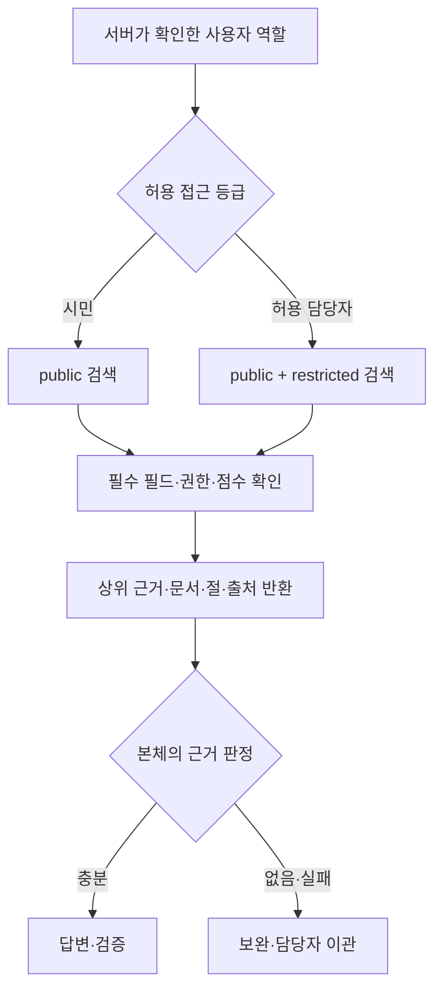

# RAG 아키텍처 설계서 · 두바퀴

> 공개용 최종본 · 계정/접속 정보와 원문 화면은 제외했습니다. 원본은 로컬 보존하며 검증 수치·미실행 판정은 유지합니다.

최종 제출본 v1.0 · 2026-11-09 KST · R03 자료 기반 R01 취합

**허용된 자료에서 근거를 찾고, 출처를 확인할 수 있을 때만 안내한다.** 실제 안내와 교육용 가상 설정을 섞지 않고, 검색 권한을 답변 생성 전에 제한한다.

| 현재 상태 | 확인한 범위와 한계 |
| --- | --- |
| 지식 | 문서 8개(공개 6·제한 2), 준비 청크 44개(공개 36·제한 8). manifest는 여전히 승인 대기·index_enabled=false이며 명시적 교육용 demo 준비로 사용 |
| 실제 검색 저장소 | VM PR36도 n8n Simple Vector Store의 프로세스 메모리. PostgreSQL은 업무 상태/DLQ용이며 pgvector 배포 완료가 아님 |
| 최신 기능 시험 | 11/08 PR36 검색·권한 사례 16/16 기대 충족, QR·긴급 보안 Support 종단 별도 확인 |
| 복구 관측 | 11/08 n8n 재시작 뒤 대응 PR36 index의 UI 44 items 성공, QR 출처 응답 확인 |
| 미측정 | 저장된 최종 벡터 총수의 독립 조회, 정확한 VM 색인 시간·토큰·청구 비용. UI items 수로 대체하지 않음 |
| 문서 관계 | [상세 설계와 날짜별 기록](../../../docs/project/RAG-ARCHITECTURE.md), [전체 사례 근거표](../../../runs/public/20261109-112300-local-final-closeout/evidence-matrix.md)를 보존 |

## 1. 원본 문서

| 항목 | 내용 |
| --- | --- |
| 업무 지식 | 시민용 대여·반납·고장 신고·요금/환불·개인정보/보안·후속 문의 6개, 담당자용 가상 이관·티켓 수명주기 정책 2개 |
| 원자료 | 팀이 수집한 따릉이 앱 FAQ·화면과 공개 안내. 실제 내부 SOP가 없는 부분은 교육용 가상 설정 |
| 색인 입력 | UTF-8 Markdown. 문서 제목·절·문단·목록 구조. 원문 HTML/사진을 직접 색인하지 않음 |
| 원본 관리 | [knowledge/manifest.json](../../../knowledge/manifest.json)의 경로·SHA-256·버전·출처·권한·승인 상태. [public](../../../knowledge/manifest.json)과 [restricted](../../../knowledge/manifest.json) 분리 |
| 길이 실측 | 2026-11-05의 8개 Markdown: 최소 405자·중앙 1,049자·최대 2,385자. 줄바꿈 포함 문자 수이며 토큰 수가 아님 |
| 언어 | 한국어 중심, QR 등 일부 영문 용어. 언어별 비율 미측정 |
| 기준 시점 | manifest의 문서 확인일과 draft 버전을 유지. 제출일을 근거 자료의 최신성 재검증일로 바꾸지 않음 |
| 승인·갱신 | 출처/정책 변경 시 검토→원본/manifest 갱신→재색인→검색 검증. 정기 주기·실서비스 승인 미확정 |

기관의 실제 정책과 팀의 가정을 구분하기 위해 최종 청크에도 `[실제 안내]`와 `[가상 설정]`을 유지한다. 공개 자료라도 현재 적용 조건을 확인하지 못한 내용을 공식 확정 정책으로 설명하지 않는다. 제한 정책은 공개 청크에 합치지 않는다.

## 2. 전처리 및 청킹

### 2.1 준비 과정

- 절 안의 문단·목록을 의미 단위로 유지하고 혼합된 실제 안내·가상 설정을 분리한다.
- 문단 사이 오버랩은 0이다. 짧은 안내의 중복을 늘리기보다 제목·절·출처 메타데이터로 문맥을 보존한다.
- 문서 제목과 절은 메타데이터에 저장한다. 임베딩 본문에 제목을 항상 접두사로 넣었다고 설명하지 않는다.
- 준비 청크는 44개지만 n8n 로더가 추가 분할할 가능성이 있어 이를 최종 벡터 저장 개수와 동일시하지 않는다.

### 2.2 비교 방법과 실제 결과

| 항목 | 채택한 절·문단 단위 | 절 전체 비교안 |
| --- | --- | --- |
| 전체 준비 청크 | 44 = 공개 36 + 제한 8 | 41 = 공개 33 + 제한 8 |
| 길이 최소 / 중앙 / 최대 | 61 / 124.5 / 251자 | 61 / 123 / 364자 |
| 문단 오버랩 | 0 | 동일 절을 결합한 구조 비교 |
| 직접 검색 비교의 대상 | 공개 36개만 | 공개 33개만 |
| 같은 13개 정상 질문의 문서 hit@3 | 13/13 | 13/13 |
| 같은 질문의 절 hit@3 | 13/13 | 13/13 |
| 별도 무관 질문 WF03 | empty | empty |
| 선택 근거 | 실제 안내와 가상 설정의 경계를 보존 | 3개 절에 두 종류가 섞임 |

**hit@3**는 검색 상위 3개 안에 기대 문서 또는 기대 절이 들어왔는지를 세는 지표다. 13/13은 제한된 정상 질문의 검색 결과이며 답변 정확도 100%나 전체 서비스 성공률이 아니다.

11/05 비교는 같은 공개 질문과 직접 임베딩 API·Python cosine을 사용했다. 구조 44 대 41은 전체 문서 기준, 검색 비교 36 대 33은 public-only 기준이다. 제한 자료까지 검색한 실험이나 n8n/VM 전체 실행의 비교가 아니다. 동일한 hit@3 때문에 더 빠르거나 더 정확하다고 결론 내리지 않고, 정보 유형을 섞지 않는 이유로 절·문단 방식을 선택했다. [비교 원시 요약](../../../runs/public/20261105-120437-chunk-retrieval-comparison/summary.json)

## 3. 임베딩

| 항목 | 선택·관측 | 한계 |
| --- | --- | --- |
| 모델 | `text-embedding-3-large`. 과정 구성과 n8n 호환성을 바탕으로 실제 호출한 모델 | 팀의 한국어 질문에서 다른 모델보다 우수하다는 비교는 미실행 |
| 차원 | 3,072. 로컬 실행에서 반환 벡터 1개의 길이 확인 | 모든 VM 벡터를 다시 열어 차원을 전수 검사한 것은 아님 |
| 유사도 | cosine similarity, 큰 점수가 우선. 로컬 n8n 1.120.4 LangChain 구현 확인 | 현 VM 라이브러리 전체 해시 동일성은 미확인 |
| 검색 개수 | 허용된 공개/제한 저장소 각각 5개, 취합 후 상위 5개 | top_k 3 대 5 품질 비교 미실행 |
| 최소 점수 | 0.30, 교육용 제한 평가의 임시값 | 사실 정확성의 보증값 아님. 출처·권한·후속 검증을 함께 적용 |
| 토큰·비용 | 11/05 직접 청킹 비교 실험 사용량 9,426토큰 | VM 전체 색인·최종 발표 운영의 토큰/청구 금액은 미측정. 실험 사용량을 운영비로 옮기지 않음 |

차원 근거는 [임베딩 확인 기록](../../../runs/public/20261105-110303-local-rag-embedding-audit/summary.json)이다. 모델·차원·청킹·전처리 버전은 색인과 검색에서 같아야 한다. 하나가 바뀌면 기존 벡터를 섞지 않고 다시 생성한다. 현재 가격 조회나 실제 청구 내역 확인 없이 예상 비용을 실측 금액으로 제시하지 않는다.

## 4. 인덱스 및 메타데이터

### 4.1 실제 구성과 접근 통제

역할은 요청 문장이나 클라이언트 자기소개에서 가져오지 않는다. 서버에서 확인한 `access_levels`로 검색 전에 memory key를 선택한다. 검색 결과를 받아 나중에 감추기만 하는 방식이 아니다. 제한된 권한 시험과 담당자 양성 대조를 구분해 확인했다.

| 구분 | 현행 |
| --- | --- |
| 저장소 | n8n Simple Vector Store / 프로세스 메모리 |
| 권한 분리 | public·restricted·readiness 키. 논리적 분리이며 분산 샤딩 아님 |
| VM 계열 | legacy와 PR36 전용 index/search는 서로 다른 namespace. PR36 Support B14와 대응 PR36 index를 한 쌍으로 사용 |
| 메타데이터 | doc, title, section, chunk_id, access_level, type, version, source_url, source_checked_at |
| 반환 Evidence | doc, section, chunk_id, text, score, access_level, version; source_url/applies_to/source_checked_at 선택 |
| 미구현 | updated_at·제품군 필터, 일반 중복 청크 제거의 보장, 버전 alias 원자 전환, 영속 벡터 DB |

### 4.2 실제 노드와 계약

index는 11개 노드·14개 연결, search는 19개 노드·25개 연결이다. 모든 실제 이름과 포트는 [로컬 JSON 목록](../../../runs/public/20261109-112300-local-final-closeout/workflow-map.md)에 있다. [상세 설계 4절](../../../docs/project/RAG-ARCHITECTURE.md#4-인덱스-및-메타데이터)에 내부 스키마와 연결별 변환을 보존한다.

| 경계 | 내용 |
| --- | --- |
| 본체 → 검색 | request_id:string, enabled:boolean, query:string, access_levels:string[], deadline_at:string |
| 입력 검사 → 검색 분기 | false면 skipped, 잘못된 접근 등급·준비 상태면 error. 허용 key만 선택 |
| 검색 결과 → 정규화 | document+metadata를 Evidence로 매핑, 필수 필드·권한·점수 검사 후 상위 근거 반환 |
| 검색 → 본체 | request_id, status:ok/empty/skipped/error, evidence:array, error_code:string/null인 객체 1개 |
| 본체 → 답변/이관 | ok의 충분한 근거만 생성·검증에 사용. empty/error는 사유를 구분하여 정책 적용 |

RAG는 Jira 티켓을 만들거나 업무 route를 확정하지 않는다. 담당자 이관은 본체의 정책이며 검색은 근거와 상태를 반환하는 도구다. 공개 계약의 원본은 [워크플로우 설계서](WORKFLOW-DESIGN.md#6-노드-간-페이로드-연결선마다)다.

### 4.3 최신 결과의 해석

- 11/08 13:14의 다른 검색 경로는 15/16이었다. SR-WF12의 raw query에서 기대 절이 빠진 최초 결과를 보존한다.
- Support가 의도를 변환한 보안 문의는 기대 근거와 긴급 이관 종단을 확인했다. raw search와 사용자 전체 경로를 같은 시험으로 바꾸지 않는다.
- 14:22의 **대응 PR36 search 16개 사례**는 16/16 기대 충족이었다. 공개/제한 권한·인용 대상·empty/invalid/off 경계를 포함한다. [최신 matrix](../../../runs/public/20261108-142200-vm-pr36-rag-full-matrix/report.md)
- 11/09 QR 리허설은 `rental-guide` 출처를 포함한 자동 답변을 확인했다. 해외 이용 질문은 근거 없음으로 이관했고 저장/감사 사유 `no_evidence`를 확인했다. [서버 대조](../../../runs/public/20261109-001140-vm-demo-rehearsal/backend-followup.md)

## 5. 백업 · 복구 및 확장

| 항목 | 실제 상태 | 운영 방향·미구현 경계 |
| --- | --- | --- |
| 원본 보존 | 지식 Markdown·manifest·workflow JSON을 버전 관리 | 원문 첨부와 비공개 실행 자료는 별도 로컬 보존 |
| 메모리 소실 | 프로세스 재시작 시 벡터 메모리 유지 보장 없음 | 대응 버전 전량 재색인 후 ready·공개/제한 probe 확인 |
| 복구 시험 | 11/08 재시작 뒤 PR36 index UI 44 items 성공, QR 기능 회복 | 44는 처리 입력 수 관측. 저장 벡터 전수 개수·정확한 소요시간 미측정 |
| 실행 메타데이터 | UI 성공·기능 성공과 SQLite running/stoppedAt=null 잔류 불일치 | 원인 미확정. 기능 결과와 색인 lifecycle을 분리 기록 |
| 롤백·부분 실패 | 원본 버전으로 재생성하는 절차 방향 | alias 전환·부분 배치 재시도·무중단 롤백은 미구현 |
| 영속화 | 업무 상태/DLQ는 PostgreSQL | RAG의 PostgreSQL+pgvector는 후속 설계이며 현재 구현으로 표시하지 않음 |
| 10배·100배 | 분포가 같다는 가정에서 약 440/4,400 준비 청크 | 시간·비용·품질·메모리 사용량을 배수로 확정하지 않음. 실측 후 배치/필터/파티션 검토 |

복구 증거는 [11/08 PR36 재시작·재색인](../../../runs/public/20261108-140200-vm-pr36-rag-recovery/report.md)이다. 11/07 PostgreSQL 복원 시험과 n8n 볼륨 격리 확인은 업무 데이터/인프라 증거이며 RAG 메모리의 영속 백업 시험과 같지 않다.

발표 5~6장은 ‘정보의 경계를 보존한 지식 준비 → 권한을 확인한 검색 → 근거 기반 답변’의 두 장으로 설명한다. 청킹 비교와 시연·시험 수치는 서로 다른 조건임을 발표자 메모에 명시한다. [발표자 메모](../presentation/team-presentation/speaker.html)
