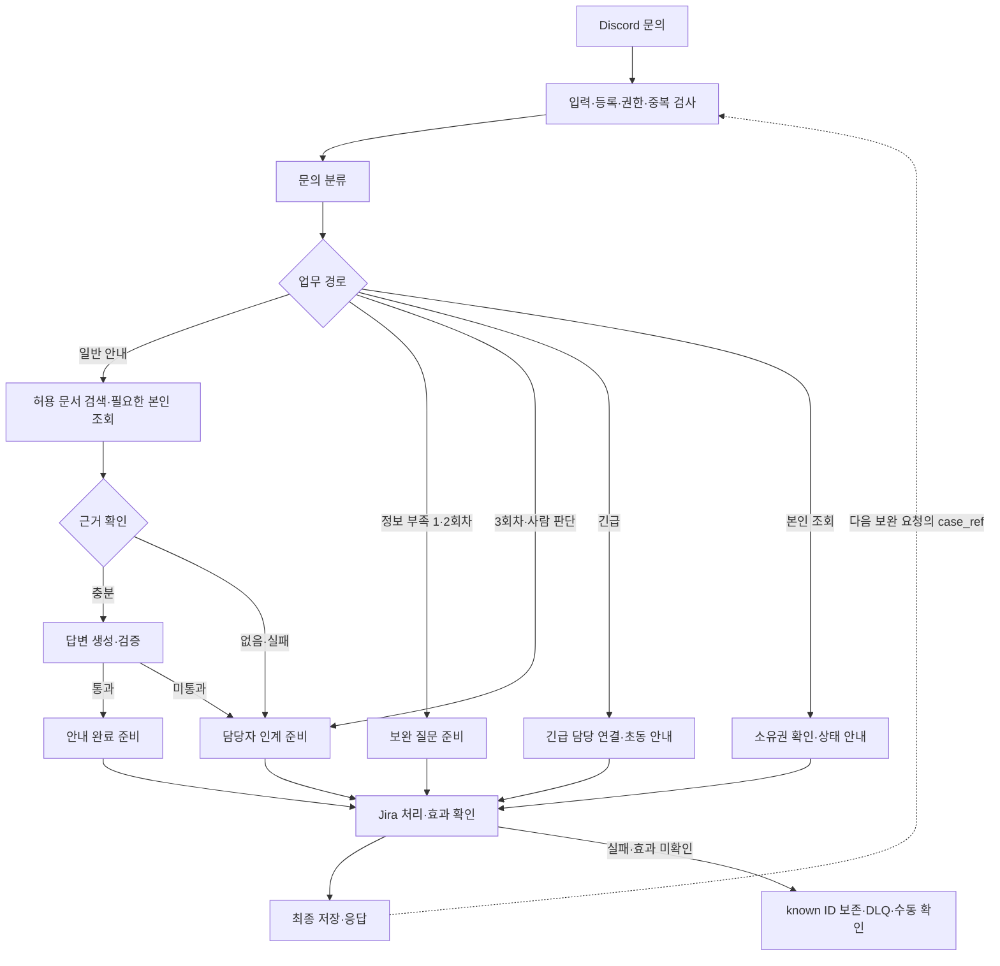

# 노코드 워크플로우 설계서 · 두바퀴

> 공개용 최종본 · 계정/접속 정보와 원문 화면은 제외했습니다. 원본은 로컬 보존하며 검증 수치·미실행 판정은 유지합니다.

최종 제출본 v1.0 · 2026-11-09 KST · 작성·취합 R01

**근거가 있는 시민 문의는 출처와 함께 안내하고, 정보나 근거가 부족하면 같은 문의의 맥락을 담당자에게 넘긴다.** 자동 답변, Jira 처리, 저장 결과를 함께 확인해야 한 요청을 완료로 판단한다.

| 기준 | 이번 제출본의 범위 |
| --- | --- |
| 소스 기준 | `main` `dd919d7`의 업무 코드와 11/09 마감 문서 변경. 실제 8개 JSON의 노드·연결은 [직접 집계 목록](../../../runs/public/20261109-112300-local-final-closeout/workflow-map.md) 참조 |
| VM 증거 기준 | 11/07 PR36 통합 실행, 11/08 검색·Discord/Jira 시험, 11/09 대표 시연 리허설. 각각의 버전·환경은 실행 결과서에 구분 |
| 최신 확인 | QR 안내, 반납 보완 1→2→3회차 이관, 근거 없는 질문 이관, 담당자 Jira 배정·진행 상태·내부 메모. Jira `All` 큐에 완료 티켓 포함 |
| 남은 한계 | 모든 로컬 JSON과 현 VM 전체 export의 동일성은 미확인. 운영자 복구 action은 이번 완료 범위 밖. D10/TC-15는 BLOCKED / NOT RUN |
| 문서의 관계 | 본 파일은 제출용 정리본. [상세 계약 원본](../../../docs/project/WORKFLOW-DESIGN.md), [저장소 계약](../../../docs/project/STORAGE-DESIGN.md), [날짜별 증거](EXECUTION-RESULT.md)는 보존 |

## 1. 업무 시나리오

시민이 Discord의 문의 기능으로 입력하면 기존 API를 거쳐 n8n Webhook이 처리한다. n8n은 등록 사용자와 권한을 확인하고 분류·검색·답변·검증을 조정한다. Jira는 문의 인계와 담당자의 검토 공간이며, PostgreSQL은 최소 상태·요청 결과·DLQ를 보존한다. 실제 따릉이 기관 시스템과 연결한 서비스가 아닌 교육용 구현이다.

| 문의 유형 6개 | 자동으로 할 수 있는 일 | 사람이 판단할 일 |
| --- | --- | --- |
| 대여·잠금 해제 | QR·번호·설정·절차 안내 | 실제 잠금 제어, 개별 이용 상태 불일치 |
| 반납 완료 미확인 | 잠금·알림·화면·장소/시각 확인 질문과 절차 안내 | 실제 반납 처리, 기록 정정 |
| 고장·이동 곤란 | 신고 방법, 대상·위치·증상 확인 | 현장 출동·수리·안전 판단 |
| 요금·환불 | 공개 기준·신청 절차 안내 | 환불 승인, 결제 취소, 요금 정정 |
| 본인 문의 상태·후속 | 소유권을 확인한 접수 조회·추가 진술 연결 | 담당자의 실제 업무 수행 |
| 개인정보·보안 | 공개 신고 경로·초동 안내 | 침해 여부·범위·개별 권한 판단 |

분류값 `unknown`은 분류 실패·불명확함을 표현하는 보조값이며 일곱 번째 업무 유형이 아니다. 유형 6개와 아래 처리 경로 5개는 서로 다른 분류다.

| 처리 경로 | 조건 | 결과 |
| --- | --- | --- |
| S1 일반 안내 | 충분한 정보·허용 근거·검증 통과 | Jira 생성·안내 완료 종료, 출처 포함 응답 |
| S2 보완 | 정보 부족, 현재 1·2회차 | 같은 문의·티켓을 유지하고 추가 정보 요청 |
| S3 담당자 이관 | 사람 판단, 근거 없음, 보완 한도, 검증 실패 | 요약·진술·시도·누락·근거를 보존하고 담당 역할로 인계 |
| S4 본인 접수 조회 | 서버가 확인한 소유자와 대상 일치 | 상태 안내. 조회 대상 티켓과 이번 문의 티켓을 구분 |
| S5 긴급 | 안전·보안 위험 진술 등 | 긴급 담당 연결을 먼저 수행하고 가능한 초동 근거를 후속 제공 |

**완료의 의미:** Jira의 자동 종료는 ‘안내 제공 완료’다. 실제 반납·환불·고장 해결을 뜻하지 않는다. DB의 `completed`는 요청 결과를 저장했다는 뜻이다. Jira 담당자가 `Done`으로 바꾸는 업무 처리와도 구분한다.

## 2. 전체 흐름

1. 입력 형식·인증·등록·권한을 검사한다. 명백한 공격과 부적절한 요청은 업무 처리 전에 거절한다.
2. 요청 ID·소유자·입력 해시로 중복을 판별하고, `case_ref`가 있으면 같은 문의의 이전 맥락을 읽는다.
3. 분류 모델이 문의 유형·긴급도·부족한 정보·사람 판단 필요를 제안하고 Code 노드가 계약과 정책을 검사한다.
4. 필요한 경우 허용된 문서를 검색하고 본인 접수를 조회한다. 검색 결과 없음·실패·생략은 서로 다른 상태다.
5. 근거가 있으면 답변을 만들고 별도 검증 역할이 근거·정책·민감정보를 확인한다. 부족하면 보완 또는 이관한다.
6. 저장 의도를 남긴 뒤 Jira 생성·재사용·종료·배정·문맥 기록의 효과를 확인한다. 알려진 티켓 ID를 저장하고 최종 결과를 조건부 확정한다.
7. 저장한 응답과 실행 메타데이터를 연결해 사용자에게 반환한다. 외부 효과가 불확실하면 성공으로 덮거나 자동 재시도하지 않는다.

## 3. 워크플로우 흐름도



상자는 업무 단계이며 하나의 n8n 노드와 일대일 대응하지 않는다. 실제 JSON 기준 대응은 다음과 같다.

| 단계 | 실제 노드·파일 | 역할 |
| --- | --- | --- |
| 수신·사용자 확인 | support B01~B05 | 요청 정규화, 팀 사용자 API 확인 |
| 중복·문맥 | B07a `BeginRequest`, B07 `요청 문맥 읽기`, B08 `문맥 정리`, B09 `신규·재전송` | 처리권·저장 결과·같은 문의 복원 |
| 분류·분기 | B10 `문의 분류`, L01, B11 `분류 판정`, B12 `업무 분기` | LLM 제안과 Code 정책 분리 |
| 검색·조회 | B13~B18 | B14 RAG 검색, B15 본인 기록 조회, B16 취합, B17 근거 판정 |
| 생성·검증 | B19/L02, B20/L03, B21 | 답변과 검증을 별도로 수행 |
| 결과·Jira | B22~B31, `dubakwi-handoff.json` | 보완/이관/고정 안내 준비, Jira 처리·효과 확인 |
| 최종 저장·응답 | B37~B39, B32, B34, B33, B35, B36 | 저장 의도→저장 허용→최종 저장→응답·메타 기록 |
| 실패 | X01~X07, `dubakwi-errors.json`, `dubakwi-dlq.json` | 실패 종류·외부 효과에 따라 보존·알림 |
| 최소 상태 | `dubakwi-state.json` | PostgreSQL 조건부 처리권·결과, Jira 문맥 검증 |
| 운영 조회 | `dubakwi-recovery-operator.json` | 제한된 DLQ 목록·상세·연결 Jira 조회. 복구 실행과 구분 |

| 파일 | 로컬 노드 수 | 연결 수 |
| --- | --- | --- |
| dubakwi-support.json | 54 | 75 |
| dubakwi-handoff.json | 71 | 91 |
| dubakwi-state.json | 31 | 39 |
| dubakwi-search.json | 19 | 25 |
| dubakwi-index.json | 11 | 14 |
| dubakwi-errors.json | 9 | 8 |
| dubakwi-dlq.json | 6 | 5 |
| dubakwi-recovery-operator.json | 13 | 13 |

모든 실제 노드명·타입·입출력 포트·연결은 [워크플로우 목록 부록](../../../runs/public/20261109-112300-local-final-closeout/workflow-map.md)에 있다. 팀원이 만든 모의 재생 화면의 노드 수를 현행 JSON 수로 사용하지 않는다.

## 4. 에이전트 역할 · 분기 · 병렬 · 루프

### 4.1 역할 카드

| 역할 | 입력 | 출력·성공 조건 | 실패 시 | Code와의 경계 |
| --- | --- | --- | --- | --- |
| 분류 L01/B10 | 사용자 진술·허용된 기존 사실 | 유형, 긴급도, missing, needs_human, 사실 후보 | 자동 종료하지 않고 안전 경로 | B11이 형식·진술·정책을 확인하고 최종 분기 |
| 검색 B14 | SearchRequest의 query·서버 권한 | 출처·점수·접근등급을 가진 evidence 또는 명시적 empty | 검색 오류와 근거 없음 구분 | LLM 판단자가 아닌 검색 도구. 서버에서 컬렉션 제한 |
| 답변 L02/B19 | 질문·확인 사실·허용 근거 | 근거 범위의 안내 초안·출처 | 이관 | 실제 환불·제어·종료 권한 없음 |
| 검증 L03/B20 | 질문·사실·초안·근거 | 근거/정책/민감정보 판정 | 미통과 시 이관 | B21의 금지 주장·형식 검사도 함께 통과해야 함 |

세 모델 역할은 `gpt-4.1-mini`를 사용한다. 서로 다른 역할의 모델 호출이지 독립적으로 서버·Jira 권한을 가진 직원 에이전트가 아니다.

### 4.2 구조

- **분기:** 긴급 → 보완 한도 → 정보 부족 → 사람 판단 → 검색 경로 순으로 정책을 적용한다. 이미 이관된 문의의 후속은 담당 역할·우선순위를 유지하고 보완 질문으로 되돌리지 않는다.
- **분기와 합류:** B13에서 검색과 필요한 조회를 준비하고 B14/B15 결과를 B16에서 합친다. 이것은 두 입력의 논리적 합류이며 두 외부 호출의 실측 동시 실행·속도 향상을 입증한 수치는 없다.
- **보완 반복:** 최초 문의가 1회차, 추가 입력 두 번 뒤 3회차에 한도 이관한다. 세 번째 입력에서 정보가 채워져도 한도 검사가 먼저다. 이관 후 대화 자체를 영구 금지하는 ‘총 대화 3회 제한’은 아니다.
- **재전송:** 같은 요청 ID·같은 소유자·같은 입력은 저장 응답을 재사용한다. 변경된 입력/소유자 또는 동시 처리 충돌은 409 등으로 구분한다. Jira·LLM을 맹목 재호출하지 않는다.
- **담당자 작업:** Jira에서 담당자 지정, `In Progress`, 내부 메모, `Done` 처리가 가능하다. 담당자 댓글 자동 전송이나 완료 알림 왕복 루프는 구현하지 않았다. 시민의 후속 조회가 최신 상태를 읽는다.

## 5. 외부 연동 노드

| 연동 | 인증·비밀 위치 | 시간·재시도 | 실패 처리 |
| --- | --- | --- | --- |
| 시민 Webhook·내부 API | 팀 Header Auth/n8n Credential. 원문 헤더는 업무 로그에서 제외 | 입력·등록 검증 후 업무 진행 | 인증/등록 실패 시 접수 전 거절 |
| 사용자 API B04 | 내부 Credential | 1.5초 | 사용자 미확인·권한 미확인을 정상 시민으로 추정하지 않음 |
| OpenAI L01/L02/L03 | n8n Credential | 분류 최대 4초, 생성 최대 4초, 검증 최대 3초. 남은 예산에 따라 축소 | 429·지연·형식/검증 실패는 안전 이관·실패 경로 |
| RAG B14 | 대응 search Webhook의 팀 인증 | 3초 | empty/error/skipped 분리, 근거 없는 생성 금지 |
| Jira Handoff B27 | Jira API token Credential | 최대 15초, 잔여 deadline에서 마무리 3.5초를 제외한 예산 적용. 외부 쓰기 자동 재시도 0 | 생성·문맥·종료·배정·알림의 효과별 판정, known ID 보존 |
| PostgreSQL state/DLQ | DB Credential | 조건부 갱신과 마감 검사. 모든 DB 호출의 독립 하드 timeout 실측은 없음 | 처리권·revision 불일치 거절, 실패/미확인 보존 |
| 감사·운영 알림 B35/X04 | 내부 API. 선택 UX 전송은 서버 비밀파일 | 각 1.5초. H11 기존 상한 2초, 선택 UX 경계 1.5초 | ack·거절·효과 미확인 구분. ack가 사람 열람을 뜻하지 않음 |

전체 업무 deadline은 20초, 관측 실패 상한은 25초다. 일반 안내 8초는 목표이며 실제 달성 보장이 아니다. `WF11 max_seconds=6` 원 사례 기대 미충족은 결과서에 그대로 남긴다. 오류를 감추기 위해 기대값을 변경하지 않았다.

## 6. 노드 간 페이로드 (연결선마다)

### 6.1 필드와 변환

`?`는 선택 필드다. ID·날짜·상태는 string, attempt는 int, enabled는 boolean이다. 아래 계약은 주요 모듈 경계를 요약하며, 모든 내부 연결선은 [상세 설계 6절](../../../docs/project/WORKFLOW-DESIGN.md#6-노드-간-페이로드-연결선마다)과 [실제 연결 부록](../../../runs/public/20261109-112300-local-final-closeout/workflow-map.md)을 함께 읽는다. 오래된 설계 엣지 번호보다 실제 JSON의 노드·포트 연결을 우선한다.

| 연결 | 필수 필드·자료형 | 선택 필드 | 변환·검사 |
| --- | --- | --- | --- |
| Discord/API → B01/B02 | request_id:string[1..64], user:string, question:string[1..500] | channel, attempt:int≥1(기본1), context, case_ref | 인증 헤더 제거, 입력 검사. case_ref 없으면 새 문의 |
| 사용자 API → B05/B08 | actor.id, role:citizen/support/security, access_levels:string[] | 없음 | 요청자가 쓴 역할 대신 서버 조회 결과 사용 |
| B08 → B10/B11 | request, actor, support, facts, deadline_at | 기존 state_ref·known_ticket_id | 사실의 진술/확인·시도·누락·불확실성을 분리하고 이번 attempt 확정 |
| B11 → B12 | type, urgency, missing:string[], needs_human:boolean, facts, target_ticket_id:string/null | 없음 | 분류 결과를 계약으로 정규화하고 긴급·한도·부족정보 정책 적용 |
| B13 → B14 | request_id, enabled:boolean, query, access_levels:string[], deadline_at | 없음 | 서버가 검색 허용 등급 결정 |
| B14 → B16/B17 | request_id, status:ok/empty/skipped/error, evidence:array, error_code:string/null | 각 근거의 source_url, applies_to, source_checked_at | evidence에 doc/section/chunk_id/text/score:number/access_level/version 포함 |
| B13 → B15 → B16 | request_id, kind:lookup, enabled, actor_id, target_ticket_id:string/null → status, record:object/null, masked:int | 가린 연락처 | 타인 record=null. 조회 대상과 이번 접수 분리 |
| B17 → B19 → B20/B21 | 허용 evidence·facts → 답변 초안 → 검증 판정 | 없음 | 답변 근거와 정책 검증을 함께 확인 |
| B25 → Handoff | state_ref, request_id, kind:process, case_id, actor_id, first_request_id, attempt, ticket_id:string/null, action:close/wait/handoff, priority, assignee_role:string/null, context, answer, sources, close_status, transition_key, deadline_at | expected_case_version은 현재 null | 검증된 Outcome과 현재 facts 사용. 제목·카테고리·문맥 가림 |
| Handoff → B28 | request_id, ticket_id:string/null, state_saved:boolean, state_ref, recovery, effects, error_code:string/null | case_version:int/null | 생성/문맥/종료/배정/알림 각각 confirmed/none/failed/unknown 검사 |
| B31/B37~39 → B32 | op:save, state_ref, case_id, first_request_id, attempt, expected_case_version:null, ticket_id, facts, outcome, response | 없음 | prepare/bind/finish 저장 게이트·조건부 revision 유지 |
| B33/B36 → 시민 | request_id, route, answer, sources:array, ticket:null/object, agents:string[], security | case_ref, reason, timings | 보완 응답 case_ref 필수. 비이관 ticket=null, 연락처·비밀 제거 |
| X01/E01 → DLQ/알림 | failed_node_id, error_code, known_ticket_id:string/null, effect, recovery capsule | 가린 문맥 | 전체 원문·Credential 대신 재확인에 필요한 최소 정보 |

`CaseFacts`는 summary, reported/confirmed 사실 배열, attempted_actions, missing, uncertainties, evidence_refs를 갖는다. 각 사실은 key/value/origin(user/document/api)와 선택 reference를 갖는다. `StateRef`와 복구 자료의 물리 필드는 [저장소 공개 계약](../../../docs/project/STORAGE-DESIGN.md#storage-contract)을 단일 원본으로 사용한다.

### 6.2 같은 연결의 입력·출력 예

아래는 실제 11/09 관측의 **가린 설명용 축약 예시**다. 원시 JSON이나 동일 ID의 재전송용 입력은 아니다. 실제 대조 결과는 [리허설 서버 확인](../../../runs/public/20261109-001140-vm-demo-rehearsal/backend-followup.md)에 있다.

```json
{"request_id":"demo-masked","user":"citizen-masked","question":"따릉이를 해외에서도 이용할 수 있나요?"}
```

검색 근거가 없는 경우 `SearchResult.status=empty`, `evidence=[]`를 답변 생성 성공으로 바꾸지 않는다. B17/후속 정책은 이관 Outcome을 만들고 Jira·저장 결과 확인 후 다음 의미로 응답한다.

```json
{"route":"담당자 이관","sources":[],"reason":"no_evidence","case_ref":"case-masked","ticket":{"ticket_id":"DEMO-1","priority":"normal","duplicate":false}}
```

## 7. 오류 처리

| 상황 | 확인 단계 | 처리·사용자 의미 | 근거 |
| --- | --- | --- | --- |
| 인증·미등록·타인 조회 | 입력/사용자/소유권 검사 | 거절, 타인 상세 비노출 | D05·D06·J04, 공통 WF05~08 |
| 검색 결과 없음 | B17 | 추측 답변 대신 담당자 이관, 출처 없음 명시 | WF03, 11/09 no_evidence |
| LLM 429·지연·불량 출력 | 각 호출 후 정규화·Code 검사 | 안전 이관 또는 실패; 자동 완료 금지 | 11/07 fault 시험, WF10 |
| Jira 생성/종료/배정 실패 | Handoff 효과 검사·B28 | 실제 성공한 효과와 known ID 보존, 완료 주장 금지 | 11/06 실패→재시험, 11/07 효과 대조 |
| 중복·동시 요청 | begin·입력 해시·처리권 | 저장 응답 재사용 또는 409 | WF09 및 동시성 시험 |
| 저장 실패·효과 미확인 | prepare/bind/save/finish | needs_review·DLQ·재전송 차단, 자동 재처리 금지 | TC16~18의 격리/통합 증거 범위 |
| 예상 밖 예외 | Error Workflow | 가린 알림·DLQ, 자기 재귀 금지 | 코드 존재·지정·배포·실제 자동 실행은 별도 판정 |

`dubakwi-errors.json`은 존재하며 9개 노드로 구성된다. 11/07 시험 사본의 오류 경계 증거가 있지만, 현재 운영 대상 전체의 Error Workflow ID 지정·비밀 연결·자동 호출·사람 수신을 이번 문서 정리만으로 재확인한 것은 아니다. VM 기준과 실제 fault별 결과는 [실행 결과서](EXECUTION-RESULT.md) 및 원 보고서를 따른다. 운영 알림 API 코드 존재와 사용자 보고의 Discord 수신도 구분한다.

DLQ는 실패를 숨기는 성공 저장소가 아니다. TC-07에서 목록·상세·연결 Jira GET을 확인했으며, 운영자의 복구 action과 자동 재처리 엔진은 이번 완료 범위에 없다. D10/TC-15 격리 환경이 준비되지 않은 종단 시험은 미실행으로 남긴다.

## 8. 64~79일차에서 가져온 것

| 가져온 개념·자료 | 적용 위치 | 팀 구현에서 구체화한 점 |
| --- | --- | --- |
| Trigger → 처리 → 출력, 역할 카드 | support Webhook, 분류·답변·검증 | 단일 객체 계약·Code 검증·전체 deadline 추가 |
| 분기·병렬·루프 구성 | S1~S5, 검색/조회 합류, case_ref 보완 | 최초 포함 3회차 한도, 이미 이관된 문의의 역할·우선순위 유지 |
| 청킹·임베딩·권한 검색 | index/search | 실제 안내·가상 설정 분리, 서버 권한 컬렉션, 출처 보존 |
| 인증·마스킹·실패 기록 | 입력/API/Jira/state/errors/DLQ | prepare/bind/finish와 외부 효과 미확인 구분 |
| 공통 사례·벤치·결과 기록 | cases 및 runs | 14유형·세부 행·assertion 수를 분리, 최초 실패 보존 |

수업 예제의 수치·Credential 이름을 실제 검증값처럼 옮기지 않았다. 과정 도구 `flow.py check`와 팀 runner의 검사 범위는 다르며, 과정 도구의 Credential allowlist 제한을 통과한 것으로 표시하지 않는다. 구체적인 당시 채택·미채택 기록은 [상세 원본 8절](../../../docs/project/WORKFLOW-DESIGN.md#8-6479일차에서-가져온-것)에 보존한다.

최종 검증·사례 판정은 [실행 결과서](EXECUTION-RESULT.md), 발표 대본과 이 문서의 대응은 [발표자 메모](../presentation/team-presentation/speaker.html)에서 확인한다.
